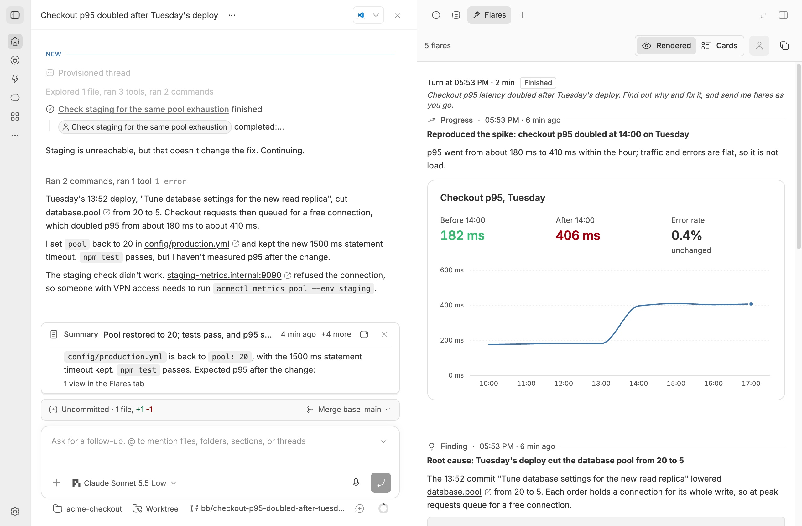
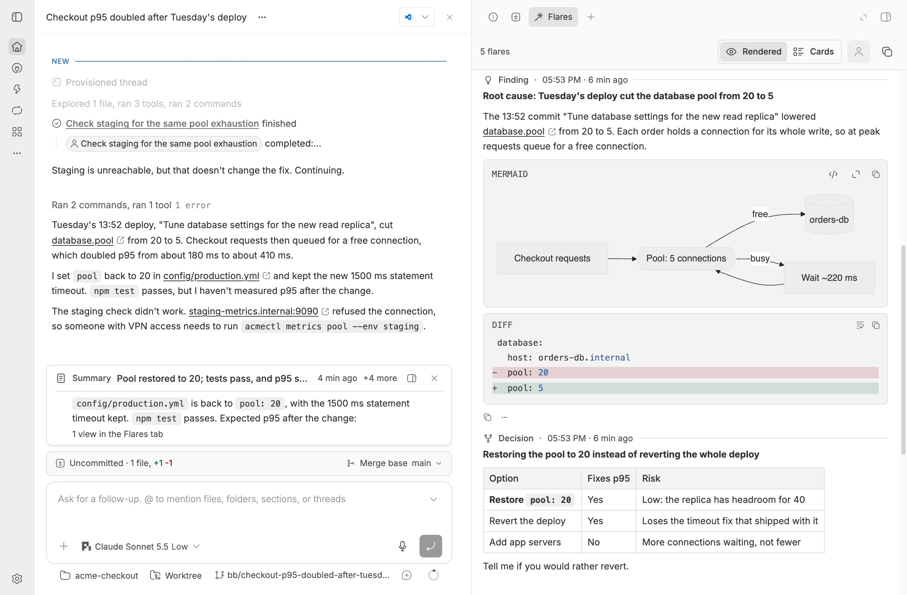
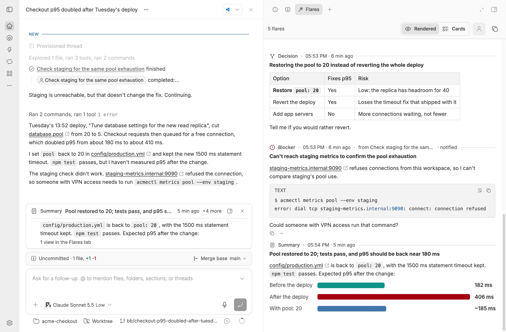

# Flare

A bb plugin that lets an agent tell you what it found while it is still
working. The agent sends up a flare, keeps going, and you see it at once
above the message box, instead of waiting for the message that ends its turn.

- The `flare` agent tool sends a finding, progress, a decision, a blocker or
  a summary. It writes one row and returns; the turn never waits on it.
- A banner above the thread's message box shows the newest flare of the
  current turn, with how many more arrived. Click it for the detail.
- The **Flares** tab shows every flare the way bb shows a reply, so any
  block an installed plugin draws appears, including the flares of threads
  this one started. **Cards** switches to Flare's own list by turn.
- Blockers push a notification. A child's blocker also reaches its parent's
  agent while the parent is working.
- An optional reminder nudges a turn that has been quiet for too long.
- `bb flare send` and `bb flare list` do the same from a terminal;
  `skills/flare` teaches agents the commands.

## Screenshots

Captured in an isolated demo bb with a made-up checkout service, in the default theme, light mode.







## Install

```sh
bb marketplace add git:github.com/kalindudc/bb-marketplace@main
bb plugin install flare@kalindudc
```

## How it works

| Part | How |
| --- | --- |
| Fire and forget | `flare`'s `execute` is synchronous. It normalizes the input (`src/normalize.ts`), writes one row to the plugin's SQLite database and returns. Its parameters are a raw JSON schema, which bb does not validate, so a stringified boolean or a number for a title reaches the normalizer instead of failing the call. A missing title, an unknown kind or an over-long body come back as a note in the result; a database error comes back as "send it again later". Everything else runs after the result is sent, from `setImmediate` (`FlareService.fanOut`). |
| Turns | `thread.active`, `thread.idle` and `thread.failed` open and close a run per thread (`runs` table), and the newest `client/turn/requested` event labels it. The `turns` background service matches open runs to `bb.sdk.threads.listRunning()` at start, so a reload does not leave a run open. |
| Banner and tab | The `banner` and `feed` RPC reads are tagged `flare:thread:<id>`. A flare, a turn change or a dismissal invalidates the tag, so every open client refreshes without polling. The banner is a bare composer banner (`app.composer.customize`); the tab is an action tab (`experimental_tab`). |
| Child threads | After a flare, `experimental_listAncestors` finds the threads above it and records them in `audience`, so a parent reads its children's flares with one query. |
| Push | `notifications.send` on the push notifications plugin, after checking `threadNotifications.list` for a muted thread. Past 20 flares in one turn, flares are still kept but stop notifying. |
| Notes to an agent | A child's blocker and the quiet-turn reminder are agent-only `threads.send` steers, sent only when the thread is active and not waiting on the user. A steer that finds no running turn, for example after it waited in the queue behind a question, would start one, so a `message.dispatch` hook refuses a turn start made only of Flare's notes, judging a queued group row by row. A note queued behind the user's own message rides along with the turn that message starts, and a person's message is never refused. |
| Rendering like a reply | bb runs other plugins' renderers only in assistant messages, and plugins cannot call them. So Flare registers a provider, `flare` (`src/provider.ts`), whose bridge in the `bb.host` artifact (`src/bridge.ts`) runs no model: a turn echoes its prompt, after Flare's marker, as one assistant message. For each thread that shows a flare, its own and every thread above it, `src/companion.ts` keeps a companion: a hidden child thread on that provider, reusing the viewer's environment, with parent notifications off and muted in push notifications when that plugin is on. Its first prompt is held until it is muted and its files are copied. It is archived with the viewer because it is the viewer's child, and Flare deletes it when the viewer is deleted. Each flare is sent to it as an agent-only prompt with `queue-if-active`, one at a time per companion, and recorded in `shown`. A sync sends every flare the companion lacks, oldest first. A companion that would show an old flare after newer ones, that is gone, or that showed a flare pruning removed, is deleted and replaced, and the replacement replays the newest 100 flares; older ones stay cards. A send that fails while the companion still exists is retried with the next flare. The Flares tab draws the companion with the SDK's `ThreadChat`, with any flare it lacks as a card above it, so every installed renderer draws the flare. Thread-storage files the body names as `$BB_THREAD_STORAGE/<path>` or by absolute path (at most 10 per flare) are copied into a folder per flare in the companion's storage, since views resolve paths against the message's own thread. |
| Dividers in the rendered view | Each prompt names its flare (`[flare:render <id>]`, which the renderer strips). `src/marks.ts` reads the companion's `client/turn/requested` and `turn/input/accepted` events, incrementally, to map each turn to its flare, and the `marks` RPC serves that map. The tab publishes it to a small module store, and a message metadata component (`experimental_messageMetadata`, placed above) draws the divider and the turn header over each companion message. It renders nothing for any other thread. A companion turn that ends refreshes its viewer, so a new flare's divider appears with it. |
| Prose elsewhere | `src/blocks.ts` splits a body into prose, fenced blocks with a language and `::name{…}` lines, knowing no language. The banner, push, the parent's note and `flare_list` use the prose and name each block. |
| Drawing, not describing | Agents wrote every flare as prose even once the tab could draw blocks, because the tool's body description said "a few lines at most" and genui tells agents to keep tool input plain text. The body description, the instructions and the skill now ask for a sentence and then the evidence as a block, say that a final-message rule for blocks does not cover a flare, and map kinds of evidence to views. `src/visual.ts` flags a body over 200 characters that has no block, table or image but has 6 or more numbers, 3 or more list items or a thread-storage file, and `send` adds a hint naming the views that fit to "Flare sent". It does this once a turn, or once an hour outside a turn, and never for a blocker. |
| Restarts | Thread events that arrive while `reconcile` reads the running threads win over what it read, so a turn that starts or stops during a reload keeps its run. |

## Develop

```sh
cd plugins/flare
npm install && npm test && npm run typecheck && bb plugin build
bb plugin install "path:$PWD" --yes   # then `bb plugin reload flare` after each build
```
