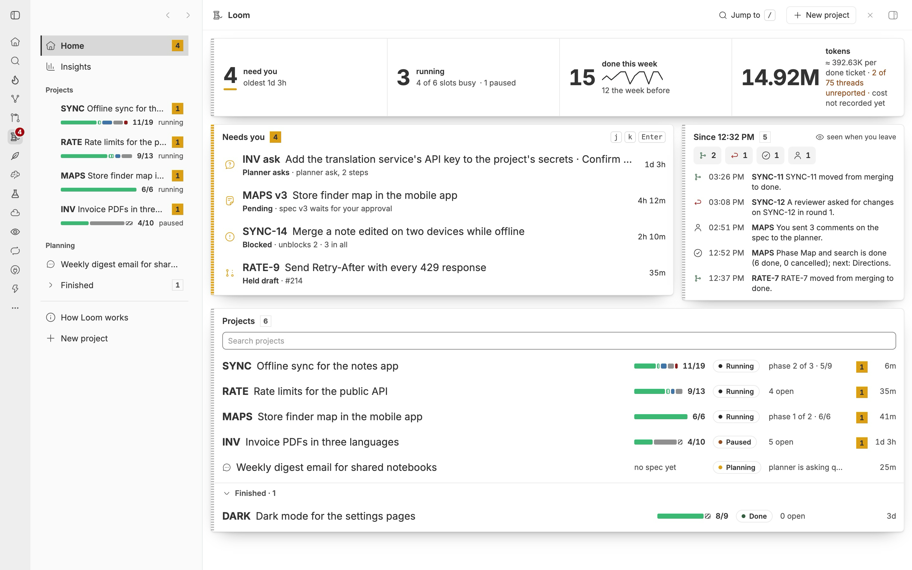
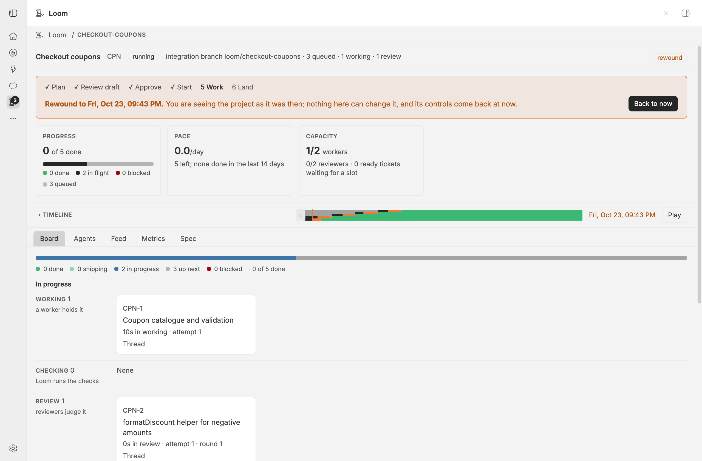
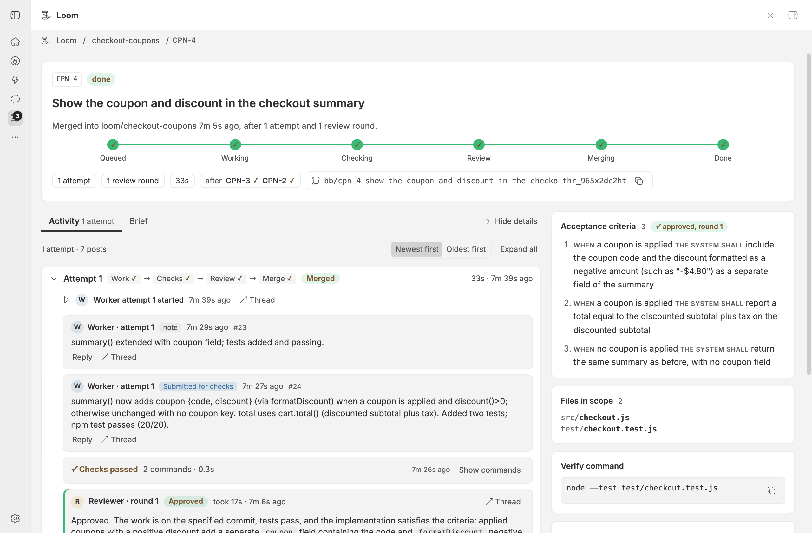
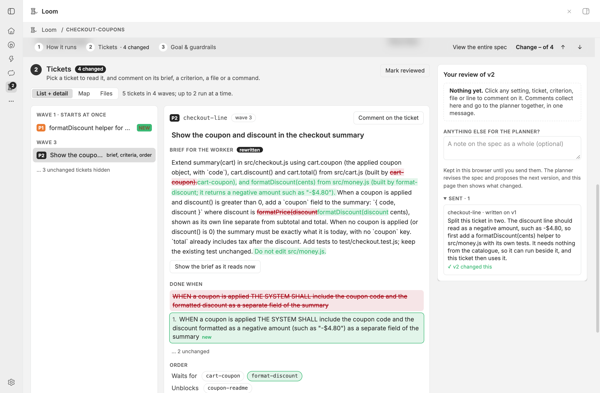
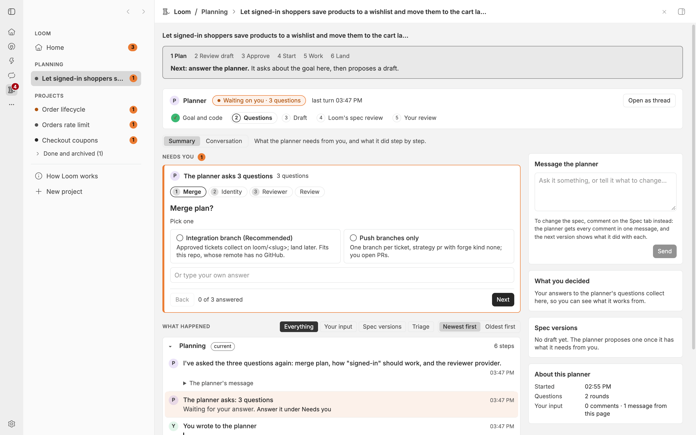
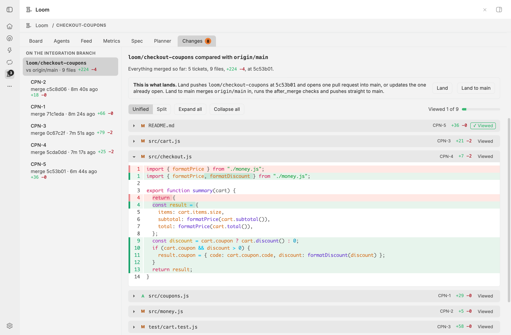
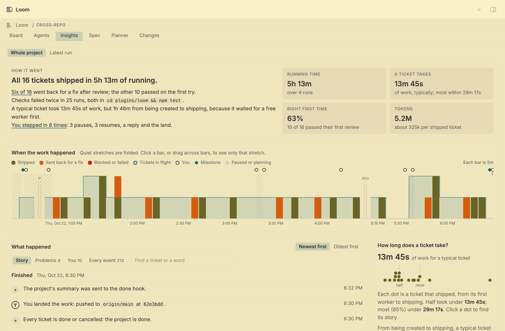

# Loom

Loom is a bb plugin that runs a software project with agents. You describe a
goal, and a planner agent turns it into a spec: tickets with acceptance
criteria, the checks that must pass, a review policy and a merge plan. Once you
approve it, worker agents build the tickets in their own git worktrees,
separate reviewer agents approve the work or send it back, and approved work
merges into an integration branch or opens as pull requests. You follow and
steer the project from the Loom page in bb's left navigation, or with
`bb loom`.

The plugin, not an agent, owns every state change. Agents get narrow tools for
their role, and only Loom's own code moves a ticket, runs checks, merges, or
decides that work is done. A project can stay in one repository or span
several.



## Install

```sh
bb marketplace add git:github.com/kalindudc/bb-marketplace@main
bb plugin install loom@kalindudc
```

Loom needs:

- `git` on the machine that has the project's checkouts.
- `gh`, signed in, for pull requests on GitHub. Other servers work through
  commands you put in the spec (see
  [Servers other than GitHub](#servers-other-than-github)).
- Provider usage. The planner, workers and reviewers are ordinary bb threads,
  so your providers' limits apply to them. A token budget or a deadline in the
  spec has Loom pause the project for you.

## Quick start

1. Open Loom in the left navigation and press New project, or ask any thread to
   plan a Loom project. Every thread has the `loom-plan` skill.
2. Answer the planner's questions. It proposes a spec, and Loom's spec review
   checks it before you see it.
3. Read the spec on the Spec tab. Comment on any part to send it back to the
   planner, or press Approve to create the tickets.
4. Press Start. Workers pick up ready tickets by themselves; answer a blocked
   ticket when the board asks.
5. Land the work: press Land (or run `bb loom land <slug>`) on the integration
   strategy, or merge the pull requests Loom opened.

## How a project runs

1. Plan. The planner asks one round of questions, calls `loom_discover` to learn
   how each repository is reached, and calls `loom_propose` with a TOML spec.
   Loom validates it and saves a draft.
2. Spec review. Loom starts a fresh agent that checks the draft against your
   request and for work the goal does not need. It approves with
   `loom_spec_approve` or sends numbered findings back to the planner with
   `loom_spec_request_changes`, for up to three rounds. Its rubric also traces
   each `done_when` item to the tickets that make it true, and flags a ticket
   whose criteria could be met by explaining why the goal cannot be met. A
   version that only changes operational settings skips it (see
   [Operational versions](#operational-versions)).
3. Approve. You read the spec and approve it, and the tickets appear on the
   board. `bb loom approve <slug> --skip-review` approves a draft whose spec
   review has not passed, and `--version N --skip-review` a pending version.
4. Start. Loom starts a worker thread for each ready ticket: its dependencies
   are done (on the pull request strategy, open pull requests are enough), and
   its scope does not overlap work in flight.
5. Work. The worker calls `loom_note` as it goes, then `loom_submit`, or
   `loom_block` when it needs help.
6. Check. Loom commits the worktree and runs the ticket's and the project's
   check commands. A failure goes back to the worker.
7. Review. Reviewer threads call `loom_checkout` to get the exact work that
   passed the checks, read the diff and call `loom_approve` or
   `loom_request_changes`. Requested changes go back to the worker as numbered
   findings. On the pull request strategy a finding about the pull request's
   text alone goes back as a text-only round, which Loom's text review judges
   instead of the checks and a code review (see [Pull requests](#pull-requests)).
8. Merge. On the integration strategy, Loom merges exactly the reviewed commit
   into the integration branch, one ticket at a time, and runs the
   `after_merge` checks on the result. On the pull request strategy, the
   worker writes the pull request and Loom opens it and follows it through CI
   (see [Pull requests](#pull-requests)).
9. Land. On the integration strategy you read what will land on the Changes
   tab, then run `bb loom land <slug>` to push the branch and open one pull
   request, or `bb loom land <slug> --direct` to merge in the remote's base
   branch when it moved, run the `after_merge` checks on the result, and push
   straight to the base branch.

`skills/loom/references/spec.md` lists every key of the spec with its default.
Each `provider` in `[agents.worker]` and `[agents.reviewer]` must be a bb
provider id, such as `claude-code`, `codex` or `pi`. `loom_propose` refuses an
unknown one and names the ids bb has; when bb's list cannot be read, the spec
is accepted unchecked.

### How many agents run at once

`agents.max_workers` and `agents.max_reviewers` (2 each by default) cap the
worker and reviewer threads that run at once in a project. A thread counts
while it runs a turn Loom gave it: a worker on its ticket, while its checks run
or while it writes its pull request, and a reviewer until its verdict. A worker
waiting in review or on an open pull request holds no slot, and neither does a
worker or reviewer waiting for your answer to its question.

Work that goes back to a worker waits for a slot as a new ticket does: a pull
request's fix round, a review's requested changes and a merge that did not
land. Its ticket moves to working and its card says "Waits for a free worker
slot"; the worker gets the message, and a released worker its environment
back, once a slot is free. Waiting work takes free slots before new tickets
start, priority 0 first, then the work that has waited longest. Its ticket
timeout starts when it gets the slot, and a reply you post on the ticket
reaches the worker together with that work.

### When a ticket gets stuck

A ticket that gets stuck is blocked. The planner hears about it in a triage
round and answers with its board tools (`loom_board`, `loom_ticket`,
`loom_post`, `loom_requeue`, `loom_edit_ticket`, `loom_add_tickets` and
`loom_cancel_ticket`), or you answer on the ticket. Your reply on a blocked
ticket goes to the planner at once, as a message that names the ticket.

When the work is right and only needs another look, such as after reviewers
that ended without a verdict or a status no fix can clear, `bb loom requeue
CSV-1 --review` (Review again as is on the ticket page, or the planner's
`loom_requeue` with `review: true`) sends it back with no new worker. Loom
reads the ticket's branch first. When its open pull request already has all
of it, the ticket goes straight back to following that pull request, with its
fix rounds counted afresh; when the branch is still the commit whose checks
passed last, it goes back to review for that commit in a new round. On the
pull request strategy its worker's thread stays the ticket's released worker,
so a review's requested changes, a later fix round or a catch-up with a
dependency brings it back, or a new worker from the branch when bb cannot
restore it. Anything else is refused
with the reason, such as a stacked ticket whose worker's thread cannot come
back, and a plain requeue is the way on.

Triage rounds go to the planner for blocked tickets, and when Loom paused the
project for its token budget or deadline, which a new spec version can change.
A pause for a missing sign-in or a broken forge command sends no round, since
the planner cannot fix either: the next-step bar says why and offers Resume.

A spec version the planner proposes after approval waits for your approval,
and Loom's spec review checks it first, as a change to the version in force.
When you have to act, for example approve that version and then requeue the
tickets it unblocks, the planner records the steps with `loom_ask_human`, and
the Planner tab lists them under Needs you with a button for each. Loom checks
a step off once it sees you take it: an approval, a requeue, a reply, a start,
a resume, a land, or a live mark on the ticket or milestone a `live` step names.
Mark done checks off any other step, such as one you did outside Loom.

When bb refuses to start a worker or a reviewer with a client error (an HTTP
4xx status other than 408, 409 and 429), the ticket blocks at once with bb's
message as the reason, because the same request would fail again. Any other
failed start waits and tries again: after 1 minute, then twice as long each
time, up to every 15 minutes. When the environment provider says it cannot
start one now (see [Environments with limited room](#environments-with-limited-room)),
the wait counts no attempt; after an hour of it the ticket blocks, with a
reason that names the provider's unavailability, so triage hears of it. Any
other failure, such as a
provisioning failure, counts against `budget.max_attempts` only once it has
happened 4 times in a row. A waiting ticket stays queued, or in review for a
reviewer, and its card says why and when Loom tries again; a retry keeps the
worker's attempt number and its branch. Approving a pending spec version
queues again every blocked ticket whose worker never started, resets its
failure counts and tells the planner which tickets it requeued. A ticket
blocked because bb refused its reviewer goes back to review instead, in a new
round for the same commit: its work already passed the checks. On the pull
request strategy it keeps its newest worker's thread, as Review again as is
does, so requested changes, or a fix round or a catch-up once its pull request
is open, bring that thread back.

### When the machine or the server does not answer

Every failure that reaches Loom, from a call to the project's machine, `gh`,
`git` or a forge command, is classified once: by its kind (temporary, lasting,
or an unknown outcome when a call got no answer, so Loom cannot tell whether
it ran) and by how far it reaches (this ticket, a forge or the project's
machine, or the whole project). What Loom does follows from that:

| The failure | What Loom does |
|---|---|
| Temporary, of this ticket, such as a server error (HTTP 500, 502, 503, 504), a timeout or an error no rule names | The step waits and runs again after 1, 2, 5 and 10 minutes, then every 15. The ticket blocks with the last reason once the step has failed for an hour, or after 5 tries of an error no rule recognizes. Other tickets keep going. |
| Temporary, of a forge or the project's machine, such as a rate limit, a network or name lookup failure, a call that got no answer (the machine's Loom worker exited or was retired, as during a plugin update), a repo with no checkout on the machine | The step waits the same way, never blocks the ticket and never pauses the project. After an hour of it, the ticket says so once more. |
| Lasting, of this ticket, such as a merge conflict git cannot finish, a push the remote refuses, a branch or pull request that is not there, or a change the forge refuses | The ticket blocks at once with the reason, and the planner's triage hears of it. |
| Lasting, of the project's machine, such as a checkout git left in the middle of a merge, an integration branch checked out in another worktree, or git-lfs or gh missing | The ticket says at once what someone has to put right, and the step runs again every 15 minutes. Nothing blocks or pauses. |
| Of the whole project: a missing sign-in (`gh auth login`, bad credentials) or a forge command that breaks its contract (a `feedback` command that prints no JSON object, a `state` command that prints no state, an `open` command that prints no URL and no error) | The project pauses, and the reason says what to fix before you resume. An exhausted token budget or a passed deadline pauses it too. |

- After a rate limit a step waits at least 15 minutes, or until the time the
  server names.
- The wait is kept on the ticket, so a restart of Loom goes on with it. The
  ticket gets one post when the failures start, and its card, its page and the
  next-step bar say what it waits for and when Loom tries again.
- A merge that waits keeps its ticket in merging. On the integration strategy
  the merge queue waits with it, since every merge moves the integration
  branch, and so does a new worker in that repo, whose worktree would start
  from the branch the merge moves. On the pull request strategy the queue goes
  on with the other repos' tickets, one ticket in merging per repo, so a forge
  that does not answer for one repo holds back no other repo's pull requests. Every step of a
  merge or a push to a pull request is safe to run again: a merge, a push or a
  pull request that already happened is found, not made twice, which is why a
  call with an unknown outcome is simply run again. Loom records each push
  before it makes it, so a push whose answer was lost is found on the remote
  branch on the next run and counted as made, never sent again. A merge Loom has put in a
  worker's worktree, to bring its branch up to date or to take commits someone
  else pushed, is kept until its checks pass, so the next run finishes that
  merge, and Loom pushes nothing and counts no commit as pushed before then.
  When the ticket blocks instead, Loom first takes that merge out, as it does
  when you block the ticket.
- Asking reviewers to review again and running `after_open` and `after_push`
  commands are not tried again, because a second run could repeat what the
  first did, such as starting CI twice. A failure is posted once and the merge
  completes.
- Setting a pull request's title and description, or refreshing its Rollout
  section, waits the same way, but on the ticket's pull request instead of the
  merge queue: the ticket gets one post, the edit runs again on a later read
  of the pull request, and nothing pauses.
- While its step waits, you can block or cancel the ticket. On the
  integration strategy Loom first takes a merge whose `after_merge` checks
  have not passed back out of the integration branch.
- Reading the diff for a ticket's reviewers, and reading an open pull request,
  wait the same way; a read never runs sooner than the usual 5 minutes after
  the last (see [Syncing pull requests](#syncing-pull-requests)).
- Starting a worker or a reviewer has its own wait, described under
  [When a ticket gets stuck](#when-a-ticket-gets-stuck), on the same 1, 2, 5,
  10 and 15 minute steps.

## The page

Loom adds a full-screen page to bb's left navigation. The Loom icon in the
navigation rail counts what needs you: the Needs you items and Loom threads
waiting on a question or an approval. The count is amber, and red while a
ticket is blocked. While the page is open, bb's sidebar lists Loom instead of
your threads: Home, the planning conversations, every project with what needs
you in it, the open project's tickets that are moving or stuck (blocked first),
done and archived projects folded away, How Loom works and New project. bb's
title bar names the page, such as `Loom / CSV export › CSV-3`, with the project
linking back to it. The page updates within about a second of an event,
without a reload, catches up by itself after bb reconnects, and reopens a view
seen before at once. It remembers where you left it on this device: the Loom
icon in the rail reopens the page you were on, each project opens on the tab
you left it on, each view scrolls back to where you were, and the sidebar keeps
its Done and archived group open or folded. Its addresses work after a reload:
`/plugins/loom/loom/_home` opens home, `/plugins/loom/loom/<slug>` a project,
`/plugins/loom/loom/<slug>/<KEY>` a ticket and
`/plugins/loom/loom/_plan/<threadId>` a planning conversation.

On a phone, or any page narrower than 36rem (576 pixels), every view fits the
screen and the page never scrolls sideways. A project's tabs stay in one row
that scrolls sideways by itself, with the chosen tab in view, and stick to the
top while the page scrolls. The health strip folds into one row of its main
numbers and the Timeline into one row, each opening its full view with one
click and folding back with another, and the About strip keeps the summary's first lines, so the tabs show on the first
screen. The next-step bar's button goes under its sentence. Home draws each
project as a card with its name, summary, state, what needs you and progress,
the Agents tab stacks each thread's facts, and bb's title bar names a ticket's
project by its key.

### Home

A first visit, before any project exists, shows a guide: the five steps from
plan to land, who does what, and a ticket's life. "How Loom works" opens it at
any time.

Five tiles sum up every project that is not archived: projects running, agents
working against the worker and reviewer slots of running and paused projects,
tickets done in the last 7 days, how many things need you (across how many
projects, and how many tickets are blocked), and the sampled tokens.

Under them, one table lists every project and every planning conversation. Its
Needs you column has a button for each blocked ticket, draft to review, pending
spec version, integration project ready to land, and project Loom paused by
itself (a budget or a deadline). Rows that need you come first, most urgent
first, with a coloured edge: red for a blocked ticket, green for a project
ready to land, amber for the rest. A planning conversation has "Continue
planning". Each row also shows the project's state, strategy, ticket counts and
progress, its workers and reviewers at work, a 14-day throughput sparkline, its
tokens against the spec's budget and its last event. A search box filters the
table by name, key, slug or title. Done and archived projects that need nothing
fold into a Finished group at the bottom.

### New project

New project shows bb's own new-thread composer, with its project, worktree,
branch, model and permission pickers; the permission picker starts on full. You
can also settle the merge plan, name a reviewer model, and pick the repos the
work spans: the repo picker lists bb's standard projects, takes up to 10, and
marks a project with no checkout on any machine. The picked repos are a
starting point, not a limit.

Submitting starts an ordinary bb thread as the planner, with the `loom-plan`
skill, and opens its Planner page. When Loom's Planner instructions setting
has text, Loom adds it after your goal, for the planner only (see Hooks). Once
it proposes, the conversation becomes the project's Planner tab. Conversations that have not proposed yet stay on the
home page until their thread is archived. "Don't work in a project" is refused,
because Loom needs a git checkout.

### A project

Under its header, an About strip says what the project is for: the spec's
summary, the issues and pull requests its goal links to, its repos, and "Done
when" with the spec's `done_when` lines. Full goal opens the Spec tab, and
Planner thread opens the planner. A project approved before every spec needed a
summary shows its goal's first paragraph instead, until the planner's next
revision adds one. While a version that writes or changes the summary waits for
your approval, the strip shows that version's summary and links to it. The home
list shows each project's summary under its name.

Every project has a next-step bar under its header: the stages from Plan to
Land with the current one marked, one sentence on what happens next, and the
one button you need now, such as "Approve v1 · create 7 tickets" or "Start
project · 2 workers". It turns yellow when tickets are blocked or Loom paused
the project, and says why and what Loom is doing about it. When every ticket of
an integration project is done or cancelled, it offers Land beside Review
changes, which opens the Changes tab; the header's "Land to <base>" lands with
`--direct` instead.

On the pull request strategy, while a pull request is open, the header also
has Sync pull requests. It reads every open pull request now instead of at its
next check, and acts on what each one says, as the regular check would (see
[Syncing pull requests](#syncing-pull-requests)). A toast says what the reads
found.

Once the spec is approved, a health strip shows progress, pace (tickets done in
the last 14 days over the time the project ran in them, so paused days do not
count), the time left at that pace, the token budget and the deadline when the
spec sets them, and worker and reviewer capacity with the ready tickets and the
work going back to workers that wait for a slot.

A tab carries a badge only for something that needs you, and the tab opens
with a short notice that says what the badge counts, lists those items with a
link to each, and says what clears it:

| Tab | The badge counts | It clears when |
| --- | --- | --- |
| Board | Blocked tickets (red) | each ticket is requeued, by you or by the planner in a triage round, or cancelled |
| Spec | A draft or a pending version waiting for you | you approve it; comments get you a new version instead |
| Planner, "?" | bb's word that the planner's thread waits for an answer, such as a question or a tool approval | it is answered, under Needs you or in the thread, or the planner's turn is stopped; reading the thread does not clear it |
| Planner, a number | The steps of the planner's newest `loom_ask_human` ask that are not done | Loom sees you take each step, or you mark it done; Set aside hides the whole ask |
| Changes | Files of a project ready to land you have not marked Viewed | you mark each one Viewed (kept in this browser) |
| Merge order | Pull requests merged into another ticket's branch, so their change is not on the base (red) | the ticket whose branch each went into merges, or you acknowledge it |
| Rollout | Warning-tone rollout warnings, such as a step that deploys on merge before what it needs is live | what each waits for goes live, or you acknowledge them |

A badge Loom cannot see you resolve, Merge order and Rollout, has
Acknowledge in its notice. It records your acknowledgement with the items it
counted then, and the badge stays hidden until a new item appears. A pull
request at step 1 with nothing before it is no badge: it waits on its own
review and checks, which the Merge order tab shows. Info-tone rollout warnings,
such as a milestone that does not hold yet or a freeze window a few days away,
show on the Rollout tab without a badge.

#### Board



A row per stage, stacked down the page, under a bar that counts the tickets
done, shipping, in progress, up next and blocked:

- Needs you: the blocked tickets, when there are any.
- In progress: Working, Checking, Review, and Shipping (approved, merging and
  open pull requests, each card with its state).
- Up next: Ready, and Waiting, where each ticket names what it waits on.
- Finished: Done and Cancelled, folded to one line each.

Each card shows its age in its state, its attempt and review round, a link to
the thread working on it and a Changes link. Before approval, the draft's
tickets show as dashed cards with the keys approval will give them.

#### Ticket



A header with the state, a one-line summary, a stage tracker from Queued to
Done, and chips for the attempts, review rounds, total time, dependencies, the
branch and the pull request. While the pull request is open, Sync now beside it
reads that one pull request now. A blocked ticket shows its reason, an answer
box and Requeue; Block and Cancel ticket sit in the ⋯ menu, and each needs a
reason. Beside Requeue, Review again as is appears when Loom may send the
ticket back as it is: to review for the commit whose checks passed, or to its
open pull request.

The Activity tab shows one card per worker attempt, newest first (Oldest first
switches the order). Inside an attempt, posts are cards with their replies, each
check lists its commands with their result, time and exit code and the failed
command's output, each review shows its verdict, findings and notes, and each
merge its git steps, each with a line or two on what it did. Copying a
ticket's files between machines shows as one step with the number of files and
bytes it moved; Loom keeps no file contents in its database. On the pull
request strategy it also shows the pull
request the worker wrote, the commits Loom pushed, the checks as Loom last read
them, and a card per fix round with the feedback it sent. The Brief tab shows
the worker's brief as Markdown.

A side column lists the acceptance criteria, the files in scope, the verify
command and every worker and reviewer thread with how it ended; Hide details
folds it away. The reply box says who gets your reply now; on an open pull
request, your reply starts a fix round.

#### Spec



The spec as one page in three sections:

- How it runs: the settings as cards. Merging (with stacking, releasing idle
  workers, `refresh_behind`, the git time limit and the forge, each of its
  commands in words and folded to its first line, or to the lines a version
  changed), workers and reviewers with
  their environment and machine, the checks before review and after each merge
  and whether Loom relies on CI, the scope guard and its protected paths, each
  repo, its other settings behind a Settings line that opens by itself when one
  of them changed, the deploy order when the spec has one (how changes deploy,
  the stages with their soak and tickets, the milestones and the windows), the
  hooks (each one's event, what it tells and to whom), and the
  limits and triage. Every setting the spec can hold is drawn there, and
  what a version removes stays drawn, struck through, so "What changed" can
  jump to any change and you can comment on it.
- Tickets: List + detail shows the tickets by wave beside the picked one, with
  its brief, criteria, files, verify commands, dependencies, merge order,
  priority, environment inputs and rollout, and any files it shares with a
  ticket nothing orders it against. Map draws the
  waves from left to right with an arrow to each ticket that waits. Files lists
  the Shared files and every path by folder.
- Goal & guardrails: the goal, the non-goals, the reviewer rubric, the open
  questions and the raw TOML.

Every proposal before approval is kept as its own version, and older drafts
read as superseded. A version with one before it opens on "Only what changed
since vN": unchanged parts hide or fade, changed values say what they were,
additions are outlined in green, removals are struck through, and a rewritten
brief or goal shows word by word. "What changed" lists every change by section,
marks the ones that answer your comments, and jumps to each; j and k step
through them. A pending version compares with the version in force, and
"compared with" picks another.

Click any part to comment on it. A choice, a number or a switch can also take a
suggested value, which the planner gets as TOML
(`Suggested value: "pr" (now "integration")`), files take a "+ note", and quick
picks such as "Split it in two" start the text. Comments collect, numbered, in a
review panel with a note on the whole spec, a preview and one Send. The planner
gets them in one message that names each part, such as
`ticket[csv-export].acceptance[1]`, and each sent comment later says whether
the next version changed its part. With nothing to send, the panel offers
Approve.

Loom's spec review shows above the version and stays after approval: its
verdict, the reviewer's summary, and each finding pinned to its part as
R1, R2… with Go to it. A version that skipped the review says so, against
which version, and lists the operational settings it changed.

##### Operational versions

A version whose changes against the version before it touch only operational
settings skips the spec review, and you still approve it: `bb loom approve`
and the page's Approve need no `--skip-review`. Operational settings say how
Loom runs the project, not what it builds: the forge (`merge.forge`, a repo's
`forge`), environments (`environment`, a repo's or a ticket's), `agents`,
`budget`, every `[merge]` key but `strategy` and `remote`,
`checks.timeout_minutes`, `checks.ci` and a repo's `ci`. Any other change keeps
the review, such as a ticket's fields, the goal, the scope, the check commands,
the review policy, or adding a repo. A pending version is compared with the
version in force; a draft with the draft before it, and only when that draft's
review passed or was skipped; the first version is always reviewed. Loom
records the skip with the paths that changed, writes it to the feed, and tells
the planner to hand over, as a passed review does. The next-step bar and the
Planner tab's version card say how many settings changed and what they belong
to, such as "6 operational settings: the forge on 4 repos and web's
refresh_behind", with each setting listed behind a disclosure.

#### Planner



The planner's work as a page, with its chat one click away under Conversation.
A strip says whether it is working (and on what), waits on you or is idle, and,
before approval, where planning stands.

- Needs you holds what it waits for: its Ask User Question rounds, one question
  at a time with "Use the recommended answers for the rest"; the steps it asked
  for with `loom_ask_human`, each checked off when done, each with Mark done
  for a step Loom cannot see you take, and Set aside for the whole ask; or a
  version ready for your review. When bb says the thread waits on something
  the page cannot show, such as a tool approval, a card says so and opens the
  thread to answer it there.
- What happened tells its work in chapters, one per spec version and one for
  the running project: your input, its proposals and board changes, Loom's
  reviews, your approvals, and each triage round with what the planner did.
- A side column has a box to message the planner, your answers to its
  questions, and every spec version.

#### Changes



What the project changed, from the start of the work until after it lands. On
the integration strategy the list starts with the integration branch compared
with the remote's base branch (`origin/main`), which is what Land pushes, then
each merged ticket with what its merge added, then the tickets not merged yet:
the commit in review, and a working ticket's worktree as it is now, read again
every 10 seconds. On the pull request strategy each ticket is compared with the
remote's base branch.

Each file shows its status and line counts, and opens its patch in bb's own
diff viewer, unified or split. Viewed marks stay in your browser and clear when
a file changes again. On the branch, a panel carries Land and "Land to <base>"
with what each pushes. A done project still shows what it merged, from the
merge commits Loom recorded.

#### Merge order

On the pull request strategy, the order to merge the project's pull requests
in. A pull request is at step 1 when nothing it waits on is still open, and one
step after the latest of those otherwise. It waits on the tickets it depends on
and on those its `merge_after` names. It is stacked when it targets another
ticket's pull request branch; merging it first would put it into that branch
instead of the base, so the tab says to merge the other one first.

Steps lists the pull requests step by step. Each row has its checks, whether it
conflicts with its base ("conflicts with main"), how many commits behind its
base it is on a repo that sets `refresh_behind` ("12,374 commits behind main",
a warning once it is due a refresh), whether it is a draft and its review
decision, a verdict (Ready to merge, what still holds it, or what it waits for),
and what it waits on and unblocks in plain words. A pull request that conflicts
with its base is not ready to merge.
By repo lays them out in one lane per repo and one column per step, with a
solid line for a stack and a dashed one for a wait; hovering shows a pull
request's whole chain, and a click says what to do with it. Warnings at the top
name a stacked pull request the forge already shows approved while its parent
is open, and one that merged into another ticket's branch.

The tab reads what Loom stored from its last poll of the pull requests, so it
never asks the forge itself. Drafts and reviews come from GitHub, or from a
command forge's feedback command when it prints them. Ready to merge needs all
of it said: checks that passed, not a draft, and approved. A pull request whose
checks pass without that reads "Checks pass", one that targets a branch other
than its base or another ticket's says so, and on a project with
`max_fix_rounds = 0` Loom does not read checks, so they read "Checks not
read". On a repo whose forge sets `auto_merge`, this verdict is what Loom
merges on (see [Merging ready pull requests](#merging-ready-pull-requests)).

#### Rollout

On the pull request strategy, when the spec or a ticket has a rollout (see
[Deploy order](#deploy-order)), the order to deploy the project's changes in.
The tab reads top to bottom: what to do, what to hold off, when, and the whole
order.

- Do next is the next safe step as a checklist. For a pull request that is
  next it lists the review and checks Loom last read (from the Merge order
  data), the merge (and whether merging deploys it), the deploy and the verify
  command, then says what going live opens: "Staging is all live and soaks
  1 day, until about Thu 11:56 AM. Then OTLP-2 and OTLP-12 can go in
  Production dark." When nothing can go yet it says what to wait for: a stage
  to soak, a milestone to hold, or another step to go live.
- Hold off lists each step a warning names, once, with its reasons as a short
  list: "Don't merge OTLP-10 yet" because a milestone does not hold, the stage
  before is not all live, and a freeze starts in 12 days. Warnings name a
  deploy-on-merge pull request that is open while something it needs is not
  live, a merged step that should wait to deploy, a deploy-on-merge pull
  request inside a window or with one starting within 14 days, a step whose
  earlier stage has not soaked, and one that needs a milestone that does not
  hold. They are advice for you: none of them holds a start, a review or a
  merge, apart from the merges Loom makes itself with `auto_merge`, which wait
  out a window that is on and, with `require_live`, for what must be live.
- Calendar puts the freeze windows on a dated strip with today marked, and the
  earliest date each stage could be done if every step went live as soon as it
  could. A stage that waits on a milestone that does not hold has no date.
- Deploy order has one column per stage, stacked on a narrow page, with a
  progress bar, how many steps are live, and when the stage can start or how
  long it soaks. Steps above a "then" line go first. Each step has one status:
  Live (with the soak time left), Deploy now, Merge now, Merge, then deploy,
  Ready after the stage before, Waiting (and for what), Don't merge yet, Don't
  deploy yet, No pull request yet, or Blocked. ⚡ marks a step whose merge
  deploys it. A milestone sits in the stage that first needs it, or at the top
  of the stage it gates. Hovering a step highlights what it needs and what
  waits on it, with a line from each; Highlight on hover turns that off, and
  Show every link draws every line. Both switches are remembered on the
  device. Opening a step shows what it needs, how it deploys, its release, its
  verify command's last result with Copy and the output, its rollback (and the
  live steps a rollback would break), what it unblocks, and Mark live, Open
  ticket and its pull request.
- How each repo deploys says once per repo whether merging deploys its changes
  and how, instead of on every step.

Mark live, with a second click to confirm, marks a step or a milestone live for
a deploy Loom has no command to check, and Undo live takes it back.

#### Agents

Every planner, worker and reviewer thread. Those working now come first, with
their ticket, model, running time, timeout, tokens and rate-limit retries. Then
the planner, on call for triage rounds, the tokens by role, how threads ended,
and the ended threads. A provider that reports no token usage shows "not
reported".

#### Insights



How the project went, when its work happened and what happened to each
ticket, on one page:

- How it went: one headline, a few plain sentences and four figures: running
  time, how long a typical ticket takes, how many passed their first review,
  and tokens. A link in a sentence shows the problems, or your own actions, in
  the story.
- When the work happened: a bar per stretch of time for the tickets shipped,
  sent back for a fix and blocked, with the tickets in flight behind them, your
  actions and milestones above, and paused stretches hatched. Quiet stretches
  fold. Hover a bar to read it; click a bar, or drag across bars, to show only
  that stretch, or use the arrow keys, Enter and Escape. Whole project, Latest
  run and Last 24 hours pick a stretch too.
- What happened: a group per run and pause, newest or oldest first, and in
  each one entry per ticket that says in a sentence or two what happened to
  it there (shipped on the first try, sent back by a reviewer with the first
  finding, blocked with its reason), with a bar of its time in each state and
  its steps one click away. Right now, above the story, lists the blocked
  tickets, the open pull requests and the tickets a pause holds. Problems, You
  and Every event filter the story, and a search box finds a ticket or a word.
  An action that wrote several events, such as a review and the move it
  caused, reads as one line; the ticket page keeps everything.
- In numbers: how long a ticket takes (a dot per ticket; a dot finds its
  story), where its time goes, how often the first try is right, with the
  code reviews' findings and, apart from them, the text reviews and the rounds
  sent back for the text alone, what it cost, when you stepped in, what went
  wrong, and the checks by command.

On the pull request strategy a ticket's work ends when its pull request opens,
so the timings stop there and the time the pull request then waits on people
is its own number. This is only how Insights measures: Loom schedules, stacks
and merges exactly as before. Every part follows the stretch shown, apart from
tokens, which threads report as one running total.

#### Timeline

Under the health strip, every project has a Timeline in a dashed frame. Collapsed,
it is one row: a Play button, a strip of how much happened when on a labelled
time axis, with a red dot under each time a ticket blocked or was sent back and
a ring for each of your own actions, and whether the page is live. Hover the
strip to read what happened at a moment before anything changes; click or drag
it, press Play, or step with the arrow keys while the Timeline has focus to
rewind the whole page to that moment. Rewound, the frame turns orange and the
time after the playhead fades; the health strip, Board, Agents, Insights,
Spec and any ticket show the project as it was then, every control is disabled,
and Back to now (or Esc) returns the live page.

The Timeline steps through moments, not raw events: each moment changes the
board, the header or the health strip, and events less than 2 seconds apart
read as one. Posts and edits only add text, so they are not moments, but the
Insights tab of a rewound page still shows them. Open, the Timeline shows the moment's
time and sentence with previous and next buttons, plays at 1, 5 or 20 minutes
per second, and draws a row for the project's running and paused stretches,
then a row per ticket on the same axis: its time working, in checks, in review,
shipping and blocked, where it was sent back, a check when it was done, and its
state at the playhead. Agents draws each ticket's worker and reviewer sessions
instead, Only trouble keeps the tickets that blocked or were sent back, and a
ticket's name opens it. Quiet stretches of 15 minutes or more fold to a dotted
gap, and the axis labels the time work resumed after a long one. The server
rebuilds the past from the event log and runs the live page's own views on it,
so the numbers are the real ones. History from before Loom 0.7.0 kept no ticket
text or failure counts per move, so a moment from then shows today's text and
no failed attempts.

#### Controls

Every button that changes something asks twice: the first click turns it amber
with "Click again to ..." and a bar that drains over five seconds, beside a
Cancel button. Each button calls the same engine method as the matching command
and is logged as a `human.action` event. Sync pull requests and Sync now are
the exception: they only read, so they take one click and log nothing, and a
read that failed or still runs turns their toast into a warning. Archive sits
in the ⋯ menu. A project control or a ticket action says in bb's toast what it
did, such as "Project started" or "CSV-2 requeued"; the toasts stay in bb's
notification center. A
change Loom refuses shows in bb's own error toast, as every failed change in bb
does, with Loom's reason. A reply, a message to the planner, spec comments and
New project also keep their errors beside the text you wrote.

A worker, reviewer or planner thread shows a header chip such as
`CSV-3 · review` that opens its ticket, and a planning conversation shows
"Planning", which opens it on the page. The chip is hidden on phone-sized
screens. The thread's Info tab has a Loom row on every screen size: the ticket
(or project, or planning conversation), its state and the thread's role, with a
link to the page.

## Pull requests

On the pull request strategy (`merge.strategy = "pr"`), each ticket ships as
its own pull request.

- The worker proposes the pull request's title and description with
  `loom_submit`'s `pr = { title, body }`, written as the pull request should
  read, and the reviewers judge that text with the work: they may request
  changes to it as to the code. A later `pr` replaces only the fields it gives.
- Both follow the `loom-pr-description` skill, which Loom ships and gives every
  worker and reviewer: a Summary with Why and What, Review guidance, Changed
  files, Technical details and Notes for reviewers, readable in under five
  minutes, and written for a reviewer who has never seen Loom. Other changes
  are named by their pull request link and title, never by a ticket key; Loom's
  vocabulary (planner, worker, round, brief, triage) and the agent's sandbox
  stay out. Reviewers request changes to a text that breaks these rules.
- The skill's core rules are also built into the worker's brief, and into
  every message that asks for the text, so they hold for every model, even one
  that skips the skill: lead with what changed and why in two or three
  sentences; say how to verify it; say how it deploys and rolls back only when
  Loom's own section does not; define terms on first use; never use ticket
  keys, Loom's stage names, project slugs or other words a reader outside the
  project cannot look up; put long detail, such as tables, logs and migration
  lists, in collapsed sections; and keep it as short as the change allows. A
  test keeps the brief's rules and the skill's "Core rules" section the same.
- Reviewers give each finding a kind: `code` (the default) when the change
  itself must change, `text` when only the title or description must. When
  every finding of a round is about the text, and the other reviewers the
  round needs approved, the ticket goes back to its worker as a text-only
  round: the worker changes no files and proposes the new text with
  `loom_submit`'s `pr`. Loom, never the worker, then puts that text on the
  pull request, so a worker can always apply a finding about the text, and
  `loom_block` is refused during such a round. The human's and the planner's
  controls are unchanged. A round
  with any code finding goes back as an ordinary round. With
  `merge.describe = "loom"` the worker writes no text, so a text finding is an
  ordinary one there.
- A submit that changes only the proposed text, on work whose checks already
  passed, runs no checks and no code review. Loom's text review judges it
  instead: one short turn by `agents.reviewer` at low reasoning, which gets the
  changed files and their line counts (not the patch), the text before and
  after, the ticket, the feedback or findings it answers, the core rules and
  the rubric. It needs no checkout, so it starts as the final review does: in
  an empty scratch directory of its own under `~/.cache/bb-loom` (or
  `$XDG_CACHE_HOME`) on the project's machine, with no worktree, environment
  or machine, even on a repo whose reviewers get a machine each. Loom removes
  the directory only once bb says the reviewer stopped (idle, failed or
  archived; "stopping" is not stopped), however long that takes, and asks again
  later until it does. When bb's answer to the spawn is lost, Loom looks the
  thread up by its spawn token and adopts it; while that lookup fails too, the
  reviewer keeps its place and its directory, and Loom asks again later. The
  ticket's card and page say "Waiting to find out whether bb started a
  reviewer" with the next try, and after an hour Loom posts once on the ticket
  what is uncertain and what you can do (block it, then Review again as is or
  requeue it), and the planner's next triage round hears of it. The
  final review does the same. The sweep removes any directory that a restart
  or a failed removal left once nothing owns it. With no such directory outside bb's data
  directory, or when bb refuses it, the ticket blocks; Loom never runs the
  text review in a checkout instead. It approves, or returns findings, which
  go back to the worker as another text-only round. Text-only rounds and code
  rounds each have `review.max_rounds` of their own, so rewriting the text
  never uses up the code review's rounds.
- The merge and deploy order, the prerequisites and the Rollout section are
  Loom's: it writes them from the spec and keeps them current. Reviewers do not
  ask the worker to write them, or rollout and rollback prose they already
  give; they judge only whether the worker's own text contradicts them. A
  rollout fact that is wrong is a spec matter, which a reviewer raises in its
  verdict's summary for the planner instead of a finding.
- Once the reviewers approve a ticket, its worker writes the rest of the pull
  request with `loom_pr`: the commit message, and the title and description if
  it proposed none, by the same skill. `loom_pr` refuses a title or a
  description the reviewers approved, and in a fix round it takes the commit
  message alone: text reaches the pull request only after a review, so a
  change to it goes through `loom_submit`'s `pr`. A worker that ends its turn
  twice without it, or takes more than 30 minutes, gets Loom's template
  instead for what it did not propose, and `merge.describe = "loom"` always
  uses the template. The template follows the skill's shape too: the ticket's
  title, a Summary from its goal and what it must do, and no ticket key.
- The worker's description comes first. Loom's own section follows it between
  `<!-- loom:begin -->` and `<!-- loom:end -->`, so Loom can find and replace it
  later: a "Merge and deploy order" heading with the pull requests this one
  builds on or merges after, what must be in production first (each by its
  pull request link and title, or "pull request not open yet", and whether it
  is deployed), how the change deploys, its release, verify and rollback, from
  the ticket's rollout. It names no ticket key and says nothing about Loom; the
  ticket's key is only in a hidden comment. With nothing to say, the block is
  that comment alone. Loom takes its markers, and anything between them, out of
  the worker's text, so a description has one block of Loom's.
- Loom pushes the reviewed work as one commit, never with force, and opens the
  pull request.
- Loom then follows the pull request: its checks, reviews, unresolved review
  threads and comments. What needs a fix goes back to the worker as a fix
  round, once a worker slot is free (see
  [How many agents run at once](#how-many-agents-run-at-once)), which passes
  the checks and a Loom review again and is pushed as one more commit. After `merge.max_fix_rounds` rounds (5 by default) the ticket
  blocks and the pull request stays open.
- When someone else pushes to the pull request's branch, such as a reviewer's
  own fix or the server's "Update branch", Loom merges their commits into the
  ticket's work itself, against the commit it last pushed there, so the next
  push builds on them. A worker on the project's machine merges them at the
  start of a fix round. A worker on a machine of its own, which cannot fetch
  that branch or keep a merge of it, gets the merge from the project's checkout
  as linear commits. If more commits arrive while the worker fixes, Loom
  merges those before it pushes: it runs the ticket's checks on the result and
  pushes with no new review. A conflict or a failing check goes back to the
  worker. So does a worktree with a merge its worker began and did not finish:
  Loom leaves it as it is, and the worker finishes it with `git commit` or
  aborts it with `git merge --abort`, then submits.
- Once a fix is pushed, Loom asks the people whose reviews and review threads
  it answered to review the pull request again, as GitHub's Re-request review
  button does. Bots, people who only left a top-level comment, and rounds of
  failed checks alone ask no one. This goes through `gh`; a person Loom cannot
  ask is named in a post on the ticket, and the fix stays pushed.
- A failed check goes to the worker once the pending checks stop holding it
  back, so the worker does not wait for slow or stuck CI. A check still queued
  5 minutes after Loom first saw it stops holding. A running check holds only
  while it is at least 75% along: by the server's own progress, its time so far
  against its usual duration on that repository, or its GitHub Actions job's
  steps. A check Loom cannot measure, and every commit status, holds until
  `checksSettleMinutes` after the push. The fix round's message lists the
  checks Loom did not wait for. The numbers are Loom settings, so they apply
  to every project (see [Settings](#settings)).
- Loom relies on the pull request's CI for every test its own checks do not
  run. The checks in `[checks]` and a repo's `checks` are the cheap ones that
  run where each worker runs; tests that need containers or services, or take
  too long for every submit, are left to CI. The briefs say so: a worker does
  not block, fail or loop on a test it cannot run, and names the tests it did
  not run when it submits, and a reviewer does not request changes only
  because a test was not run. A failed CI check comes back as a fix round, as
  above, and a ticket stacked on this one follows the pushed fix. Pending and
  failing CI shows on the board card, the next-step bar and the Merge order
  tab. This needs a server that reports checks (`gh`, or a command forge with
  a `feedback` command), so a repo on any other forge does not rely on it
  unless the spec says `ci = true`, which `loom_propose` refuses there.
  `ci = false`, in
  `[checks]` or on a `[[repo]]`, makes Loom ignore that repo's CI: its own
  checks are the whole bar, and a failed CI check starts no fix round.
- A fix round can change the pull request's text: the worker passes `pr`
  to `loom_submit` again. A fix whose only
  change is the proposed text runs no checks and goes to Loom's text review
  (above), which judges it against the feedback it answers; once it is
  approved, Loom sets it and pushes nothing. A
  fix with code and text is pushed, then Loom sets the text. Loom sets it with
  the server's edit (`gh pr edit`, or a command forge's `edit` command) on the
  project's machine, so a worker on a machine of its own needs no access to the
  server. A server Loom cannot edit through gets the text posted on the ticket
  for you to set. An edit that fails with what looks like a temporary error is
  tried again on a later read of the pull request, unless a newer approved
  text replaces it first, even one that keeps the description as it is; any
  other failure is posted, and the pull request keeps its text. Neither blocks
  the ticket.
- The worker answers review comments with `loom_pr_reply({ item, text,
  resolve })`, naming each review, review thread or comment by the key the fix
  round's message gives it, on every machine and never with the server's CLI.
  Loom posts the reply from the project's machine (with `gh`, a reply in the
  review thread, which `resolve` resolves, or a comment that quotes a review
  or comment; or a command forge's `reply` command), and posts it on the
  ticket. It ends each reply with a signature line, "Posted by Loom" unless you
  change it (see [Settings](#settings)), and a hidden mark, so a later read
  never counts the worker's reply as new feedback. A fix round takes at most
  30 replies.
- When the block Loom would write differs from the one Loom last wrote, as after
  an update changes its format, or when a pull request it builds on opens or
  merges, Loom rewrites the block at its next read of the pull request, once
  per block, at most 5 pull requests every 10 minutes, and says so on the
  ticket. A description with no markers is left alone without a word.
- When a ticket or milestone an open pull request requires goes live, Loom
  rewrites the deploy part of that pull request's section on its next read of it,
  replacing only what lies between its markers and keeping the rest of the
  description as it is. It never cuts a description short. A description Loom
  cannot read, one without exactly one pair of its markers (such as one from
  before Loom added them), or one the new section would make longer than a
  pull request takes, is left alone, and Loom says so once on the ticket; the
  Rollout tab stays the source of truth.
- You merge the pull request, and Loom completes the ticket. On a repo whose
  forge sets `auto_merge`, Loom merges it once it is ready (see
  [Merging ready pull requests](#merging-ready-pull-requests)), and with
  `reviewers` it asks people to review each one it opens (see
  [Asking for reviews](#asking-for-reviews)).
- An open pull request can fall behind its base while it waits for a person,
  and some CI systems fail every pipeline once a branch is far enough behind.
  See [Keeping pull requests fresh](#keeping-pull-requests-fresh).
- While the pull request waits, its idle worker does not hold an environment.
  Once the worker has nothing in flight and its worktree holds exactly the
  reviewed commit, Loom archives its thread, and bb frees the environment. A
  fix round or a catch-up brings the same thread back: bb restores its
  environment on the worker's branch and the worker keeps its whole
  conversation, with a note that files git ignores must be set up again. When
  bb cannot restore it, a new worker takes over from the branch and can read
  the earlier worker's thread.

### Drafts

With `merge.draft = true`, the default, Loom opens each pull request as a
draft, and then marks it ready for review: right after it opens when the forge
has no `after_open` commands, else at the first read after those commands end
that still finds it a draft, once per pull request, and once it targets its repo's base (a stacked
pull request waits until it moves there). It posts on the ticket when it does,
and asks for reviewers as before. `gh` marks it ready itself; a command forge
needs a `ready` command. Loom never makes a pull request a draft again.

A ticket that must stay a draft sets `keep_draft = true` in its `[[ticket]]`
table, or through `loom_edit_ticket`; its pull request opens as a draft even
with `merge.draft = false`. The planner can clear it only before the pull
request exists; after that only your release, or a spec version you approve,
lets it go. Loom never marks its pull request ready:
the board card, the ticket page and the Merge order tab show it as "Held as a
draft: you release it", and you release it with Release draft there or with
`bb loom release <slug> --ticket CSV-1`, which marks it ready for review. The
planner can only ask you to, with `loom_release_draft`; the request shows on
the Planner page, the ticket and its card. A draft Loom is about to mark ready
shows as "being marked ready", never as ready to merge. Loom marks a draft ready only
while its project runs; a paused project still reads its pull requests but
changes none. A pull request that was open as a draft before `keep_draft`
existed is held: the migration sets `keep_draft` on it.

With `merge.publish`, Loom keeps each pull request a draft while it cannot
ship yet, and publishes it (marks it ready for review) itself once it can, so
people review only pull requests that can merge. `publish = { when = ["checks",
"live"] }`, the default when the table is empty, waits until, for the commit
Loom pushed, every check it reads has passed and what the ticket's rollout
requires is live; the pull request must target its base, and a repo whose
forge has a review gate waits for it to come back clean. A fix round's push
starts the wait again. Loom posts on the ticket when it publishes, then asks the
spec's reviewers right away. The board card, the ticket page and the Merge
order tab say what a draft still waits for, such as "Draft until it can ship:
1 check is still running". A `keep_draft` ticket is never published. This
replaces `after_open` and `after_push` commands that mark pull requests ready
by branch name.

A repo's forge can add a review gate: `review_start` and `review_read`
commands that run an outside review on the draft before Loom publishes it,
such as a review bot's private review. Loom runs `review_start` once for each
push of the ticket's own work (never for a restack or a refresh), with
`LOOM_SHA`, and `review_read` at each read until the gate is done. The gate
is clean only when it lists no finding for the commit. Its findings go to the
worker as a fix round, and one still listed after the worker's next push goes
again, counted against `max_fix_rounds`, with at most `review_rounds` (3 by
default) of these rounds; after that the draft waits for you with a post that
names what is left. A gate that fails or is
still pending after 90 minutes keeps the draft a draft, with a post on the
ticket, and pauses nothing. The loom skill's `references/forges.md` describes
both commands.

### Merging ready pull requests

Loom merges nothing by itself unless a repo's forge says how, with
`auto_merge`. It is off by default; approving a spec version that sets it is
your consent for that repo. Merging is not deploying: `[rollout]` stays advice
about deploys.

```toml
[merge.forge]                 # or [repo.forge] for one repo of a multi-repo project
kind = "gh"
auto_merge = { method = "squash" }
```

- `mode` says who decides each merge. `"manual"`, the default, waits for you:
  once a pull request is ready, Loom posts that it waits, and asks the forge to
  merge only after you confirm the exact commit, with Confirm merge on the
  ticket page or its board card, or with
  `bb loom auto-merge <slug> confirm --ticket CSV-1 --pr <url> --sha <full sha>`
  (without them it prints the pull request and commit it would confirm). A confirmation names the pull
  request and commit you saw, and Loom refuses it once either has changed, so a
  new push always needs a new confirmation. Confirm merge shows only once the
  pull request is ready to merge: Loom's Ready to merge verdict (not a draft,
  approved, checks passed, nothing before it), no freeze window, what
  `require_live` names live, and a passed final review, all on the commit Loom
  pushed. Until then the ticket and its card say the one thing it waits for,
  and Loom refuses a confirmation. The planner cannot confirm: its
  `loom_confirm_merge` only asks you, and the request shows on the Planner
  page, the ticket and its card, as waiting until the pull request is ready. `"auto"` merges once the pull request is ready,
  with no confirmation.
- `method` is how the repo merges. With `gh`: `"squash"`, `"merge"` or
  `"rebase"` run `gh pr merge` with that method; `"queue"` runs
  `gh pr merge --auto`, which adds the pull request to the repo's merge queue;
  `"comment"` posts `comment` on the pull request, for a merge bot that merges
  on a command such as `/merge`. With `kind = "command"`, `"command"` runs the
  forge's `merge` command. Every gh merge names the commit Loom pushed
  (`--match-head-commit`), so a branch that changed is never merged.
- Loom asks only when the pull request is ready by the Merge order tab's own
  verdict: nothing it waits on is still open (its `depends_on` and
  `merge_after` tickets, and the pull request it is stacked on, which must
  have merged and Loom must have moved it to its base), not a draft, no
  conflict with its base, every check it reads passed and the forge says it is
  approved, and its branch has no commits Loom did not push and review. Loom's reviewers approve inside Loom only, so approved means a
  person approved it on the forge. Checks that
  `ignore_checks` names do not count, as everywhere else; the forge's own rules
  still apply, so a required check you told Loom to ignore makes the forge turn
  the merge down. The project must be running and the ticket not blocked, no
  `[[rollout.window]]` may be on, and with `require_live = true` everything the
  ticket's `rollout.requires_live` names, and every milestone that gates its
  stage, must be live; as on the Rollout tab, a cancelled ticket or a name the
  spec no longer has holds nothing back. A held draft stays a draft, so it is
  never merged. Loom judges all of this again right before it sends the
  merge, so pausing the project, turning auto-merge off or a new push stops
  one that was about to go.
- Each ask is an attempt, recorded on the ticket before Loom calls the forge
  and posted, so a comment or a command is never sent twice for one attempt,
  also after a restart or a lost answer. While it is in flight Loom reads the
  outcome from the pull request: merged completes the ticket as before; for
  `"queue"`, GitHub's own record of why it took the pull request out of the
  queue, newer than the removal it saw before the attempt and never while the
  pull request is in the queue; for `"comment"` and `"command"`, a comment that
  matches one of the `rejected` globs and is new since the attempt (by the
  comment's own id, so editing an old comment does not count) and was made
  after it. A rejection the worker can address, such as a conflict
  found at merge time or the queue's checks failing, goes back to the worker
  as a fix round with the forge's words, and counts against `max_fix_rounds`
  like other feedback. A refusal it cannot fix, and a rejection on the last of
  `max_attempts` (3 by default), blocks the ticket with the reason. A person
  who takes the pull request out of the merge queue turns auto-merge off for
  that ticket. With gh's `"squash"`, `"merge"`, `"rebase"` and `"queue"`, which
  never merge twice, a temporary failure is tried again at the next read and
  uses no attempt. A comment or a command might have gone out whatever the
  answer, so after a temporary failure, a timeout or a lost answer its attempt
  stays open and is never sent again: a later read settles it, or you clear it
  with `retry` once you have checked. The ticket says so once per attempt, also
  for one a restart left without its answer, and an answer that comes back
  after you cleared its attempt is posted and changes nothing. An attempt made
  before a requeue or `on` does not count against the fresh budget.
- A merge command gets `LOOM_URL`, `LOOM_PR_NUMBER`, `LOOM_HEAD`,
  `LOOM_BASE`, `LOOM_SHA` (the commit Loom pushed) and `LOOM_ATTEMPT`. Exit 0
  means the merge happened or the server took it; exit 3 means the server
  turned it away in a way the worker can fix, and exit 4 in a way it cannot,
  with the reason in the output; any other failure is read like other forge
  commands' failures. See the spec reference for the details.
- `bb loom auto-merge <slug> off` stops Loom's merging for the project, and
  `--ticket CSV-1` for one ticket; `on` turns it back on, and for a ticket
  counts its attempts afresh. `bb loom auto-merge <slug> retry --ticket CSV-1`
  clears an attempt in flight whose outcome Loom cannot see, so it asks again.
  `confirm --ticket CSV-1 --pr <url> --sha <full sha>` confirms a manual merge of that pull request at that commit.

### A final review before each merge

`auto_merge.final_review` adds one short agent turn right before Loom asks
to merge, as a last sanity check. It is off unless the spec sets it:

```toml
[merge.forge]
kind = "gh"
auto_merge = { method = "squash", final_review = {} }   # or final_review = true
```

- It runs only once every other merge hold has cleared, on the exact commit
  Loom would merge, and Loom merges only once it passes for that commit. A
  new push needs a new review; Loom judges the ticket again right before it
  asks to merge, so a pause, an `off` or a push during the review stops it.
- It is cheap on purpose. It does not review the change again: it judges
  only what changed since Loom's reviewers approved the ticket, whether the
  pull request's title and description are still true, people's comments and
  reviews since the approval, and the ticket's acceptance criteria. What
  changed is shown inline for the pull request's own files: those it changed
  at the approval or changes now, so a conflict resolution that drops an
  approved change stays in. Files only the base brought are counted, not
  shown, and only when Loom could establish that; otherwise every changed
  file counts as the pull request's own. When nothing in the code changed, it
  is told to check the text only.
- The brief is bounded: at most 12 patches and about 30 KB of them, 30 more
  file names, 50 of the pull request's files and 40,000 characters in all.
  What it leaves out is counted exactly, and a brief that left out anything
  the reviewer needs says so at its top. A pass of such an incomplete brief
  is not a full sanity check: Loom holds the merge until you run
  `bb loom auto-merge <slug> accept --ticket CSV-1`, or `retry` for a new
  review.
- It runs as one thread in an empty scratch directory on the project's
  machine, under `~/.cache/bb-loom/final-review` (or `$XDG_CACHE_HOME`),
  outside bb's data directory, where bb refuses a workspace that is none of
  the project's own. Loom resolves symlinks and passes over a cache inside
  bb's data directory; when both are inside it, the review does not run and
  the merge holds with a post. Everything it needs is in its brief: no
  worktree, environment provider or machine to provision, and nothing of
  yours in its working directory. It never runs in the repo's checkout:
  should bb refuse the scratch directory, the review does not run and the
  merge holds with a post. It is told not to run commands or change files.
  The threat is an accident, such as a reviewer that wanders into the
  checkout, not an adversary, so the guard is a cheap one: Loom fingerprints
  the checkout before the review (HEAD and branch, the index file's checksum,
  `git status`, and each changed or untracked path's type, size and
  modification time; no contents) and, once the reviewer has really stopped,
  again before it counts a pass. Any difference, or a fingerprint Loom cannot
  take (more than 300 changed or untracked paths, a read past 5 seconds, a
  path it cannot read), holds the merge with a post: check the checkout (you
  may have edited it yourself meanwhile), then `retry`. Loom never resets it.
  A reviewer's thread is stopped and its scratch directory removed once its
  run is over, a pass included, whatever the merge; a removal that fails is
  tried again later, and directories no run owns are swept.
- Its agent is the spec's `agents.reviewer` at `"low"` reasoning, and it has
  10 minutes to answer.
- It answers with one tool, `loom_final_review`: pass, or fail with a reason
  and whether the worker can fix it. A failure the worker can fix becomes a
  fix round with the reason, counted like other feedback; any other blocks
  the ticket with it.
- A run is kept up apart from whether a merge may start: it times out at its
  deadline, which is recorded with it, and a verdict after the deadline is
  refused; a new push ends it; and a pause, an `off`, a block, a cancel or
  the pull request no longer being ready to merge stops it and archives its
  thread. Loom starts a new one only once the pull request is ready again.
- A review that does not start, times out, or ends its turn twice without a
  verdict never merges: Loom tries again 5, then 10 minutes later, and after
  3 such runs for one commit it holds the merge with a post.
  `bb loom auto-merge <slug> retry --ticket CSV-1` lets it try again.
  Each run is recorded before its thread starts, so a restart neither runs a
  second review for the commit nor merges without its verdict.
- The ticket's posts and the feed record each run and its verdict, the
  Merge order tab says "Waiting for final review", "Final review running" or
  "Final review failed: …", and `bb loom metrics` counts them.

### Asking for reviews

A forge's `reviewers` lists who Loom asks to review each pull request it
opens: a sample of fixed logins.

```toml
[[merge.forge.reviewers]]
users = ["alice", "bob", "carol"]
count = 2
```

- Loom asks once per pull request, at its first read that says it is not a
  draft: right after it opens ready, or once a held draft is marked ready. A
  read that does not say waits, so a command forge needs a `feedback` command
  that prints `draft`.
- The pick is random but stable: members are ordered by a hash of the pull
  request's URL and their login, so a retry or a restart picks the same
  people. The author and bots are never picked and never count, and people
  already asked or reviewing count toward `count`. Without `count`, Loom asks
  every login in `users`. A forge's rules may ask at most 20 people for one
  pull request.
- With `gh` Loom asks with the same call as its re-requests. A command forge
  needs `request_reviews`, which gets the logins comma-separated in
  `LOOM_REVIEWERS`. Loom records the request
  before it sends it. A `request_reviews` command that exits non-zero must
  have asked no one, and Loom tries again at the next read, three times in
  all; one that runs out of time, is stopped after it started, or whose
  answer is lost, may have asked them, so Loom never runs it again for that pull request and says so on the
  ticket. gh reads who is already asked first, so it is tried again the same
  way after any failure.
- A post on the ticket says who was asked, by which rule, who was skipped,
  and anyone the forge refused.

### Keeping pull requests fresh

`merge.refresh_behind = <commits>`, or `refresh_behind` on a `[[repo]]`, keeps
that repo's open pull requests up to date with their base. It is counted in
commits behind the base, not in time, and is off unless set.

- While the repo has open pull requests, Loom fetches its remote base on the
  project's checkout at most every 30 minutes and counts the commits of the
  base each pull request's pushed commit lacks. The Merge order tab shows the
  count.
- An open pull request on the base that lacks at least `refresh_behind`
  commits, or that the server says conflicts with the base (gh reads it; a
  command forge's `feedback` prints `mergeable`), goes through the merge queue
  as a stacked pull request that must catch up does, after every approved
  ticket and restack. Loom merges the base tip it counted against, with no
  fetch of its own, into the ticket's branch in its worker's worktree, runs the ticket's
  checks there and pushes, with no new review, and posts, for example, "CSV-4's
  branch lacked 12,374 commits of origin/main, so Loom merged origin/main into
  it, ran its checks and pushed abc123." A released worker comes back first, and
  a worker on a machine of its own gets the merge as linear commits.
- Loom never rebases or force-pushes. A conflict goes back to the worker with
  the files named, and so does a check that fails on the result.
- A stacked pull request is not refreshed itself: its parent's refresh reaches
  it through the merge that brings it up to date with its parent. A ticket in a
  fix round waits until its pull request is open again.

### Syncing pull requests

Loom reads each open pull request every 5 minutes, and waits longer after a
read that failed: up to 15 minutes after a failure of that read, and up to 30
for every pull request on a host it could not reach. When you know a pull
request merged, closed or got a review, you do not have to wait for that.
Press Sync pull requests in the project's header, or Sync now on the ticket,
or run `bb loom sync <slug>` (`--ticket <KEY>` for one).

- The read happens in the engine's next pass, as an ordinary check, so a merge
  completes the ticket, a close blocks it and new feedback starts a fix round,
  exactly as the regular check would. A pull request Loom is reading at that
  moment is not read again: the sync waits for that read's answer.
- It goes past the wait after failed reads and past a host's network wait,
  because you may have just fixed what failed. A read that fails again
  continues the same streak, so the ticket still blocks after an hour of its
  own failures.
- It does not go past a rate limit, since another read would only make the
  limit longer; it says how long the limit lasts instead.
- It waits up to 30 seconds for the reads and then says what each one found,
  which reads failed, and which are still going. The page updates when a slow
  read finishes.
- A sync changes nothing you decide, so the button needs one click, not two,
  and it writes no `human.action` event: it does not count as an intervention.

### Slow repositories

Loom fetches, runs `ls-remote` and pushes in each repo's checkout: it fetches
the base branch to bring a stacked pull request up to date, reads the pull
request's branch to build its commit, and pushes. Each of these git steps may
take `git_network_timeout_seconds`, 300 by default, set on a `[[repo]]` or on
`[merge]`. Raise it only for a repository whose fetch of main takes several
minutes. A step that runs
out of time is waited out like any temporary failure (see
[When the machine or the server does not answer](#when-the-machine-or-the-server-does-not-answer)),
but while the fetch stays that slow every try runs out of time, and the ticket
blocks after an hour. A revision with a new value applies once it is approved,
and one that changes only it skips the spec review. `gh`, the forge's commands
and the first checkout of an integration worktree keep their own 2-minute
limits.

Loom also reads and writes trees in the checkout: it brings a commit
home from a worker on another machine by rewriting only the trees on the way to
the changed files, and runs merge-tree to bring a pull request up to date or
build a stacked base. These calls run one at a time per checkout. The
steps of one such call share 300 seconds; quick git calls keep 30 seconds. A
submit that runs out of it tells the worker to submit again and counts against
nothing; a merge that runs out of it is waited out.

### Stacked pull requests

A ticket does not wait for the tickets it depends on to merge. It starts once
each of them is done or has an open pull request with a commit Loom pushed, so
chasing reviews no longer holds up the work that builds on them.
`merge.stack = false` turns this off.

- In the same repo, the dependent stacks on its dependency. Its worktree starts
  from the dependency's pull request commit, through the branch
  `loom/<slug>/<key>-stack`; its scope check and reviewers' diff count only its
  own changes; and its pull request opens on the dependency's branch, with a
  line saying to merge that one first.
- When the dependency gets a new commit, after a fix round, Loom merges it into
  each ticket stacked on it, in that ticket's worker worktree, runs the
  ticket's checks and pushes, with no new worker turn and no new review. A
  conflict or a failing check goes back to the ticket's worker. A released
  worker is brought back for it first; when it cannot come back, a new worker
  takes the ticket. A ticket whose worker the human archived catches up once a
  fix round gives it a new one.
- When the dependency merges, Loom merges the remote base branch into each
  ticket stacked on it the same way, and moves its pull request to the base
  branch with `gh pr edit --base`. On another server it runs the forge's
  `retarget` command; without one, the ticket's post asks you to change the
  base by hand. A `retarget` that fails in a way worth waiting out runs again
  with the merge; any other failure is posted, asks you to move it by hand
  and pauses nothing.
- A ticket with two or more open dependencies in its repo starts on a merge of
  their commits. Its pull request waits until all but one of them have merged,
  because a pull request builds on one branch; Loom then merges the base branch
  into the one still open and opens the ticket's pull request on it. When their
  commits conflict with each other, the ticket waits and says so.
- A dependency in another repo cannot be stacked on. Its dependents start on
  its open pull request and read its files from that repo's checkout; each new
  commit on it is posted on the dependent ticket and sent to its worker.
- The board marks a stacked ticket with what it is stacked on, and an approved
  ticket whose pull request waits with what it waits for.
- When the server closes a stacked pull request because the branch it built on
  is gone, as GitHub does when the pull request it was stacked on merged and
  its branch was deleted, Loom does not block the ticket. It lets go of the
  closed pull request, says why on the ticket, keeps the ticket's branch and
  the title and description the reviewers approved last, and the merge queue
  brings the branch up to date and opens a new pull request on the branch the
  ticket builds on now, with that text and Loom's own sections as they are now. When the dependency merged into yet
  another branch, which blocks that dependency, the ticket waits for the
  dependency's new pull request. A closed stacked pull request whose branch is
  still there blocks the ticket, as any closed pull request does, since a
  person closed it. Until the new one opens, the board card says so, Sync
  pull requests reports it, and Sync now is not offered for that ticket.
- A stacked pull request merged before its parent lands in the parent's branch,
  not the base. When Loom reads a pull request as merged into a branch other
  than its repo's base, it blocks the ticket and names the branch, and the
  ticket whose branch it is, instead of counting the work as done. The
  [Merge order](#merge-order) tab warns before that happens.
- `merge_after` on a ticket orders merges without holding its start or
  stacking it, for an order the rollout needs and the code does not, such as
  clients after the server they call. Its pull request's description names
  those pull requests, and the Merge order tab puts it after them. The planner
  can change it with `loom_edit_ticket` while the pull request is open.

Some repositories run CI only on pull requests to the default branch. A stacked
pull request's checks then start once Loom moves it to the base branch.

### Deploy order

Loom orders three things. `depends_on` orders the work: when a ticket can
start. `merge_after` and stacks order the merges, so git history is right. A
ticket's `rollout` orders the deploys: when its change may reach traffic, and
what must be live first. Merges and deploys differ both ways: a change can
merge early and stay dark behind a gate, a repo can deploy on merge, one
release can carry several merges, and some prerequisites are no ticket at all,
such as a metric reaching zero.

Deploy order is advice for you. Loom never holds, delays or reorders a start, a
review, a merge or a push because of it, and posts nothing to the forge for it
apart from its merge and deploy section of each pull request's description.

- `[rollout]` in the spec has `deploy` (how changes reach traffic, and
  `on_merge` when merging deploys them; a `[[repo]]` can set its own),
  `[[rollout.stage]]` tables in order, each with a goal and an optional soak,
  `[[rollout.milestone]]` tables for prerequisites no ticket delivers, with an
  optional check command, and `[[rollout.window]]` tables for freezes. Each
  ticket's `rollout` names its stage, what it `requires_live`, its release,
  whether it ships dark, how it deploys, a `verify` command and its rollback.
  The spec reference lists every field.
- A ticket's rollout status runs from not merged to merged, live and soaked,
  apart from its ticket state. A ticket in a repo that deploys on merge is live
  once its pull request merges. A merged ticket with `verify` is live once that
  command exits 0: Loom runs it on the project's machine, in the ticket's repo
  checkout, every 15 minutes with a 2-minute timeout. A milestone's check runs
  the same way from when the project starts. A run that fails is kept with its
  output and tried again at the next interval; it never pauses the project.
  One command runs per step or milestone at a time, across a plugin reload too,
  and a run keeps no result when the project was archived or its command
  changed while it ran. Loom keeps checking after the project is done, until
  you archive it.
  Anything else waits for you: Mark live on the Rollout tab, or
  `bb loom live <slug> <KEY or milestone>`.
- Each going live is a `rollout.live` event, and your undo a `rollout.unlive`
  event, so the feed shows them. A check's last result stays on its row; it
  writes no event.
- The description Loom opens a pull request with, the worker's or its
  template, gets a `## Rollout` section when the ticket has a rollout or the
  project has stages: the stage and its goal, what must be live first with each
  pull request and how it deploys, how this change deploys and whether merging
  does it, its release, whether it is dark, verify and rollback. Workers are
  told not to write deploy order into the description, and reviewers not to
  ask for a draft or a deploy order description; a reviewer who thinks the
  order is wrong says so in a should-fix finding.
- `bb loom rollout <slug>` prints the same view as the tab, as sentences.

## Multi-repo projects

A spec with `[[repo]]` tables spans several repositories. Each `[[repo]]` names
a bb project with a checkout on the machine the planner runs on, where the
workers run too, and can set its own base, remote, checks, `after_merge` checks,
protected paths and `git_network_timeout_seconds`; what it leaves out comes from
the top level. Every ticket
names one repo and changes only that repo, with its scope relative to the
repo's root, so work that spans repos is split into one ticket per repo, linked
with `depends_on`.

- Planning: the planner finds the repos with `bb project list --json` and
  `bb project discover`, and offers to clone a repo with no checkout on this
  machine with `bb project source add <id> --clone --machine <host>`, which it
  runs only after you agree. `loom_propose` refuses a repo without a checkout
  and names the same command.
- Workers: one worker per ticket, in a worktree of its ticket's repo. Its brief,
  and each reviewer's, lists the other repos' checkout paths, to read but never
  edit. Scopes collide
  only within one repo, so tickets in different repos run side by side. Checks
  and review use the ticket's repo's own checks and protected paths.
- Merging: `bb loom start` creates an integration branch of the same name in
  every repo, from each repo's base. The merge queue still runs one merge at a
  time per project, across every repo. On the pull request strategy each pull
  request opens in its ticket's repo, on that repo's remote and base.
- Landing: `bb loom land <slug>` lands every repo with merged work, each with
  its own pull request; `--repo <name>` lands one repo, and `--direct` pushes
  each repo to its own base. When one repo fails, the repos before it stay
  landed and the error says what to run next. The project is done when every
  ticket is done or cancelled and every repo with merged work has landed.
- The page: a repo chip marks each ticket's repo on the board, the ticket page
  and the Spec tab, whose Files view groups paths by repo. The Changes tab has
  one section per repo, in the spec's order, each with that repo's integration
  branch compared with that repo's remote base branch, its merges and its
  tickets not merged yet (on the pull request strategy, its tickets compared
  with that repo's remote base). The panel on a repo's branch lands that repo
  alone. A repo that cannot be read, such as one with no checkout on the
  project's machine, says why in its own section. The header links each repo's
  pull request, and the land buttons name the repos they land.
- `bb loom show` lists each repo with its bb project, base, integration branch,
  pull request and land, and `bb loom tickets` adds a repo column.
- After approval, a new spec version may add repos, but cannot remove or rename
  one or change its bb project, base or remote.

## Servers other than GitHub

Loom opens pull requests with `gh` unless the spec says otherwise, and it
knows no other server by name. Before proposing, the planner calls
`loom_discover`, which reports for each repo its git remotes, whether `gh` can
open pull requests where it pushes, the environment providers bb offers for it
on this machine, and whether Loom can add its own integration worktree. Each
choice is found or ask; the planner asks you the ask items in one round, and
`loom_propose` refuses a spec that leaves one of them open.

- `[merge.forge]` names the server: `kind = "command"` with an `open` and a
  `state` command for that server's CLI, plus optional `after_open` commands
  such as one that starts CI, `after_push` commands that run after each push
  to an open pull request (to start CI again, or to mark a stacked pull
  request ready once it builds on the base branch), and a `retarget` command
  that moves a pull request to another base; or `kind = "none"`, where Loom only pushes the
  branch and completes the ticket when the remote's base branch contains it.
  A `feedback` command that also prints `draft`, `review`, `base` and
  `mergeable` gives the Merge order tab the same drafts, reviews and conflicts
  it reads from GitHub, and lets Loom catch a merge into the wrong branch and
  keep pull requests fresh there too; one that prints `title` and `body` lets
  Loom refresh its merge and deploy section. An `edit` command
  lets Loom change a pull request's title and description, and a `reply`
  command lets workers answer its reviews and comments through Loom.
- `after_push` commands, on `gh` or a command forge, run on the project's
  machine after each push to an open pull request (a fix round, a catch-up
  with what it is stacked on or with the base branch, a refresh, one that takes
  commits someone else pushed, or a land's push to the integration pull
  request already open) and after Loom moves one to another base, as
  `after_open` runs after opening, for example to start CI or to mark a
  stacked pull request ready once it builds on the base branch. They get
  `LOOM_URL`, `LOOM_PR_NUMBER`, `LOOM_HEAD`, `LOOM_SHA` and `LOOM_BASE`, the
  branch the pull request builds on now. A push and a move in one step run them
  once, after the move, on the new base. When the move fails or waits, they run
  at once for the push, on the base the pull request still has, and a move that
  succeeds later runs them again on the new base. They run at most once per
  push and once per move, also when the merge runs again after a failure. A
  failure is posted on the ticket and pauses or blocks nothing.
- `ignore_checks = ["<glob>", …]`, on `gh` or a command forge, drops the
  checks whose names match from what Loom reads: they start no fix round and
  count on neither the board, the ticket page nor the Merge order tab. A glob
  matches the whole name, case-sensitively: `*` matches any run of characters,
  `?` one character, and everything else is literal, such as
  `"Review Bot*"`. Use it for advisory statuses, such as a review bot's.
  `bb loom forge check` lists what it drops.
- `[environment]` starts the threads Loom runs in a repository (workers,
  reviewers, the spec reviewer and the summary agent) in a bb environment
  provider, such as one a plugin adds, with `inputs` in which Loom fills
  `{branch}` and `{base}` for each thread. A ticket's own
  `environment.inputs` narrows the inputs for that ticket's threads.
- A repository that refuses worktrees outside its own location cannot use the
  integration strategy, since Loom keeps its own worktree of the integration
  branch; it uses one pull request per ticket.

Every key, with the commands' variables and output, is in the loom skill's
`references/spec.md`.

### Forge profiles

When several projects use the same server, keep its commands in a forge
profile instead of in each spec. A profile lives in bb's settings for Loom,
under **Forges**, and holds the commands above (`open` and `state` are
required), `ignore_checks`, `bots` (author globs whose comments count as a
bot's) and `notes`, which Loom adds to the brief of every worker and reviewer
of a pull request on that forge, such as how the server's review bot clears a
finding. A spec names it by id:

```toml
[merge.forge]
profile = "forge"
```

Keys the spec sets beside `profile`, such as `auto_merge`, `reviewers` or its
own `ignore_checks`, win over the profile's for that project. `loom_propose`
refuses a profile Loom does not have, and lists the ones it has. A spec stores
only the id, so an edit to the profile reaches every project that uses it at
its next call to the forge, with no new spec version. Each change is recorded:
the project gets an event with the profile's old and new version, and each
ticket whose pull request Loom follows on it gets a post. Loom checks an edit
against every project that uses the profile, as `loom_propose` checks a spec,
and refuses one that would leave a project unable to run, naming the project
and the field. Loom keeps a profile that any stored spec version names, archived
projects' and older versions' too, so their history stays readable, and a
profile's id cannot change.

Settings › Forges shows each profile with its version and the projects that
use it, a form to add or edit one, and a Test field: give it a pull request
URL, and Loom runs only the profile's `state` and `feedback` commands, which
change nothing, on the machine bb's server runs on, and shows what it reads, or
the failing field and the command's error. Settings › Import and export shows
every profile as TOML and imports one you paste, after showing what it changes.
From a terminal:

```sh
bb loom forge list
bb loom forge show forge
bb loom forge test forge https://forge.example.com/acme/shop/pull/12
bb loom forge export > forges.toml
bb loom forge import forges.toml [--apply]
```

An import adds and changes profiles and never removes one the file leaves out.
The loom skill's `references/forges.md` is the guide for setting one up: what
each command gets and must print, how Loom reads a failure, a full example and
how to test it.

`bb loom forge check <slug> <CSV-1 or pull request URL>` tests a repo's forge
against a live pull request. It runs the repo's own forge read on the
project's machine, as a poll would (gh's read, or the spec's `feedback`
command, else its `state` command), and prints what Loom reads: the state,
draft flag, review, base and whether it is mergeable, each check with its state, the checks
`ignore_checks` drops, each item with its kind, author, key and first line, and
whether the description has Loom's markers. A failed read prints the error, how a poll
treats it, and any field the host contract refused. `--version N` runs that
spec version's forge, so a pending version's commands can be tried before you
approve it, and `--repo <name>` picks the repo of a URL on a multi-repo
project. It changes nothing in Loom, so planners may run it too.

### Threads on new machines

`machine = { provider, inputs }` in a repo's `[environment]` starts each of its
workers and reviewers on a new machine of its own, from any bb machine
provider, instead of on the machine with the project's checkout. Loom names no
provider; it tells a thread on another machine by its environment's host, and
reads the machine providers and the environments that make a new machine
themselves from bb. `loom_discover` lists them under "New machine per thread",
with the environments earlier approved projects chose for a repository with
the same remote, and the planner proposes one on every project and confirms it
with you.

- Only the pull request strategy works there, with or without stacking;
  `loom_propose` refuses the integration strategy, because the integration
  branch is made on the project's machine.
- Stacked pull requests work there. Loom makes every stack merge on the
  project's checkout and puts only linear commits on a machine, since a
  machine may keep no merge commit. A stacked ticket's first worker calls
  `loom_resume`, which puts the commit it is stacked on in as one commit on the
  fresh base; its own work goes on top, its scope is measured from that
  commit's tree, and its work comes home on the commit it is stacked on, so the
  reviewers' diff and its pull request are its own. When a dependency's pull
  request changes or merges, Loom merges on the checkout, carries the result
  into the dependent's worktree, runs its checks there and pushes, with no new
  review. A conflict arrives with conflict markers in its files, and a submit
  that still has them is refused. A worker on a machine is not released while
  its ticket has a dependency in its repo that has not merged, so the machine
  stays for those merges.
- Commits someone else pushes to a ticket's pull request branch are merged on
  the project's checkout the same way, against the commit Loom last pushed
  there. The result goes into the worker's worktree as linear commits, or onto
  the home branch for the next worker to resume from, so a worker never
  fetches or merges that branch. When those commits merged a newer base branch
  in, the worktree starts from that newer base, so the worker's changes are
  still measured as its own.
- The checks run on the worker's machine. On a pass, Loom carries the
  worker's commit back to the project's checkout through its own host entry:
  it rebuilds the same tree on the same base, refuses it unless the tree
  matches, and commits it with the worker's author and message. That commit is
  what reviewers judge and what the pull request is built from. It is on the
  branch `loom/<slug>/<key>-home`, and `refs/loom/<slug>/<key>/reviewed` keeps
  it. Only the tree the checks passed comes home, and files over 100 MiB
  cannot move.
- A worker's work in progress comes home when its thread ends. While that
  fails, Loom keeps the thread and its machine for up to 10 minutes, then ends
  it and says on the ticket that the work did not come home.
- Loom compares trees where a commit crossed machines, since a machine that
  moves or re-signs a commit changes its id.
- A worker that comes back starts at the fresh base on a new machine and calls
  `loom_resume` first, which carries in the work on the home branch (after a
  `machine` change, the last worker's branch on the project's checkout when
  that is newer). Every reviewer calls `loom_checkout` first, which carries the
  reviewed tree to its machine or checks it out on the project's machine.
  Neither drops uncommitted changes or commits in the worktree: they refuse
  and say to stash them.
- A carry never takes a worker's work. It starts only on a clean worktree,
  with nothing ignored or untracked where it writes, and uses only `git add`
  and `git commit` there, committing only while the worker's index matches
  HEAD. Loom carries on its own, as for a merge of the worker's branch, only
  while bb reports the worker's thread idle, waiting otherwise, a thread in
  error included, and holds its own messages and turn retries for that worker
  while the carry is under way; a turn the human starts on it at the
  moment a file goes in is the same race any editor has. A carry that fails
  leaves the worktree, its files and its index as they are, and says what each
  path it wrote holds now; the next carry takes its files over when every
  change there is its own. Each file goes in whole by a rename, or, where no
  directory outside the worktree shares its filesystem, is written in place
  after one more check, never through a symlink.
- A machine provider that cannot start a machine now (`machine_provider_rejected`)
  makes the ticket wait as for an unavailable environment provider, and an
  idle caused by bb moving a thread's machine does not count.
- A spec version that adds or removes `machine` on a running project moves
  only new threads. A thread that runs keeps its machine: a worker's submits
  still come home from a machine or stay on the checkout, it keeps
  `loom_resume` while that is pending, a move of its machine is still not
  counted, and a restack runs where its worktree is. A reviewer on the
  project's machine starts from the home branch when the head came home. A
  released worker comes back on the project's machine; one on a removed
  machine is taken over by a new worker from the ticket's newest work.

### Environments with limited room

Some environment providers can run only so many threads at once, for example a
pool of prepared checkouts. Loom knows none of them by name; it reads what bb
reports:

- A provider whose availability check answers `unavailable` on the machine
  makes bb refuse the new thread with `environment_provider_rejected`. Loom
  waits and tries again, and the wait counts no attempt. So does any error bb
  marks `retryable`. This is the contract for a provider with no room: answer
  `unavailable` until there is some. A ticket waits like this for at most an
  hour, then blocks with a reason that says so, so triage hears of it. The same
  holds for reviewers, the spec reviewer and a released worker coming back; the
  summary agent gives up after 30 minutes and the full record goes out.
- A provider can only fail its `create` or `restore` with a message, so a
  provisioning failure looks like any other. Loom gives it a bounded wait
  instead: it tries again with a backoff, and counts the failure only after 4
  in a row.
- Loom frees what it holds: an idle worker of an open pull request is released
  (see [Pull requests](#pull-requests)), reviewers can use a lighter
  environment, and each ticket can ask for only what it touches.

What bb would need for Loom to tell "no room" apart while provisioning: a
retryable failure from `create` and `restore`, such as
`{ status: "failed", message, retry: { reason: "capacity", afterMs } }`,
reported on the thread's provisioning error as a category (`capacity`) with
`retryAfterMs`. Loom would then wait for that time and count nothing, as it
does for an unavailable provider.

## Commands

```sh
bb loom list                                 # every project with its state and ticket count
bb loom show <slug>                          # state, goal, merge setup, spec versions, ticket counts, next step
bb loom spec <slug> [--version N]            # the spec as TOML
bb loom tickets <slug> [--state s,s]         # the board
bb loom ticket CSV-1                         # a ticket and its reply thread
bb loom metrics <slug> [--days N] [--json]   # flow and agent metrics; --days sets the window (default 14)
bb loom feed <slug> [--after <id>] [--json]  # the newest 200 events as sentences; --after pages forward from an id
bb loom report <slug> [--send]               # the project's record as Markdown; --send runs the done hook again
bb loom approve <slug> [--version N] [--skip-review]  # approve a draft (creates the tickets) or a pending version
bb loom start <slug>                         # workers start by themselves
bb loom pause <slug> [--now]                 # --now also stops the worker threads
bb loom resume <slug>
bb loom post CSV-1 "text" --reply-to <id>    # your reply; the ticket's worker gets it, or the planner when it is blocked
bb loom block CSV-1 "reason"
bb loom requeue CSV-1 --note "answer"        # a blocked ticket back to the queue
bb loom requeue CSV-1 --review               # review again as is: back to review or to its open pull request, no new worker
bb loom cancel CSV-1 "reason"
bb loom land <slug> [--title t] [--ready]    # integration strategy: push the branch, open one pull request
bb loom land <slug> --direct                 # integration strategy: merge in the remote's base, check, push to it
bb loom land <slug> --repo <name>            # multi-repo project: land only this repo
bb loom sync <slug> [--ticket CSV-1]         # pull request strategy: read the open pull requests now
bb loom forge check <slug> CSV-1 [--version N]  # read a live pull request through the repo's forge, as a poll would
bb loom forge list                           # the forge profiles, their versions and the projects that use them
bb loom forge show <id>                      # one forge profile as TOML
bb loom forge test <id> <pull request URL>   # run a profile's state and feedback commands, which change nothing
bb loom forge export                         # every forge profile as TOML
bb loom forge import <file> [--apply]        # what importing profiles changes; --apply saves them
bb loom rollout <slug>                       # the deploy order: next safe step, warnings, stages, milestones
bb loom live <slug> CSV-1 [--note t] [--undo]  # mark a rollout step or milestone live, or take the mark back
bb loom release <slug> --ticket CSV-1         # mark a held draft (keep_draft) ready for review
bb loom auto-merge <slug> off|on|retry|accept|confirm [--ticket CSV-1] [--pr <url> --sha <sha>]  # stop or resume Loom's merging; retry clears a ticket's attempt or held final review; accept merges on an incomplete one; confirm lets a manual merge go
bb loom archive <slug>
```

Every command takes `--json`. Each project gets a sidebar section named
`Loom · <name> (<slug>)`, and its planner, workers and reviewers move into it.
When the project is done or archived, Loom deletes the section and its threads
go back to the ungrouped list. If you delete the section while a project is
ready or paused, starting or resuming it makes the section again.

## Agent tools

| Role | Tools |
|---|---|
| Any other thread | `loom_discover`, `loom_propose` |
| Planner | `loom_discover`, `loom_propose`, `loom_board`, `loom_ticket`, `loom_post`, `loom_requeue`, `loom_edit_ticket`, `loom_add_tickets`, `loom_cancel_ticket`, `loom_ask_human` |
| Worker | `loom_note`, `loom_submit`, `loom_block`, `loom_pr`, `loom_pr_reply`; on a machine of its own also `loom_resume` |
| Reviewer | `loom_note`, `loom_checkout`, `loom_approve`, `loom_request_changes` |
| Spec reviewer | `loom_spec_approve`, `loom_spec_request_changes` |
| Final reviewer | `loom_final_review` |

## Metrics

Every metric is computed from the append-only event log and the plugin's
tables, so it can be recomputed at any time. `bb loom metrics <slug>` prints
them, and `--json` prints the same numbers for scripts and agents. `--days N`
(1 to 90) sets the window for throughput and cumulative flow; every other
metric covers the whole project. The page's [Insights](#insights) tab shows the
same kind of numbers in plain words for any stretch of the project; on the pull
request strategy it times a ticket to its pull request, where these metrics
time it to done.

| Metric | What it is |
|---|---|
| work in progress | Tickets in working, checking, review, approved, merging or pr_open. |
| throughput | Tickets that reached done, per UTC day, for the last 14 days (or `--days`). |
| cycle time | From a ticket's first move to working until done; p50 and p85. |
| lead time | From the ticket's creation until done; p50 and p85. |
| work item age | For each ticket in flight, the time since its first move to working. |
| first-pass approval | Of the tickets that have a verdict, the share approved (or merged) with no changes requested in their first verdict round. |
| review rounds | Mean number of review rounds of done tickets. |
| check failures | `check` posts, and how many of them failed. |
| blocks | Times a ticket moved to blocked. |
| human interventions | Commands the human ran, apart from `start` and the approval of a draft. |
| tokens (sampled) | Tokens used by the project's threads in total, by role and per done ticket. Sampled, not exact: the plugin reads each live thread about once a minute and once when it ends. Threads with no sample after a minute, or that ended without one, count as not reporting (`tokens.unreported` in `--json`). |
| cumulative flow | Tickets in each state at the end of each of 14 days (or `--days`). A ticket counts as queued from its creation. |
| active time | Time the project ran, without the paused spans. `windowActiveMs` in `--json` is the part of it in the last 14 days (or `--days`). |
| time in state and flow efficiency | Over done tickets, the time spent in each state from creation (as queued) until done. Flow efficiency is the share of that time spent working. |
| checks by command | For each check command, its runs, failed runs (a non-zero exit or a timeout) and p50 duration. The plugin's own refusals count under "scope check" and "worktree check". |
| scope flags | Check posts that found files outside the ticket's scope, and check posts that found protected paths. |
| review findings | Over code reviews with a verdict: the findings, how many are blocking and should-fix, the review rounds, and the rounds that requested changes. Text reviews are counted apart. |
| text reviews | Text reviews with a verdict, approved and with changes requested, and the rounds sent back to the worker for its text alone (`textReviews` in `--json`). Shown once there is one. |
| tokens by ticket | The 5 tickets whose threads used the most sampled tokens. |
| reliability | Failed worker attempts, rate-limit retries, worker threads that timed out, and merges sent back to work (a merge conflict or a failed `after_merge` check). |
| final reviews | With `auto_merge.final_review`: the final reviews started, passed and failed, those that ended without a verdict, and the sampled tokens of the finished ones. |

## When a project finishes

`bb loom report <slug>` prints the project's record as Markdown, built from its
board with no agent: the goal, where the code landed, and for each ticket its
acceptance criteria, submit summaries, reviews, merge, blocks, and the
planner's and your replies. Worker notes and check output are left out. On a
multi-repo project it lists each repo with its bb project, base and integration
branch, and gives one outcome line per repo. It works in any state, and
`--json` prints `{ slug, markdown }`.

Loom's done hook sends that record wherever you keep notes. Set it in bb's
settings for Loom, or from a terminal:

```sh
bb plugin config loom set doneHook 'cat >> "$HOME/notes/loom-$LOOM_PROJECT_SLUG.md"'
bb plugin config loom set doneRecord summary   # or full
```

- `doneHook` is a shell command that Loom runs once when a project moves to
  done, in the project's checkout on the project's machine, with a 2-minute
  limit. Empty, the default, turns the hook off. It runs with the PATH of bb's
  host process, so give a tool's absolute path when it is not found.
- The command reads the record on standard input and gets these variables:
  `LOOM_PROJECT_SLUG`, `LOOM_PROJECT_NAME`, `LOOM_PROJECT_KEY`,
  `LOOM_PROJECT_URL` (the landed pull request, or empty), `LOOM_PROJECT_URLS`
  and `LOOM_RECORD` (`summary` or `full`). On a multi-repo project
  `LOOM_PROJECT_URLS` holds every repo's landed pull request, one per line in
  the spec's order, and `LOOM_PROJECT_URL` is its first line; a repo landed
  only with `--direct` has no line. On a single-repo project both hold the same
  pull request.
- `doneRecord` chooses what the hook reads. With `summary`, the default, Loom
  starts one agent on the project's reviewer model that reads the full record
  and writes a short summary: goal, outcome, what was built, decisions,
  problems and fixes, follow-ups and files. The agent starts only when a hook
  is set, and when it cannot start, fails or takes longer than 30 minutes, the
  hook reads the full record instead. With `full`, no agent runs.
- `bb loom feed` and the Insights tab say when the record was sent, or why
  the hook failed. A project
  that finished before the hook was set is not sent;
  `bb loom report <slug> --send` sends it, for a backfill or after a failure.

## Hooks

A spec's `[[hook]]` tables say what should happen when a project event
happens, so an instruction such as "put every pull request on a Shuttle
board" holds for the whole project, long after planning ends. Each hook names
an event in `on` and an instruction in `tell`. When the event happens, Loom
sends the instruction to the planner thread with what happened (the ticket,
its pull request, why it blocked), in one message with every other hook that
fired, once the planner is idle. The planner does it with its own tools, such
as Shuttle's board tools, and says in its reply what it did. With
`to = "worker"` on `ticket.started`, the instruction goes into every worker's
brief instead. To run a shell command on an event, use the done hook setting
below, or a forge's `after_open` and `after_push`.

The events are `spec.approved`, `project.started`, `ticket.started` (a
ticket's first start), `pr.opened` (each pull request Loom opens, the land's
too), `ticket.blocked`, `ticket.done` and `project.done`. Every hook is
optional: the planner writes the ones you ask for, in the planning
conversation or in your standing instructions, and confirms the details with
you. Loom delivers each hook once per event and only delivers it: it checks
nothing a hook asks for and holds no ticket back for one. The feed and the
Insights tab record each delivery and each failure. A send to the planner that bb
refuses is tried again on the next pass, three sends in all, before it fails.

```toml
[[hook]]
on = "project.started"
tell = "Create a Shuttle board named after this project, unless one exists."

[[hook]]
on = "pr.opened"
tell = "Add this pull request to the project's Shuttle board, and create the board first if it does not exist."
```

Standing instructions make the planner write the same hooks for every
project. Set them in bb's settings for Loom (Planner instructions), or from a
terminal:

```sh
bb plugin config loom set plannerInstructions 'Use Shuttle: when a project starts, create a PR board for it, and add every pull request Loom opens to that board.'
```

`plannerInstructions` is up to 4,000 characters and empty by default. Loom
adds it after your goal when you start a project from the Loom page, and
`loom_discover`, which every planner calls before it proposes, prints it
first, so a planner started from any thread sees it too. The spec reviewer
reads it as well and asks for changes when a spec leaves out an instruction
that applies to the project, or adds a hook nobody asked for.

## Settings

Besides the done hook and the planner instructions, Loom has five settings for
pull requests. Set them in bb's settings for Loom, or from a terminal:

```sh
bb plugin config loom set checksSettleMinutes 45
bb plugin config loom set checksQueuedMinutes 10
bb plugin config loom set checksNearDonePercent 90
bb plugin config loom set commentSignature '<sub>Posted by Loom</sub>'
bb plugin config loom set botAuthors 'dependabot*, renovate*, *[bot], *@robots.example.com'
```

- `checksSettleMinutes` is the longest Loom waits for a pull request's
  pending checks after it pushes. It sends the failed ones to the worker as a
  fix round once no pending check holds them back, or once this many minutes
  have passed, whichever comes first, because some checks stay pending until a
  person approves them. It is 30 by default.
- `checksQueuedMinutes` is how long a check that has not started holds back
  the failed ones, from when Loom first saw it or from the push. It is 5 by
  default, and 0 waits for queued checks too.
- `checksNearDonePercent` is how far along a running check must be to hold
  back the failed ones. It is 75 by default, and 0 waits for every running
  check.
- `commentSignature` is the line Loom ends every reply a worker posts on a
  pull request with, so people can tell an agent wrote it from your account.
  It is "Posted by Loom" by default, takes Markdown (on GitHub, `<sub>…</sub>`
  makes it small), and an empty value turns it off.
- `botAuthors` names the accounts Loom counts as bots on every forge, on top
  of the ones the forge marks, as globs separated by commas (`*` is any run of
  characters, `?` one). A bot's top-level comments on a pull request start no
  fix round, so routine notices from service accounts that a server reports as
  people send the worker nothing. It is `dependabot*, renovate*, *[bot]` by
  default, and an empty value counts only the ones the forge marks. A forge's
  own `bots` globs, in a forge profile or the spec, add to it.

They apply to every project, and a spec cannot change them.

## Safety

- Only plugin code moves a ticket, runs checks, merges or decides that work is
  done. A thread's role comes from the plugin's own table, never from thread
  metadata.
- Agents never merge or push. On the pull request strategy a worker may reply
  to review comments with the server's CLI, but never pushes, merges, closes,
  approves or edits the pull request; the plugin pushes, never with force, and
  you merge. On the integration strategy nothing is pushed until you run
  `bb loom land`, and only `bb loom land --direct` pushes to the base branch,
  never with force and only after the `after_merge` checks pass on what it
  pushes.
- The git commands Loom runs for itself (status, commit, merge, reset, fetch,
  push and the rest) start none of the repository's hooks and no fsmonitor
  daemon, since they run in checkouts and worktrees Loom does not own. Their
  hooks come from a directory Loom makes outside every repository, whose only
  hook is a pre-push that runs `git-lfs pre-push` when the repository uses
  LFS, so a pushed commit's large files still upload. When git-lfs is not on
  the PATH of bb's host process, Loom refuses to push such a repository, and
  the ticket says so and waits for someone to install it, rather than leave
  the remote without the files.
  A repository's own pre-push checks, such as a refusal of force pushes or a
  stale-branch warning, do not run for Loom's pushes; Loom never force-pushes.
  Your spec's check commands run as you wrote them, hooks and all.
- Loom's database keeps check output, posts and pull request text, so Loom
  makes it, and its `-wal` and `-shm` files, readable by their owner alone
  (mode 0600) each time it starts.
- Workers and reviewers run in bb's full permission mode unless the spec sets
  `permission_mode`, because some providers, such as pi, accept no other mode.
  An approved spec keeps the mode it was approved with.
- The human's controls (`approve`, `start`, `pause`, `resume`, `archive`,
  `post`, `block`, `requeue`, `cancel`, `land`, `report --send`, `sync`)
  refuse Loom's own planner, worker and reviewer threads with the code
  `loom_human_only`.
- The page's RPC changes state, and starts a planner thread, only when the call
  carries `confirm: true`, and it refuses calls from other plugins. bb cannot
  tell the page from an agent running `bb plugin rpc`, so the skill tells
  agents never to call Loom's RPC.
- Loom's human-only controls rely on agents not impersonating the human. An
  agent with a shell can call the page's RPC with `bb plugin rpc`, or run the
  CLI with its bb thread identity stripped, for example
  `env -u BB_THREAD_ID bb loom auto-merge <slug> confirm …`, and Loom then
  records the call as the human's, a merge confirmation included. Loom refuses
  every call it can tell comes from its own threads, but it cannot tell these
  apart from the human. Closing this needs bb to report where each call came
  from.

## How it works

- `src/states.ts` holds the project and ticket state maps. Every move goes
  through one store method that updates the row and appends an event in a
  single transaction (`src/db/store.ts`), and the `events` table refuses UPDATE
  and DELETE with triggers (`src/db/schema.ts`).
- `src/spec.ts` parses the spec with `smol-toml`, checks it with strict zod
  schemas, then applies the cross-field rules. `src/repos.ts` fills in each
  repo's settings from the top level, and `src/checkouts.ts` finds each repo's
  checkout on the project's machine.
- `src/projects.ts` is the service: proposals, approval, lifecycle, the board's
  posts and the role lookup. `src/tools.ts` registers the agent tools per role,
  `src/cli.ts` is `bb loom`, and `src/bb-port.ts` is the one adapter over
  `bb.sdk`, faked in tests.
- `src/scheduler.ts` is pure: which tickets are ready, how many slots are free.
  `src/slots.ts` hands work back to workers as slots free up, and asks bb which
  threads wait for you.
  `src/workers.ts`, `src/checks.ts`, `src/triage.ts`, `src/review.ts` and
  the merge queue are the engine's parts, and `src/engine.ts` is the control
  loop that ticks every 15 seconds, reconciles after a restart and handles bb's
  thread events. `src/ctx.ts` holds the context every part works with.
  `src/moves.ts` is the one table of ticket moves: each move's states and the
  columns it resets. `src/sub-state.ts` reads and writes every JSON column a
  ticket keeps beside its state, with a schema for each. A write that does not
  match its schema is refused; a stored value that does not match is read as
  it is, as before, and Loom logs one warning for that ticket and column.
- The merge queue is split by job, and `src/merge.ts` names what the rest of
  Loom calls: `src/merge-queue.ts` (the per-project guard and the queue),
  `src/merge-integration.ts` (the integration merge), `src/pr-open.ts`
  (opening and pushing a pull request), `src/pr-restack.ts` (restacks, carries
  and commits someone else pushed), `src/pr-closed.ts` (closed and
  merged-elsewhere pull requests), `src/pr-hooks.ts` (the forge's after_open
  and after_push commands), `src/pr-poll.ts` (reading pull requests and waiting
  out the forge) and `src/land.ts`. No two engine files import each other's
  values, directly or around a loop; `test/import-cycles.test.ts` checks it.
- `host.ts` and `src/host/ops.ts` run on the machine that owns the checkout:
  git through argv, the repo's server for pull requests (`gh`, the spec's own
  commands, or none), and check commands in their own process group. Every git
  and `gh` process waits for a turn in bb's VCS scheduler, which caps how many
  run at once: the Changes tab's reads go first, and Loom's own work runs in the
  background. Check and forge shell commands do not wait. bb sends a quick local
  git read (`worktreeState`, `diff`, `changedFiles`, `filePatch`, `remotes`)
  again when the machine's answer is lost; a fetch, a write or a forge read is
  never sent twice.
- `src/metrics.ts`, `src/feed-text.ts`, `src/insights.ts` and `src/replay.ts`
  are pure; `src/reports.ts` reads them for the CLI, `src/insights.ts` builds
  the Insights tab, and `src/replay.ts` rewinds a project's rows to one event
  for the Timeline and for a rewound page. `src/rpc.ts` serves
  the page. The page reads through bb's tagged query cache: each read carries
  tags from `src/rpc-tags.ts` (`project:<slug>` for a live read of one project,
  `loom` for the rest; a rewound read carries none), and each change declares
  the tags it refreshes. After a project's events, and after any change that
  writes no event (`Store.changed`), `src/rpc.ts` refreshes that project's tags
  and `loom`, at most once every 300 ms per project; a change outside any
  project refreshes `loom` alone. A `LoomError` reaches the page as a refusal
  (`not_found`, `conflict`, `invalid` or `forbidden`) with its message, not as a
  plugin error.
- `app.tsx` and `src/ui/` are the page. The app imports only types from
  `src/contract.ts`, so zod stays out of its bundle: `src/ui/contract-client.ts`
  gives bb's query hooks the same methods and tags with schemas that pass every
  value through, and the server checks them. Its charts are small SVG
  components. `src/spec-view.ts` serves one spec version to the page,
  parsed and compared with the one before, and `src/activity.ts` groups a
  ticket's posts, runs and threads into worker attempts.

## Credit

The structure follows
[bb-autoresearch](https://github.com/pascal-de-ladurantaye/bb-autoresearch)
(MIT): role-scoped tools re-checked against the plugin's own table, an
append-only events table with triggers, strict zod specs with reworded errors,
and a `BbPort` adapter faked in tests. The claim, retry and reconcile ideas come
from OpenAI's Symphony `SPEC.md`.

## Develop

```sh
npm install --registry https://registry.npmjs.org
npm test
npm run typecheck
bb plugin build
bb plugin install ./plugins/loom   # from this repository's root, to try it
```

The registry flag matters on machines whose configured package proxy cannot
serve the `@get-bb/plugin-sdk` tarball.
