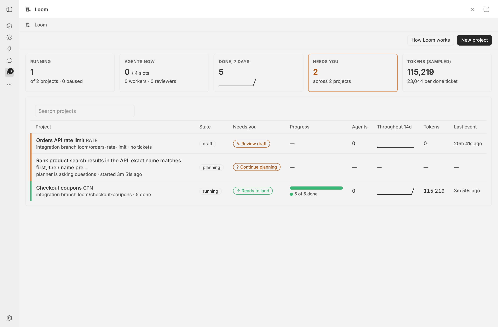
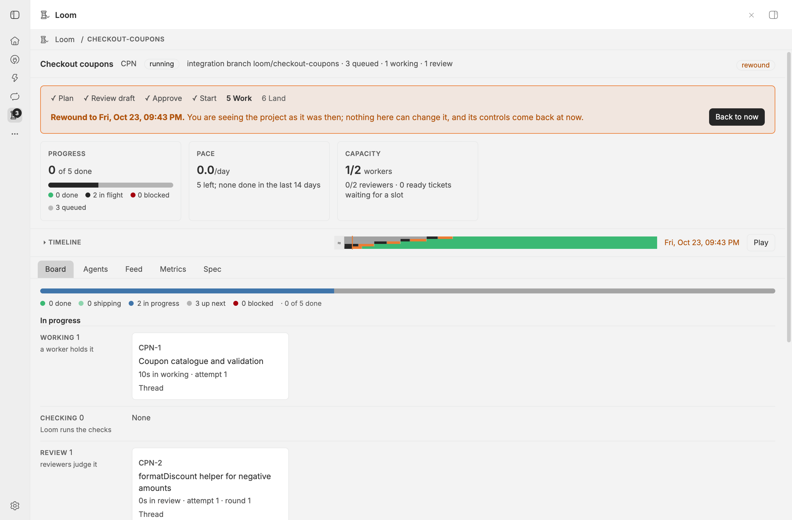
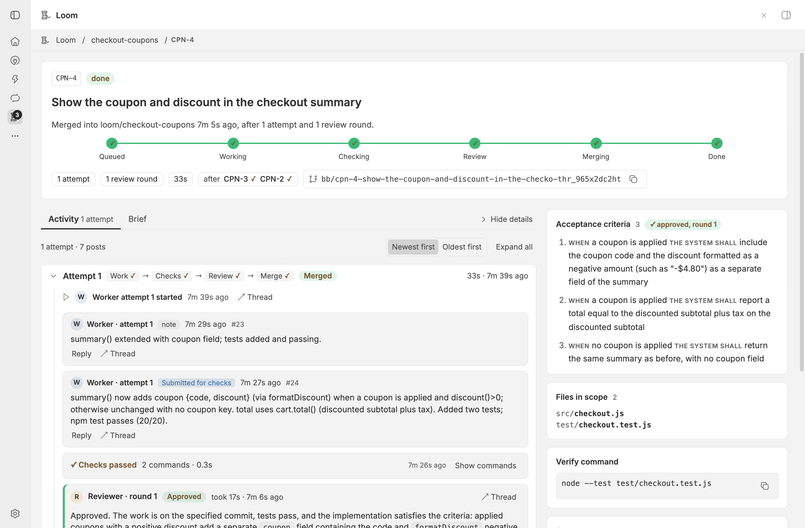
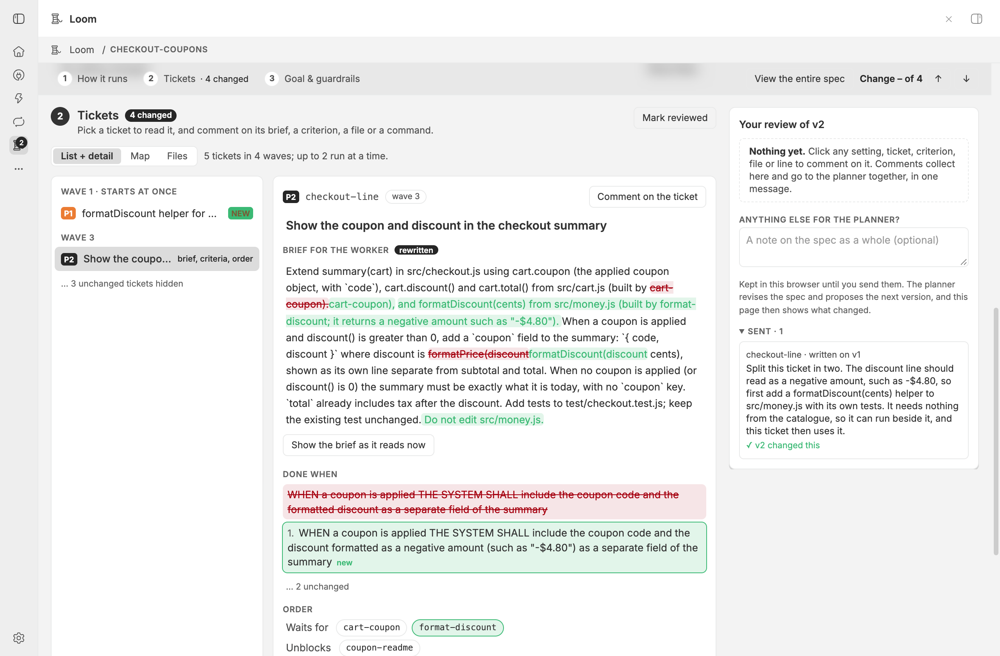
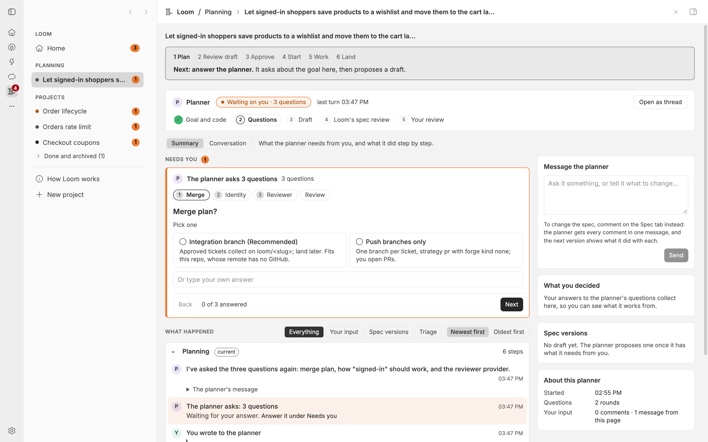
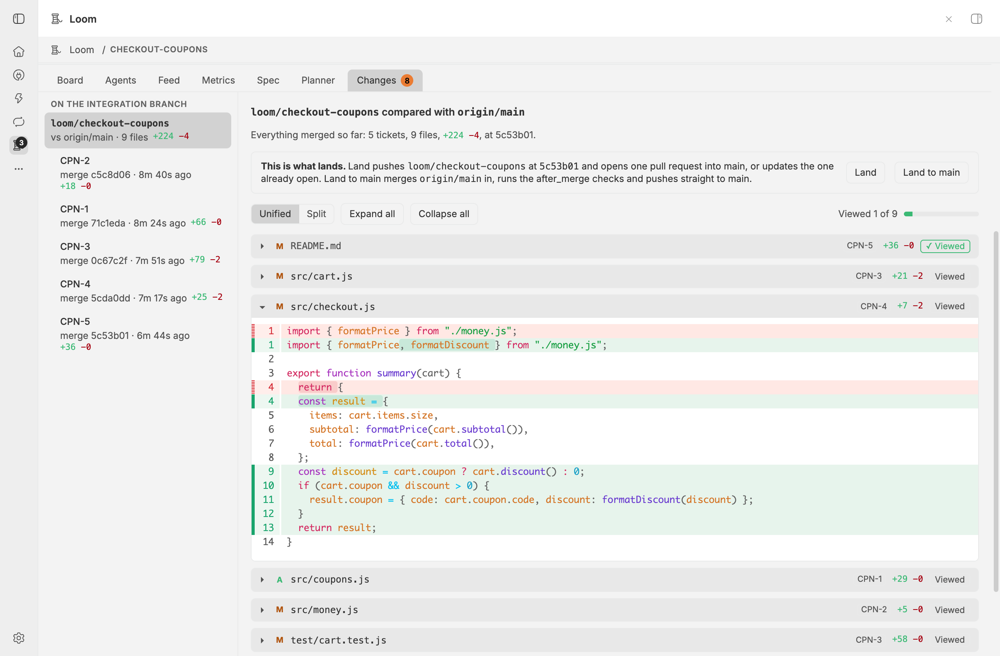

# Loom

Loom is a bb plugin that runs a software project with agents. You describe a
goal, and a planner agent turns it into a spec: tickets with acceptance
criteria, the checks that must pass, a review policy and a merge plan. Once you
approve it, worker agents build the tickets in their own git worktrees,
separate reviewer agents approve the work or send it back, and approved work
merges into an integration branch or opens as pull requests. You follow and
steer the project from the Loom page in bb's left navigation, or with
`bb loom`.

The plugin, not an agent, owns every state change. Agents get narrow tools for
their role, and only Loom's own code moves a ticket, runs checks, merges, or
decides that work is done. A project can stay in one repository or span
several.



## Install

```sh
bb marketplace add git:github.com/kalindudc/bb-marketplace@main
bb plugin install loom@kalindudc
```

Loom needs:

- `git` on the machine that has the project's checkouts.
- `gh`, signed in, for pull requests on GitHub. Other servers work through
  commands you put in the spec (see
  [Servers other than GitHub](#servers-other-than-github)).
- Provider usage. The planner, workers and reviewers are ordinary bb threads,
  so your providers' limits apply to them. A token budget or a deadline in the
  spec has Loom pause the project for you.

## Quick start

1. Open Loom in the left navigation and press New project, or ask any thread to
   plan a Loom project. Every thread has the `loom-plan` skill.
2. Answer the planner's questions. It proposes a spec, and Loom's spec review
   checks it before you see it.
3. Read the spec on the Spec tab. Comment on any part to send it back to the
   planner, or press Approve to create the tickets.
4. Press Start. Workers pick up ready tickets by themselves; answer a blocked
   ticket when the board asks.
5. Land the work: press Land (or run `bb loom land <slug>`) on the integration
   strategy, or merge the pull requests Loom opened.

## How a project runs

1. Plan. The planner asks one round of questions, calls `loom_discover` to learn
   how each repository is reached, and calls `loom_propose` with a TOML spec.
   Loom validates it and saves a draft.
2. Spec review. Loom starts a fresh agent that checks the draft against your
   request and for work the goal does not need. It approves with
   `loom_spec_approve` or sends numbered findings back to the planner with
   `loom_spec_request_changes`, for up to three rounds.
3. Approve. You read the spec and approve it, and the tickets appear on the
   board. `bb loom approve <slug> --skip-review` approves a draft whose spec
   review has not passed, and `--version N --skip-review` a pending version.
4. Start. Loom starts a worker thread for each ready ticket: its dependencies
   are done (on the pull request strategy, open pull requests are enough), and
   its scope does not overlap work in flight.
5. Work. The worker calls `loom_note` as it goes, then `loom_submit`, or
   `loom_block` when it needs help.
6. Check. Loom commits the worktree and runs the ticket's and the project's
   check commands. A failure goes back to the worker.
7. Review. Reviewer threads read the diff and call `loom_approve` or
   `loom_request_changes`. Requested changes go back to the worker as numbered
   findings.
8. Merge. On the integration strategy, Loom merges exactly the reviewed commit
   into the integration branch, one ticket at a time, and runs the
   `after_merge` checks on the result. On the pull request strategy, the
   worker writes the pull request and Loom opens it and follows it through CI
   (see [Pull requests](#pull-requests)).
9. Land. On the integration strategy you read what will land on the Changes
   tab, then run `bb loom land <slug>` to push the branch and open one pull
   request, or `bb loom land <slug> --direct` to merge in the remote's base
   branch when it moved, run the `after_merge` checks on the result, and push
   straight to the base branch.

`skills/loom/references/spec.md` lists every key of the spec with its default.
Each `provider` in `[agents.worker]` and `[agents.reviewer]` must be a bb
provider id, such as `claude-code`, `codex` or `pi`. `loom_propose` refuses an
unknown one and names the ids bb has; when bb's list cannot be read, the spec
is accepted unchecked.

### When a ticket gets stuck

A ticket that gets stuck is blocked. The planner hears about it in a triage
round and answers with its board tools (`loom_board`, `loom_ticket`,
`loom_post`, `loom_requeue`, `loom_edit_ticket`, `loom_add_tickets` and
`loom_cancel_ticket`), or you answer on the ticket. Your reply on a blocked
ticket goes to the planner at once, as a message that names the ticket.

A spec version the planner proposes after approval waits for your approval,
and Loom's spec review checks it first, as a change to the version in force.
When you have to act, for example approve that version and then requeue the
tickets it unblocks, the planner records the steps with `loom_ask_human`, and
the Planner tab lists them under Needs you with a button for each.

When bb refuses to start a worker or a reviewer with a client error (an HTTP
4xx status other than 408, 409 and 429), the ticket blocks at once with bb's
message as the reason, because the same request would fail again. Network
errors, server errors and those three statuses are retried up to
`budget.max_attempts` times. Approving a pending spec version queues again
every blocked ticket whose worker never started, resets its failure counts and
tells the planner which tickets it requeued. A ticket blocked because bb
refused its reviewer goes back to review instead, in a new round for the same
commit: its work already passed the checks.

## The page

Loom adds a full-screen page to bb's left navigation. The Loom icon in the
navigation rail counts what needs you: the Needs you items and Loom threads
waiting on a question or an approval. The page updates within about a second
of an event, without a reload, and its addresses work after a reload:
`/plugins/loom/loom/<slug>` opens a project, `/plugins/loom/loom/<slug>/<KEY>`
a ticket and `/plugins/loom/loom/_plan/<threadId>` a planning conversation.

### Home

A first visit, before any project exists, shows a guide: the five steps from
plan to land, who does what, and a ticket's life. "How Loom works" opens it at
any time.

Five tiles sum up every project that is not archived: projects running, agents
working against the worker and reviewer slots of running and paused projects,
tickets done in the last 7 days, how many things need you (across how many
projects, and how many tickets are blocked), and the sampled tokens.

Under them, one table lists every project and every planning conversation. Its
Needs you column has a button for each blocked ticket, draft to review, pending
spec version, integration project ready to land, and project Loom paused by
itself (a budget or a deadline). Rows that need you come first, most urgent
first, with a coloured edge: red for a blocked ticket, green for a project
ready to land, amber for the rest. A planning conversation has "Continue
planning". Each row also shows the project's state, strategy, ticket counts and
progress, its workers and reviewers at work, a 14-day throughput sparkline, its
tokens against the spec's budget and its last event. A search box filters the
table by name, key, slug or title. Done and archived projects that need nothing
fold into a Finished group at the bottom.

### New project

New project shows bb's own new-thread composer, with its project, worktree,
branch, model and permission pickers; the permission picker starts on full. You
can also settle the merge plan, name a reviewer model, and pick the repos the
work spans: the repo picker lists bb's standard projects, takes up to 10, and
marks a project with no checkout on any machine. The picked repos are a
starting point, not a limit.

Submitting starts an ordinary bb thread as the planner, with the `loom-plan`
skill, and opens its Planner page. Once it proposes, the conversation becomes
the project's Planner tab. Conversations that have not proposed yet stay on the
home page until their thread is archived. "Don't work in a project" is refused,
because Loom needs a git checkout.

### A project

Every project has a next-step bar under its header: the stages from Plan to
Land with the current one marked, one sentence on what happens next, and the
one button you need now, such as "Approve v1 · create 7 tickets" or "Start
project · 2 workers". It turns yellow when tickets are blocked or Loom paused
the project, and says why and what Loom is doing about it. When every ticket of
an integration project is done or cancelled, it offers Land beside Review
changes, which opens the Changes tab; the header's "Land to <base>" lands with
`--direct` instead.

Once the spec is approved, a health strip shows progress, pace (tickets done in
the last 14 days over the time the project ran in them, so paused days do not
count), the time left at that pace, the token budget and the deadline when the
spec sets them, and worker and reviewer capacity with the ready tickets waiting
for a slot.

A tab that needs you carries a badge until the thing is resolved: Board counts
the blocked tickets, Spec marks a draft or a pending version waiting for you,
Planner shows "?" while the planner waits on a question and otherwise counts
the steps it asked you to take, and Changes counts the files you have not
marked viewed on a project ready to land.

#### Board



A row per stage, stacked down the page, under a bar that counts the tickets
done, shipping, in progress, up next and blocked:

- Needs you: the blocked tickets, when there are any.
- In progress: Working, Checking, Review, and Shipping (approved, merging and
  open pull requests, each card with its state).
- Up next: Ready, and Waiting, where each ticket names what it waits on.
- Finished: Done and Cancelled, folded to one line each.

Each card shows its age in its state, its attempt and review round, a link to
the thread working on it and a Changes link. Before approval, the draft's
tickets show as dashed cards with the keys approval will give them.

#### Ticket



A header with the state, a one-line summary, a stage tracker from Queued to
Done, and chips for the attempts, review rounds, total time, dependencies, the
branch and the pull request. A blocked ticket shows its reason, an answer box
and Requeue; Block and Cancel ticket sit in the ⋯ menu, and each needs a
reason.

The Activity tab shows one card per worker attempt, newest first (Oldest first
switches the order). Inside an attempt, posts are cards with their replies, each
check lists its commands with their result, time and exit code and the failed
command's output, each review shows its verdict, findings and notes, and each
merge its git steps. On the pull request strategy it also shows the pull
request the worker wrote, the commits Loom pushed, the checks as Loom last read
them, and a card per fix round with the feedback it sent. The Brief tab shows
the worker's brief as Markdown.

A side column lists the acceptance criteria, the files in scope, the verify
command and every worker and reviewer thread with how it ended; Hide details
folds it away. The reply box says who gets your reply now; on an open pull
request, your reply starts a fix round.

#### Spec



The spec as one page in three sections:

- How it runs: the settings as cards. Merging, workers and reviewers, the checks
  before review and after each merge, the scope guard and its protected paths,
  each repo, and the limits and triage.
- Tickets: List + detail shows the tickets by wave beside the picked one, with
  its brief, criteria, files, verify commands, dependencies and priority, and
  any files it shares with a ticket nothing orders it against. Map draws the
  waves from left to right with an arrow to each ticket that waits. Files lists
  the Shared files and every path by folder.
- Goal & guardrails: the goal, the non-goals, the reviewer rubric, the open
  questions and the raw TOML.

Every proposal before approval is kept as its own version, and older drafts
read as superseded. A version with one before it opens on "Only what changed
since vN": unchanged parts hide or fade, changed values say what they were,
additions are outlined in green, removals are struck through, and a rewritten
brief or goal shows word by word. "What changed" lists every change by section,
marks the ones that answer your comments, and jumps to each; j and k step
through them. A pending version compares with the version in force, and
"compared with" picks another.

Click any part to comment on it. A choice, a number or a switch can also take a
suggested value, which the planner gets as TOML
(`Suggested value: "pr" (now "integration")`), files take a "+ note", and quick
picks such as "Split it in two" start the text. Comments collect, numbered, in a
review panel with a note on the whole spec, a preview and one Send. The planner
gets them in one message that names each part, such as
`ticket[csv-export].acceptance[1]`, and each sent comment later says whether
the next version changed its part. With nothing to send, the panel offers
Approve.

Loom's spec review shows above the version and stays after approval: its
verdict, the reviewer's summary, and each finding pinned to its part as
R1, R2… with Go to it.

#### Planner



The planner's work as a page, with its chat one click away under Conversation.
A strip says whether it is working (and on what), waits on you or is idle, and,
before approval, where planning stands.

- Needs you holds what it waits for: its Ask User Question rounds, one question
  at a time with "Use the recommended answers for the rest"; the steps it asked
  for with `loom_ask_human`, each checked off when done; or a version ready for
  your review.
- What happened tells its work in chapters, one per spec version and one for
  the running project: your input, its proposals and board changes, Loom's
  reviews, your approvals, and each triage round with what the planner did.
- A side column has a box to message the planner, your answers to its
  questions, and every spec version.

#### Changes



What the project changed, from the start of the work until after it lands. On
the integration strategy the list starts with the integration branch compared
with the remote's base branch (`origin/main`), which is what Land pushes, then
each merged ticket with what its merge added, then the tickets not merged yet:
the commit in review, and a working ticket's worktree as it is now, read again
every 10 seconds. On the pull request strategy each ticket is compared with the
remote's base branch.

Each file shows its status and line counts, and opens its patch in bb's own
diff viewer, unified or split. Viewed marks stay in your browser and clear when
a file changes again. On the branch, a panel carries Land and "Land to <base>"
with what each pushes. A done project still shows what it merged, from the
merge commits Loom recorded.

#### Agents, Feed and Metrics

- Agents: every planner, worker and reviewer thread. Those working now come
  first, with their ticket, model, running time, timeout, tokens and rate-limit
  retries. Then the planner, on call for triage rounds, the tokens by role, how
  threads ended, and the ended threads. A provider that reports no token usage
  shows "not reported".
- Feed: the project's events as sentences, newest first.
- Metrics: the numbers under [Metrics](#metrics), with charts, and a 7, 14 or
  30 day window for throughput and cumulative flow.

#### Timeline

Under the health strip, every project has a Timeline. Collapsed, it is one thin
strip: the share of tickets in each state over time, with a playhead and a Play
button. Click or drag the strip, press Play, or step with First, Previous and
Next event (the arrow keys and Space work while it has focus) to rewind the
whole page to that moment. Rewound, the health strip, Board, Agents, Feed,
Metrics, Spec and any ticket show the project as it was then, every control is
disabled, and Back to now returns the live page.

Open, the Timeline plays at 1, 5 or 20 minutes per second, marks your own
actions as diamonds, zooms to the whole project or to 2 hours or 30 minutes
around the playhead, and draws a bar per ticket or per agent session. Trouble
keeps only the tickets that blocked or were sent back to work, and quiet
stretches of 15 minutes or more fold to a band marked ≈. The server rebuilds
the past from the event log and runs the live page's own views on it, so the
numbers are the real ones. History from before Loom 0.7.0 kept no ticket text or
failure counts per move, so a moment from then shows today's text and no failed
attempts.

#### Controls

Every button that changes something asks twice: the first click turns it amber
with "Click again to ..." and a bar that drains over five seconds, beside a
Cancel button. Each button calls the same engine method as the matching command
and is logged as a `human.action` event. Archive sits in the ⋯ menu.

A worker, reviewer or planner thread shows a header chip such as
`CSV-3 · review` that opens its ticket, and a planning conversation shows
"Planning", which opens it on the page. The chip is hidden on phone-sized
screens.

## Pull requests

On the pull request strategy (`merge.strategy = "pr"`), each ticket ships as
its own pull request.

- Once the reviewers approve a ticket, its worker writes the pull request with
  `loom_pr`: the title, the description and the commit message, the way its own
  instructions and skills say. A worker that ends its turn twice without it, or
  takes more than 30 minutes, gets Loom's template instead, and
  `merge.describe = "loom"` always uses the template.
- Loom pushes the reviewed work as one commit (`merge.squash = false` pushes
  the branch as it is), never with force, and opens the pull request.
- Loom then follows the pull request: its checks, reviews, unresolved review
  threads and comments. What needs a fix goes back to the worker as a fix
  round, which passes the checks and a Loom review again and is pushed as one
  more commit. After `merge.max_fix_rounds` rounds (5 by default) the ticket
  blocks and the pull request stays open.
- A failed check goes to the worker once the pending checks stop holding it
  back, so the worker does not wait for slow or stuck CI. A check still queued
  5 minutes after Loom first saw it stops holding. A running check holds only
  while it is at least 75% along: by the server's own progress, its time so far
  against its usual duration on that repository, or its GitHub Actions job's
  steps. A check Loom cannot measure, and every commit status, holds until
  `checksSettleMinutes` after the push. The fix round's message lists the
  checks Loom did not wait for. The spec's `merge.checks_queued_minutes` and
  `merge.checks_near_done_percent` change the two numbers for one project, and
  the settings change them for all (see [Settings](#settings)).
- The worker may answer review comments with the server's CLI. It posts from
  your account, so it ends each comment and reply with a signature line,
  "Posted by Loom" unless you change it (see [Settings](#settings)).
- You merge the pull request, and Loom completes the ticket.

### Stacked pull requests

A ticket does not wait for the tickets it depends on to merge. It starts once
each of them is done or has an open pull request with a commit Loom pushed, so
chasing reviews no longer holds up the work that builds on them.
`merge.stack = false` turns this off.

- In the same repo, the dependent stacks on its dependency. Its worktree starts
  from the dependency's pull request commit, through the branch
  `loom/<slug>/<key>-stack`; its scope check and reviewers' diff count only its
  own changes; and its pull request opens on the dependency's branch, with a
  line saying to merge that one first.
- When the dependency gets a new commit, after a fix round, Loom merges it into
  each ticket stacked on it, in that ticket's worker worktree, runs the
  ticket's checks and pushes, with no new worker turn and no new review. A
  conflict or a failing check goes back to the ticket's worker. A ticket whose
  worker worktree is gone catches up once a fix round gives it a new one.
- When the dependency merges, Loom merges the remote base branch into each
  ticket stacked on it the same way, and moves its pull request to the base
  branch with `gh pr edit --base`. On another server, the ticket's post asks
  you to change the base by hand.
- A ticket with two or more open dependencies in its repo starts on a merge of
  their commits. Its pull request waits until all but one of them have merged,
  because a pull request builds on one branch; Loom then merges the base branch
  into the one still open and opens the ticket's pull request on it. When their
  commits conflict with each other, the ticket waits and says so.
- A dependency in another repo cannot be stacked on. Its dependents start on
  its open pull request and read its files from that repo's checkout; each new
  commit on it is posted on the dependent ticket and sent to its worker.
- The board marks a stacked ticket with what it is stacked on, and an approved
  ticket whose pull request waits with what it waits for.

Some repositories run CI only on pull requests to the default branch. A stacked
pull request's checks then start once Loom moves it to the base branch.

## Multi-repo projects

A spec with `[[repo]]` tables spans several repositories. Each `[[repo]]` names
a bb project with a checkout on the machine the planner runs on, where the
workers run too, and can set its own base, remote, checks, `after_merge` checks
and protected paths; what it leaves out comes from the top level. Every ticket
names one repo and changes only that repo, with its scope relative to the
repo's root, so work that spans repos is split into one ticket per repo, linked
with `depends_on`.

- Planning: the planner finds the repos with `bb project list --json` and
  `bb project discover`, and offers to clone a repo with no checkout on this
  machine with `bb project source add <id> --clone --machine <host>`, which it
  runs only after you agree. `loom_propose` refuses a repo without a checkout
  and names the same command.
- Workers: one worker per ticket, in a worktree of its ticket's repo. Its brief
  lists the other repos' checkout paths, to read but never edit. Scopes collide
  only within one repo, so tickets in different repos run side by side. Checks
  and review use the ticket's repo's own checks and protected paths.
- Merging: `bb loom start` creates an integration branch of the same name in
  every repo, from each repo's base. The merge queue still runs one merge at a
  time per project, across every repo. On the pull request strategy each pull
  request opens in its ticket's repo, on that repo's remote and base.
- Landing: `bb loom land <slug>` lands every repo with merged work, each with
  its own pull request; `--repo <name>` lands one repo, and `--direct` pushes
  each repo to its own base. When one repo fails, the repos before it stay
  landed and the error says what to run next. The project is done when every
  ticket is done or cancelled and every repo with merged work has landed.
- The page: a repo chip marks each ticket's repo on the board, the ticket page
  and the Spec tab, whose Files view groups paths by repo. The Changes tab has
  one section per repo, in the spec's order, each with that repo's integration
  branch compared with that repo's remote base branch, its merges and its
  tickets not merged yet (on the pull request strategy, its tickets compared
  with that repo's remote base). The panel on a repo's branch lands that repo
  alone. A repo that cannot be read, such as one with no checkout on the
  project's machine, says why in its own section. The header links each repo's
  pull request, and the land buttons name the repos they land.
- `bb loom show` lists each repo with its bb project, base, integration branch,
  pull request and land, and `bb loom tickets` adds a repo column.
- After approval, a new spec version may add repos, but cannot remove or rename
  one or change its bb project, base or remote.

## Servers other than GitHub

Loom opens pull requests with `gh` unless the spec says otherwise, and it
knows no other server by name. Before proposing, the planner calls
`loom_discover`, which reports for each repo its git remotes, whether `gh` can
open pull requests where it pushes, the environment providers bb offers for it
on this machine, and whether Loom can add its own integration worktree. Each
choice is found or ask; the planner asks you the ask items in one round, and
`loom_propose` refuses a spec that leaves one of them open.

- `[merge.forge]` names the server: `kind = "command"` with an `open` and a
  `state` command for that server's CLI, plus optional `after_open` commands
  such as one that starts CI; or `kind = "none"`, where Loom only pushes the
  branch and completes the ticket when the remote's base branch contains it.
- `[environment]` starts the threads Loom runs in a repository (workers,
  reviewers, the spec reviewer and the summary agent) in a bb environment
  provider, such as one a plugin adds, with `inputs` in which Loom fills
  `{branch}` and `{base}` for each thread.
- `[merge.worktree]` prepares the integration worktree with a command, or with
  a plugin's CLI command (`plugin = "<id>"`), for repositories that refuse
  worktrees outside their own location. Without it, such a repository uses one
  pull request per ticket.

Every key, with the commands' variables and output, is in the loom skill's
`references/spec.md`.

## Commands

```sh
bb loom list                                 # every project with its state and ticket count
bb loom show <slug>                          # state, goal, merge setup, spec versions, ticket counts, next step
bb loom spec <slug> [--version N]            # the spec as TOML
bb loom tickets <slug> [--state s,s]         # the board
bb loom ticket CSV-1                         # a ticket and its reply thread
bb loom metrics <slug> [--days N] [--json]   # flow and agent metrics; --days sets the window (default 14)
bb loom feed <slug> [--after <id>] [--json]  # the newest events as sentences
bb loom report <slug> [--send]               # the project's record as Markdown; --send runs the done hook again
bb loom approve <slug> [--version N] [--skip-review]  # approve a draft (creates the tickets) or a pending version
bb loom start <slug>                         # workers start by themselves
bb loom pause <slug> [--now]                 # --now also stops the worker threads
bb loom resume <slug>
bb loom post CSV-1 "text" --reply-to <id>    # your reply; the ticket's worker gets it, or the planner when it is blocked
bb loom block CSV-1 "reason"
bb loom requeue CSV-1 --note "answer"        # a blocked ticket back to the queue
bb loom cancel CSV-1 "reason"
bb loom land <slug> [--title t] [--ready]    # integration strategy: push the branch, open one pull request
bb loom land <slug> --direct                 # integration strategy: merge in the remote's base, check, push to it
bb loom land <slug> --repo <name>            # multi-repo project: land only this repo
bb loom archive <slug>
```

Every command takes `--json`. Each project gets a sidebar section named
`Loom · <name> (<slug>)`, and its planner, workers and reviewers move into it.
When the project is done or archived, Loom deletes the section and its threads
go back to the ungrouped list. If you delete the section while a project is
ready or paused, starting or resuming it makes the section again.

## Agent tools

| Role | Tools |
|---|---|
| Any other thread | `loom_discover`, `loom_propose` |
| Planner | `loom_discover`, `loom_propose`, `loom_board`, `loom_ticket`, `loom_post`, `loom_requeue`, `loom_edit_ticket`, `loom_add_tickets`, `loom_cancel_ticket`, `loom_ask_human` |
| Worker | `loom_note`, `loom_submit`, `loom_block`, `loom_pr` |
| Reviewer | `loom_note`, `loom_approve`, `loom_request_changes` |
| Spec reviewer | `loom_spec_approve`, `loom_spec_request_changes` |

## Metrics

Every metric is computed from the append-only event log and the plugin's
tables, so it can be recomputed at any time. `bb loom metrics <slug>` prints
them, and `--json` prints the same numbers for scripts and agents. `--days N`
(1 to 90) sets the window for throughput and cumulative flow; every other
metric covers the whole project.

| Metric | What it is |
|---|---|
| work in progress | Tickets in working, checking, review, approved, merging or pr_open. |
| throughput | Tickets that reached done, per UTC day, for the last 14 days (or `--days`). |
| cycle time | From a ticket's first move to working until done; p50 and p85. |
| lead time | From the ticket's creation until done; p50 and p85. |
| work item age | For each ticket in flight, the time since its first move to working. |
| first-pass approval | Of the tickets that have a verdict, the share approved (or merged) with no changes requested in their first verdict round. |
| review rounds | Mean number of review rounds of done tickets. |
| check failures | `check` posts, and how many of them failed. |
| blocks | Times a ticket moved to blocked. |
| human interventions | Commands the human ran, apart from `start` and the approval of a draft. |
| tokens (sampled) | Tokens used by the project's threads in total, by role and per done ticket. Sampled, not exact: the plugin reads each live thread about once a minute and once when it ends. Threads with no sample after a minute, or that ended without one, count as not reporting (`tokens.unreported` in `--json`). |
| cumulative flow | Tickets in each state at the end of each of 14 days (or `--days`). A ticket counts as queued from its creation. |
| active time | Time the project ran, without the paused spans. `windowActiveMs` in `--json` is the part of it in the last 14 days (or `--days`). |
| time in state and flow efficiency | Over done tickets, the time spent in each state from creation (as queued) until done. Flow efficiency is the share of that time spent working. |
| checks by command | For each check command, its runs, failed runs (a non-zero exit or a timeout) and p50 duration. The plugin's own refusals count under "scope check" and "worktree check". |
| scope flags | Check posts that found files outside the ticket's scope, and check posts that found protected paths. |
| review findings | Over reviews with a verdict: the findings, how many are blocking and should-fix, the review rounds, and the rounds that requested changes. |
| tokens by ticket | The 5 tickets whose threads used the most sampled tokens. |
| reliability | Failed worker attempts, rate-limit retries, worker threads that timed out, and merges sent back to work (a merge conflict or a failed `after_merge` check). |

## When a project finishes

`bb loom report <slug>` prints the project's record as Markdown, built from its
board with no agent: the goal, where the code landed, and for each ticket its
acceptance criteria, submit summaries, reviews, merge, blocks, and the
planner's and your replies. Worker notes and check output are left out. On a
multi-repo project it lists each repo with its bb project, base and integration
branch, and gives one outcome line per repo. It works in any state, and
`--json` prints `{ slug, markdown }`.

Loom's done hook sends that record wherever you keep notes. Set it in bb's
settings for Loom, or from a terminal:

```sh
bb plugin config loom set doneHook 'cat >> "$HOME/notes/loom-$LOOM_PROJECT_SLUG.md"'
bb plugin config loom set doneRecord summary   # or full
```

- `doneHook` is a shell command that Loom runs once when a project moves to
  done, in the project's checkout on the project's machine, with a 2-minute
  limit. Empty, the default, turns the hook off. It runs with the PATH of bb's
  host process, so give a tool's absolute path when it is not found.
- The command reads the record on standard input and gets these variables:
  `LOOM_PROJECT_SLUG`, `LOOM_PROJECT_NAME`, `LOOM_PROJECT_KEY`,
  `LOOM_PROJECT_URL` (the landed pull request, or empty), `LOOM_PROJECT_URLS`
  and `LOOM_RECORD` (`summary` or `full`). On a multi-repo project
  `LOOM_PROJECT_URLS` holds every repo's landed pull request, one per line in
  the spec's order, and `LOOM_PROJECT_URL` is its first line; a repo landed
  only with `--direct` has no line. On a single-repo project both hold the same
  pull request.
- `doneRecord` chooses what the hook reads. With `summary`, the default, Loom
  starts one agent on the project's reviewer model that reads the full record
  and writes a short summary: goal, outcome, what was built, decisions,
  problems and fixes, follow-ups and files. The agent starts only when a hook
  is set, and when it cannot start, fails or takes longer than 30 minutes, the
  hook reads the full record instead. With `full`, no agent runs.
- The feed says when the record was sent, or why the hook failed. A project
  that finished before the hook was set is not sent;
  `bb loom report <slug> --send` sends it, for a backfill or after a failure.

## Settings

Besides the done hook, Loom has four settings for pull requests. Set them in
bb's settings for Loom, or from a terminal:

```sh
bb plugin config loom set checksSettleMinutes 45
bb plugin config loom set checksQueuedMinutes 10
bb plugin config loom set checksNearDonePercent 90
bb plugin config loom set commentSignature '<sub>Posted by Loom</sub>'
```

- `checksSettleMinutes` is the longest Loom waits for a pull request's
  pending checks after it pushes. It sends the failed ones to the worker as a
  fix round once no pending check holds them back, or once this many minutes
  have passed, whichever comes first, because some checks stay pending until a
  person approves them. It is 30 by default.
- `checksQueuedMinutes` is how long a check that has not started holds back
  the failed ones, from when Loom first saw it or from the push. It is 5 by
  default, and 0 waits for queued checks too.
- `checksNearDonePercent` is how far along a running check must be to hold
  back the failed ones. It is 75 by default, and 0 waits for every running
  check.
- `commentSignature` is the line a worker ends every comment and reply on a
  pull request with, so people can tell an agent wrote it from your account.
  It is "Posted by Loom" by default, takes Markdown (on GitHub, `<sub>…</sub>`
  makes it small), and an empty value turns it off.

They apply to every project; a spec's `merge.checks_queued_minutes` and
`merge.checks_near_done_percent` override the queued and running check
settings for that project.

## Safety

- Only plugin code moves a ticket, runs checks, merges or decides that work is
  done. A thread's role comes from the plugin's own table, never from thread
  metadata.
- Agents never merge or push. On the pull request strategy a worker may reply
  to review comments with the server's CLI, but never pushes, merges, closes,
  approves or edits the pull request; the plugin pushes, never with force, and
  you merge. On the integration strategy nothing is pushed until you run
  `bb loom land`, and only `bb loom land --direct` pushes to the base branch,
  never with force and only after the `after_merge` checks pass on what it
  pushes.
- Workers and reviewers run in bb's full permission mode unless the spec sets
  `permission_mode`, because some providers, such as pi, accept no other mode.
  An approved spec keeps the mode it was approved with.
- The human's controls (`approve`, `start`, `pause`, `resume`, `archive`,
  `post`, `block`, `requeue`, `cancel`, `land`, `report --send`) refuse Loom's
  own planner, worker and reviewer threads with the code `loom_human_only`.
- The page's RPC changes state, and starts a planner thread, only when the call
  carries `confirm: true`, and it refuses calls from other plugins. bb cannot
  tell the page from an agent running `bb plugin rpc`, so the skill tells
  agents never to call Loom's RPC.

## How it works

- `src/states.ts` holds the project and ticket state maps. Every move goes
  through one store method that updates the row and appends an event in a
  single transaction (`src/db/store.ts`), and the `events` table refuses UPDATE
  and DELETE with triggers (`src/db/schema.ts`).
- `src/spec.ts` parses the spec with `smol-toml`, checks it with strict zod
  schemas, then applies the cross-field rules. `src/repos.ts` fills in each
  repo's settings from the top level, and `src/checkouts.ts` finds each repo's
  checkout on the project's machine.
- `src/projects.ts` is the service: proposals, approval, lifecycle, the board's
  posts and the role lookup. `src/tools.ts` registers the agent tools per role,
  `src/cli.ts` is `bb loom`, and `src/bb-port.ts` is the one adapter over
  `bb.sdk`, faked in tests.
- `src/scheduler.ts` is pure: which tickets are ready, how many slots are free.
  `src/workers.ts`, `src/checks.ts`, `src/triage.ts`, `src/review.ts` and
  `src/merge.ts` are the engine's parts, and `src/engine.ts` is the control
  loop that ticks every 15 seconds, reconciles after a restart and handles bb's
  thread events.
- `host.ts` and `src/host/ops.ts` run on the machine that owns the checkout:
  git through argv, the repo's server for pull requests (`gh`, the spec's own
  commands, or none), and check commands in their own process group.
- `src/metrics.ts`, `src/feed-text.ts` and `src/replay.ts` are pure;
  `src/reports.ts` reads them for the CLI and the page, and `src/replay.ts`
  rewinds a project's rows to one event for the Timeline. `src/rpc.ts` serves
  the page and publishes `loom:changed` after a project's events and after any
  change that writes no event (`Store.changed`), at most once every 300 ms per
  project; a change outside any project publishes `{ slug: null }`.
- `app.tsx` and `src/ui/` are the page. The app imports only types from
  `src/contract.ts`, so zod stays out of its bundle, and its charts are small
  SVG components. `src/spec-view.ts` serves one spec version to the page,
  parsed and compared with the one before, and `src/activity.ts` groups a
  ticket's posts, runs and threads into worker attempts.

## Credit

The structure follows
[bb-autoresearch](https://github.com/pascal-de-ladurantaye/bb-autoresearch)
(MIT): role-scoped tools re-checked against the plugin's own table, an
append-only events table with triggers, strict zod specs with reworded errors,
and a `BbPort` adapter faked in tests. The claim, retry and reconcile ideas come
from OpenAI's Symphony `SPEC.md`.

## Develop

```sh
npm install --registry https://registry.npmjs.org
npm test
npm run typecheck
bb plugin build
bb plugin install ./plugins/loom   # from this repository's root, to try it
```

The registry flag matters on machines whose configured package proxy cannot
serve the `@get-bb/plugin-sdk` tarball.
