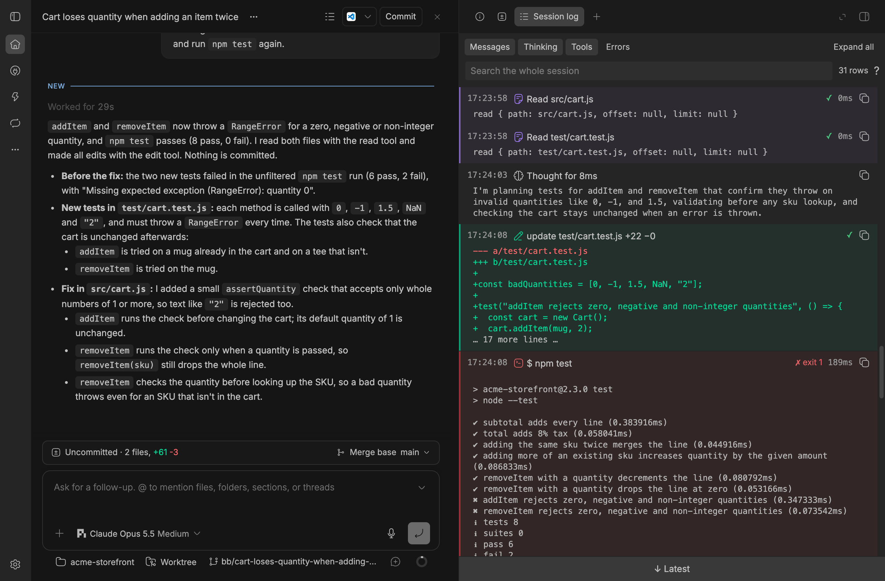
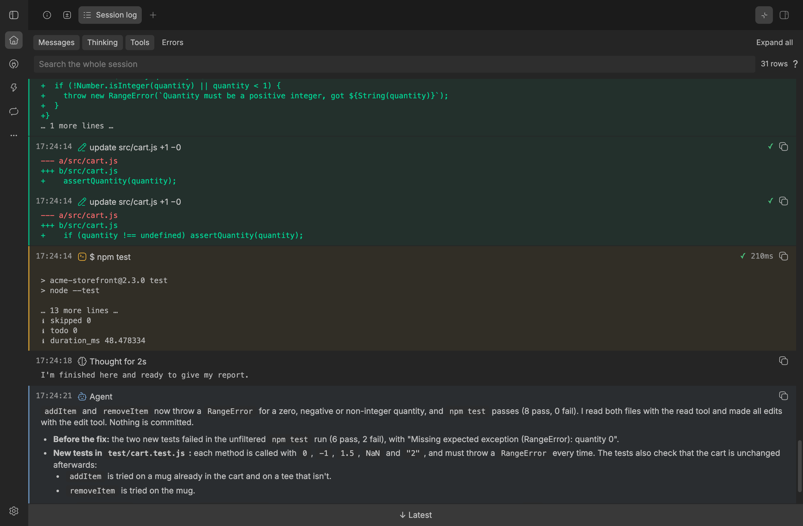

# Session Log

A bb plugin that puts a thread's whole session in one flat, live, searchable
side-panel tab. Open it from the thread header or with Mod+Shift+L (Command
on macOS, Control elsewhere). On a phone, the header leaves the button out
and the right panel's tab list opens the log. bb's Maximize pane button, at the top right of
the panel, gives the log the whole window.



Incoming messages, steers and child reports start labeled dividers. The log
then shows agent replies, thoughts, commands with output, exit codes and
duration, tool calls, file diffs and subagent steps in bb's timeline order.
Replies stay visible in full; long outputs show their first and last lines,
and failures open in full. Filters narrow to Messages, Thinking, Tools, Hidden
or Errors.

The log also shows what bb gives the agent but keeps out of the chat: a
plugin's steer (such as cortex memory), the context a mention resolves to, an
automatic retry, and tool results delivered with their presentation
suppressed. Each one sits where the agent received it, with a dashed rail and
a “Hidden” label: “Hidden steer” and “Hidden message” for whole messages,
“Hidden context” for the hidden part of a message the chat shows. The Hidden
chip, or the `showHidden` setting, turns them off. The log follows new output until you scroll up or move to an older
row with the keyboard; “↓ Latest” or `G` resumes it.

Rows are tinted by type in your bb theme's colors, so they stand apart at a
glance: agent replies, tool calls and subagents, commands, file changes and
failures each get a faint background, a left rail and a colored icon.
Thinking and incoming messages stay neutral.



## Keys

| Key | Action |
| --- | --- |
| Mod+Shift+L | Open the Session Log tab for this thread |
| j / ↓, k / ↑ | Move between visible rows |
| Enter / o | Expand or collapse the focused row (buttons keep Enter) |
| x | Toggle the expanded view; the choice persists on this device |
| n / N | Next / previous agent reply |
| e / E | Next / previous error |
| g / G | First / latest row; G resumes live follow |
| / | Focus search |
| c | Copy the focused row |
| s | Show the focused message in bb's chat |
| ? | Show or hide keyboard help |
| Enter in search | Focus the first matching row |
| Escape in search | Clear the query; when empty, return to the log |

Use the row's “Open thread” action to open a child or sender thread in a
split. “Show in chat” links user and agent messages to their message anchors.

## Settings

Settings → Plugins → Session Log, or `bb plugin config session-log set <key> <value>`.
Changes reach open panels straight away.

| Key | Default | What it controls |
| --- | --- | --- |
| `outputHeadLines` | 4 | Lines of command and tool output kept from the start of a collapsed row (0 to 50) |
| `outputTailLines` | 4 | Lines kept from the end of a collapsed row (0 to 50) |
| `thinkingLines` | 3 | Lines shown for a collapsed thought; 0 shows only its title (0 to 20) |
| `expandFailures` | true | Failed commands and tools start expanded |
| `showMessages`, `showThinking`, `showTools`, `showHidden` | true | Which rows the filter chips show, until you toggle a chip yourself |
| `timeFormat` | `24h` | Row timestamps: `24h` (14:02:31) or `12h` (2:02:31 PM) |
| `tintRows` | true | Tint agent replies, tool calls, commands, file changes and failures in your theme's colors; icons stay colored either way |

## Install

After the first release is tagged:

```sh
bb marketplace add git:github.com/kalindudc/bb-marketplace@main
bb plugin install session-log@kalindudc
```

## How it works

The panel reads bb's public `threads.timeline` API with nested rows. It
loads every page when opened, then keeps the server's latest window separate
from the complete list so it can apply `afterSequence` deltas and splice
updates into that list. Thread events and reconnects trigger refreshes, at
most twice per second while activity continues; rewritten history triggers
a new load. Follow works like bb's own sticky scrollers: only a scroll by the
reader (a wheel, touch, drag or scroll key within 350 ms) pauses it, and any
other change in size or position re-pins the newest row.

bb's timeline leaves out prompt parts marked `agent-only` and suppressed
tool-result messages, so the panel also reads the thread's request events
(`client/turn/requested`, `turn/input/accepted` and `client/turn/rejected`)
with `threads.events.list`, 100 at a time, on load and with each refresh. A
hidden steer takes its place from the event that accepted it, as bb places a
visible steer; anything else takes it from its request. If those events cannot
be read, the rest of the log still loads and a notice says why.

It does not read or change bb's chat markup, send thread data
elsewhere, or persist a copy of the log. Only the expanded-view preference
is kept in this device's local storage. The server only defines the settings
and tells open panels when they change.

The icon is “Logs” from [Hugeicons](https://hugeicons.com) core free icons
(MIT License, copyright 2025 Hugeicons).

## Limits

- bb shortens output above 32,000 characters and appends its truncation note;
  the log displays that note rather than fetching beyond the limit.
- Search includes message text, but does not highlight matches inside rendered
  Markdown. Titles and plain-text bodies do highlight matches.
- The whole session loads when the tab opens, so very large threads need
  an initial fetch before search is complete.
- bb's events do not record which plugin sent a hidden message, so the log
  labels it by kind (steer, message, retry, tool result) rather than by
  sender. Hidden images and files appear by path or name.

## Develop

```sh
cd plugins/session-log
npm install
npm test
npm run typecheck
npm run build    # bb plugin build
```

With explicit permission to change the local bb plugin installation, a
working copy can be installed and reloaded from this directory:

```sh
bb plugin remove session-log
bb plugin install "path:$PWD" --yes
bb plugin reload session-log
```

## Release

After review, bump the package version for later releases, merge to an
up-to-date `main`, and tag that version. The first release uses:

```sh
git tag session-log/v0.1.0 && git push origin session-log/v0.1.0
```
