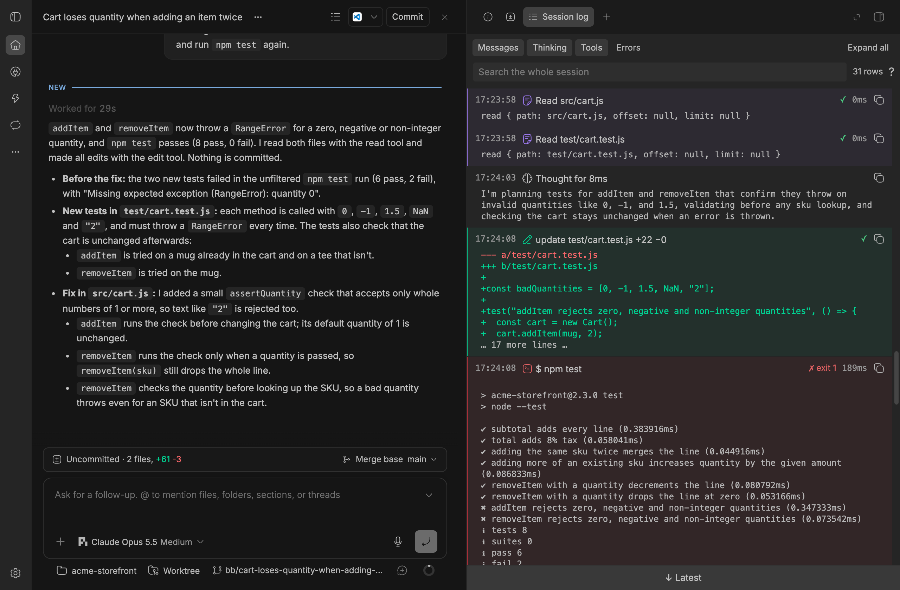
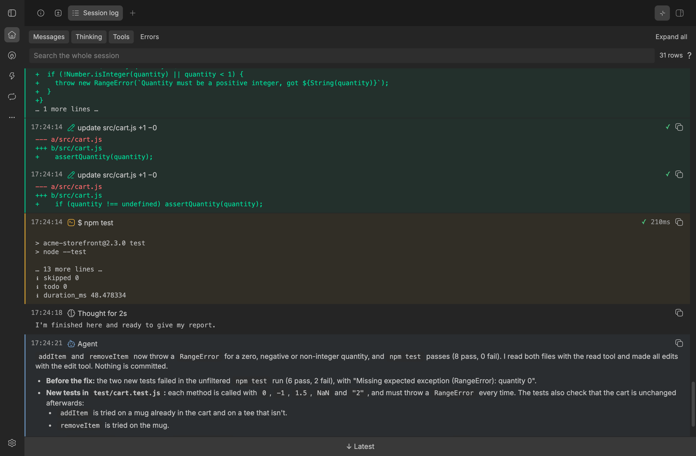

# Session Log

A bb plugin that puts a thread's whole session in one flat, live, searchable
side-panel tab. Open it from the thread header or with Mod+Shift+L (Command
on macOS, Control elsewhere). On a phone, the header leaves the button out
and the right panel's tab list opens the log. bb's Maximize pane button, at the top right of
the panel, gives the log the whole window.



Incoming messages, steers and child reports start labeled dividers. The log
then shows agent replies, thoughts, commands with output, exit codes and
duration, tool calls, file diffs and subagent steps in bb's timeline order.
Replies stay visible in full; long outputs show their first and last lines,
and failures open in full. Filters narrow to Messages, Thinking, Tools, Hidden
or Errors.

The log also shows what bb gives the agent but keeps out of the chat: a
plugin's steer (such as cortex memory), the context a mention resolves to, an
automatic retry, and tool results delivered with their presentation
suppressed. Each one sits where the agent received it, with a dashed rail and
a “Hidden” label: “Hidden steer” and “Hidden message” for whole messages,
“Hidden context” for the hidden part of a message the chat shows. The Hidden
chip, or the `showHidden` setting, turns them off.

The log always opens on the newest rows and follows new output until you
scroll up or move to an older row with the keyboard; “↓ Latest” or `G`
resumes it. It draws 50 rows at a time (the `rowsPerPage` setting), so even a
thread with thousands of steps opens at once. Scrolling toward the top draws
the next page of earlier rows, and reads older rows from bb when you reach
the oldest one it has, without moving what you are reading. The log draws at
most four pages at once; scrolling back down draws the later rows again, and
reaching the bottom resumes follow.

Rows are tinted by type in your bb theme's colors, so they stand apart at a
glance: agent replies, tool calls and subagents, commands, file changes and
failures each get a faint background, a left rail and a colored icon.
Thinking and incoming messages stay neutral.



## Keys

| Key | Action |
| --- | --- |
| Mod+Shift+L | Open the Session Log tab for this thread |
| j / ↓, k / ↑ | Move between visible rows; moving past the drawn rows draws the next page, and `k` on the oldest loaded row reads older ones |
| Enter / o | Expand or collapse the focused row (buttons keep Enter) |
| x | Toggle the expanded view; the choice persists on this device |
| n / N | Next / previous agent reply; while a search is active, next / previous match |
| e / E | Next / previous error |
| g / G | First / latest row; `g` first reads the rest of the session, G resumes live follow |
| / | Focus search |
| c | Copy the focused row |
| s | Show the focused message in bb's chat |
| ? | Show or hide keyboard help |
| Enter / Shift+Enter in search | Next / previous match; focus stays in the search box |
| ↓ in search | Move into the log at the current match, keeping the search |
| Escape in search | Clear the query; when empty, return to the log |

Search filters the log to the rows that match and paints every match in
amber, inside rendered Markdown too. To cover the whole session it reads the
older rows from bb in the background, while the row count says “loading
older”, and it still draws only a page of matching rows at a time.

The match you are on is orange and underlined, and its row gets an orange
frame. A counter beside the search box says which match you are on (“3 of
17”), and its arrows, Enter and Shift+Enter, or `n` and `N` in the log step
through them, wrapping at either end. The counter counts the matches in the
drawn rows, so it shows “3 of 17+” while some matching rows are not drawn or
not loaded yet; stepping past the drawn rows draws the next page and carries
on. With no current match, stepping starts from the row you moved to, or from
the first or last match while the log follows the newest row. Stepping to a
match scrolls it to the middle of the log and pauses follow.

Use the row's “Open thread” action to open a child or sender thread in a
split. “Show in chat” links user and agent messages to their message anchors.

## Settings

Settings → Plugins → Session Log, or `bb plugin config session-log set <key> <value>`.
Changes reach open panels straight away.

| Key | Default | What it controls |
| --- | --- | --- |
| `outputHeadLines` | 4 | Lines of command and tool output kept from the start of a collapsed row (0 to 50) |
| `outputTailLines` | 4 | Lines kept from the end of a collapsed row (0 to 50) |
| `thinkingLines` | 3 | Lines shown for a collapsed thought; 0 shows only its title (0 to 20) |
| `expandFailures` | true | Failed commands and tools start expanded |
| `showMessages`, `showThinking`, `showTools`, `showHidden` | true | Which rows the filter chips show, until you toggle a chip yourself |
| `timeFormat` | `24h` | Row timestamps: `24h` (14:02:31) or `12h` (2:02:31 PM) |
| `tintRows` | true | Tint agent replies, tool calls, commands, file changes and failures in your theme's colors; icons stay colored either way |
| `rowsPerPage` | 50 | Rows the log draws when it opens, and how many more it draws each time you scroll past them (10 to 500); fewer keep very long threads fast |

## Install

Session Log needs bb 0.48.1 or later.

```sh
bb marketplace add git:github.com/kalindudc/bb-marketplace@main
bb plugin install session-log@kalindudc
```

## How it works

The panel reads bb's public `threads.timeline` API with nested rows. It
reads only the latest window when opened, and reads older pages one at a time
as the reader scrolls up to them, or all of them for a search or `g`, leaving
at least as long as the last request took between pages. It keeps the
server's latest window separate from the rows loaded so far. Each refresh passes that window's `afterTag`, so bb
answers with only the rows and fields that changed, and the panel splices
them into the list; rows that did not change keep their objects and are not
redrawn. Thread events and reconnects trigger refreshes; rewritten history
triggers a new load.

bb builds the whole latest window for every refresh, which blocks its event
loop for a few hundred milliseconds on a long thread. The panel therefore
waits at least half a second between refreshes, and at least four times as
long as the last request took, up to 5 seconds. bb keeps a closed panel's
tab mounted, so while the log tab is closed or behind another tab it reads
nothing, and it catches up with one refresh when it shows again.

Follow works like bb's own sticky scrollers: only a scroll by the
reader (a wheel, touch, drag or scroll key within 350 ms) pauses it, and any
other change in size or position re-pins the newest row.

The panel draws a window of the visible rows, held by entry id so it stays
put while rows arrive at either end or a filter changes. While it follows,
the window is the newest page. When follow pauses, the window keeps its first
row, so new output adds below it. Scrolling within a screen of the top or the
bottom of the drawn rows adds a page there; when rows are added above, the
panel puts the row that was at the top of the view back where it was. A jump
to a far row (`g`, `e`, a search match) draws a page around that row instead.
When the drawn rows do not fill the panel, as with a narrow filter, the panel
draws more and reads older pages until they do or the session runs out.

bb refuses a pagination cursor once the thread's title or working directory
changes. The panel then walks a fresh chain of pages back to the oldest row it
has and carries on from there; if that fails too, the top of the log says why
and offers Retry.

bb's timeline leaves out prompt parts marked `agent-only` and suppressed
tool-result messages, so the panel also reads the thread's request events
(`client/turn/requested`, `turn/input/accepted` and `client/turn/rejected`)
with `threads.events.list`, 100 at a time: newest first and only back to the
oldest loaded row when the log opens, further back with each older page, and
forward with each refresh. A
hidden steer takes its place from the event that accepted it, as bb places a
visible steer; anything else takes it from its request. If those events cannot
be read, the rest of the log still loads and a notice says why.

It does not read or change bb's chat markup, send thread data
elsewhere, or persist a copy of the log. Only the expanded-view preference
is kept in this device's local storage. The server only defines the settings
and tells open panels when they change.

The icon is “Logs” from [Hugeicons](https://hugeicons.com) core free icons
(MIT License, copyright 2025 Hugeicons).

## Limits

- bb shortens output above 32,000 characters and appends its truncation note;
  the log displays that note rather than fetching beyond the limit.
- Matches are painted with the browser's CSS Custom Highlight API. bb's
  diff viewer draws expanded file changes in its own shadow DOM, which plugin
  styles cannot reach, so a match there is not painted; stepping still lands
  on its row and frames it. Search also stops at the row: a match in text the
  row does not show, such as a collapsed command's later lines, frames the row
  the same way.
- Only loaded rows can be reached by `n`/`N` between replies and `e`/`E`
  between errors. Scroll up, search or press `g` to load older rows first.
- A search on a very large thread reads every older page before its results
  are complete; the counter says “loading older” until then.
- bb's events do not record which plugin sent a hidden message, so the log
  labels it by kind (steer, message, retry, tool result) rather than by
  sender. Hidden images and files appear by path or name.

## Develop

```sh
cd plugins/session-log
npm install
npm test
npm run typecheck
npm run build    # bb plugin build
```

With explicit permission to change the local bb plugin installation, a
working copy can be installed and reloaded from this directory:

```sh
bb plugin remove session-log
bb plugin install "path:$PWD" --yes
bb plugin reload session-log
```

## Release

After review, bump the package version for later releases, merge to an
up-to-date `main`, and tag that version. The first release uses:

```sh
git tag session-log/v0.1.0 && git push origin session-log/v0.1.0
```
