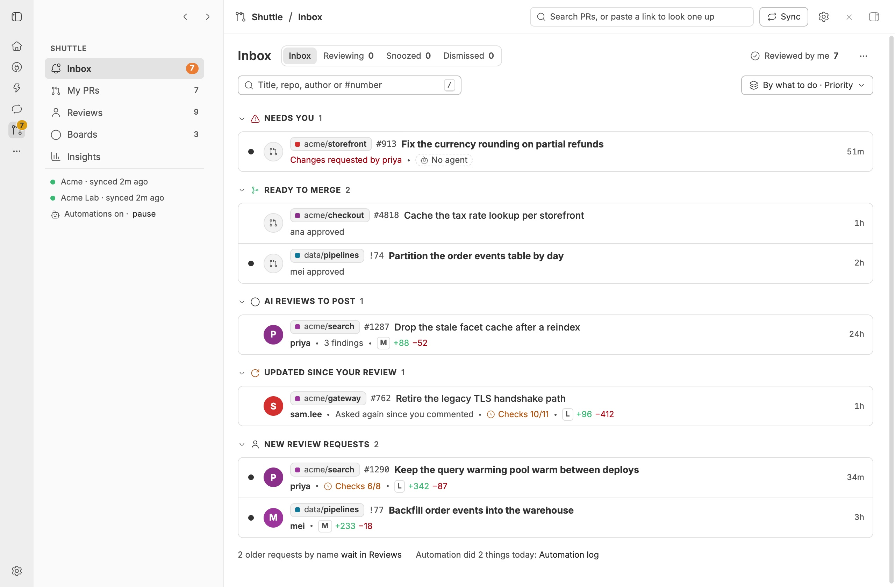
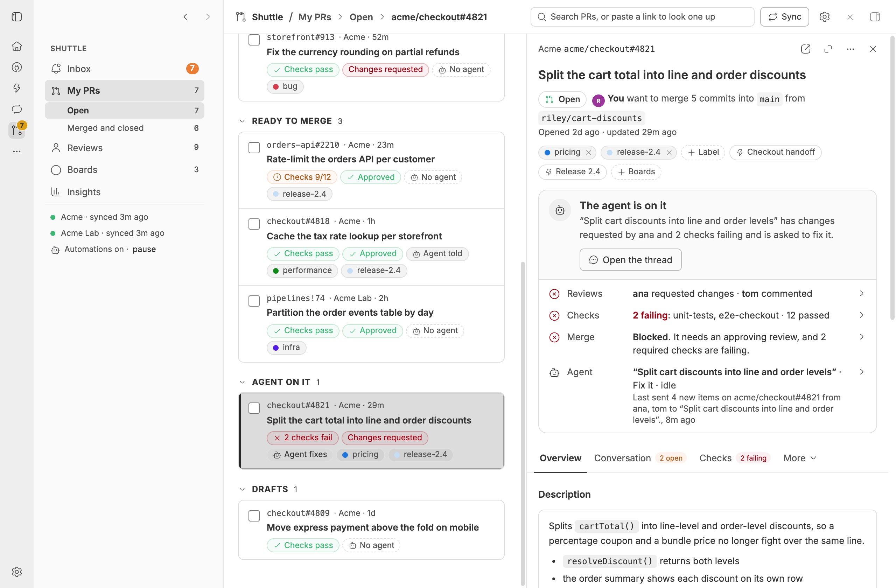
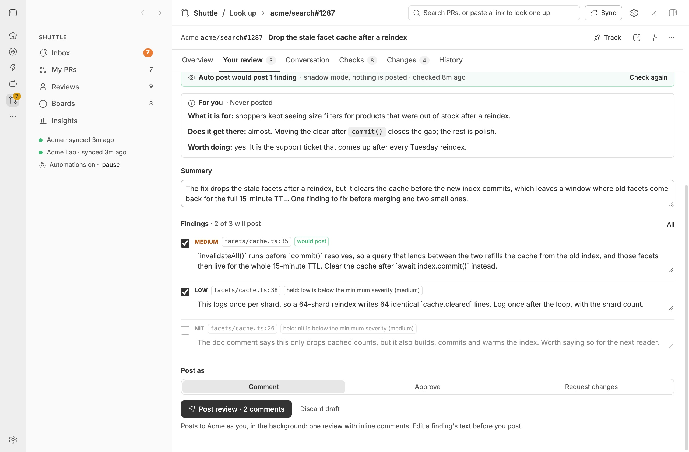
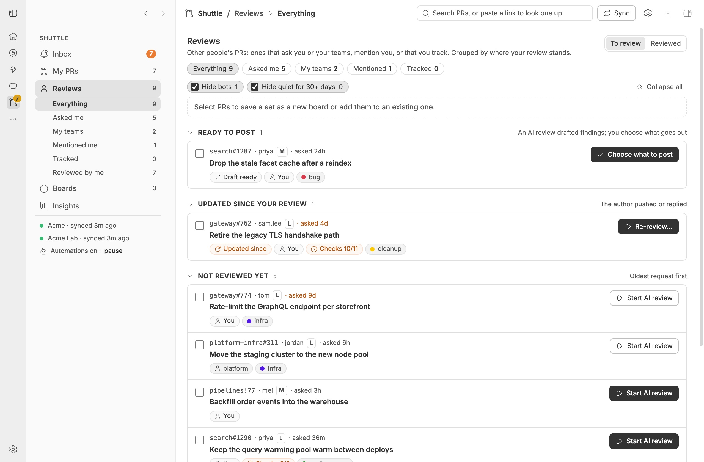
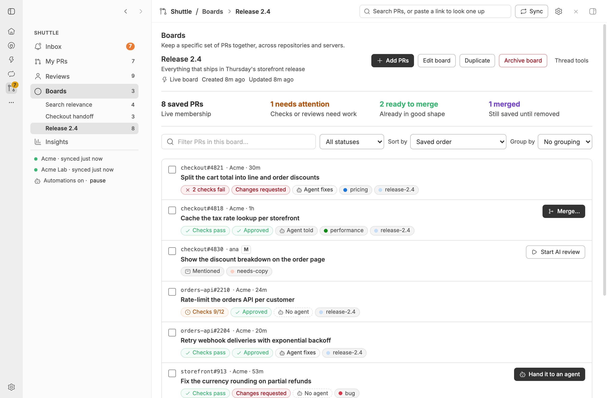

# Shuttle

Every pull request that needs you, from any server, in one place. See
[PLUGIN_OVERVIEW.md](PLUGIN_OVERVIEW.md) for what it does, and
[skills/shuttle/references/servers.md](skills/shuttle/references/servers.md) for the command
adapter contract.

## Screenshots

Captured in an isolated demo bb with made-up PRs on two fictional command servers (Acme and Acme Lab), in the default theme, light mode.











## Inbox

The Inbox lists what waits on you, one row per PR under what to do with it: Needs you, Ready to
merge, AI reviews to post, Updated since your review and New review requests. A row's second line
says only what its heading, avatar and time do not. Search, group by what to do or by repository,
and sort; the choice is kept on this device. Pointing at a row, or moving to it with J and K,
shows its next step, Snooze, Dismiss and ⋯; each says what it does, and its key, in a tooltip. A
row's ⋯ menu holds Snooze and Dismiss too (the only menu on a phone, besides swiping), then its rules.

- **Reviewing** lists your reviews on their way to their servers, then the PRs an AI review is
  running on, which are out of the Inbox until it finishes or stops: the preset, when it started,
  whether its thread waits on your answer or is idle, and a button to its thread. The Inbox's foot
  says how many of each there are, and how many merges are on their way.
- **Snooze** hides a PR until later today, tomorrow, next week or until it changes; anything new
  brings it back sooner. The Snoozed tab lists them with when each comes back.
- **Dismiss** keeps a PR out of the Inbox for good, even when it changes. The Dismissed tab lists
  them, marks those with new activity and restores one.
- **Rules** from a row's ⋯ menu keep out every PR by an author, every PR from a repo, or mentions
  in a repo when you are not asked to review. They are per server and listed under Dismissed.
- **New since you opened it:** Shuttle stores when you last opened each PR, so the dot and bold
  title follow you across devices. Opening the PR clears them; Mark all as seen clears every one.

Several rows can be snoozed or dismissed at once. Snoozes, dismissals and rules have Undo, and a
phone swipes a row left to dismiss it or right to snooze it.

## Filters and search

Every list has a keyword filter: the Inbox and its Reviewing, Snoozed and Dismissed tabs, My PRs
and Merged and closed, Reviews, Reviewed by me, and each board. A PR stays when every word is in
its title, repository, description, author, branches, labels or server's name; `#123` matches PR
numbers that start with 123, and `@dana` matches dana.

The PRs with the most words in the title come first, then those with the most in the repository,
then in the author, branches and labels, and last those that match only through their
description. The list keeps its groups, and its own sort orders the PRs that rank the same. The
field says how many PRs match, Escape or its ✕ clears it, and / puts the cursor in it. Each list
keeps its words for the rest of the session; the Inbox's tabs share theirs. In Reviews, a line says
how many matches Hide bots and Hide quiet keep out.

The header's search field finds PRs the same way among every PR Shuttle has, and so do a board's
Add PRs dialog and `bb shuttle search`. There, open PRs come before merged and closed ones, so a long
history never crowds them out of the 50 shown; the ranking above orders each.

GitHub's lists read each PR's description, so a word in it finds PRs you never opened in Shuttle.
A command server's PRs match on their descriptions once Shuttle has them: from `view`, or from its
lists when they print `body`. A template's `<!-- … -->` comments are not part of the match. Words in
titles and the rest match as you type; matches that need a description come from Shuttle's server a
moment later, and a row only ever shows when every word is known to be on it. When descriptions
cannot be searched, the field shows a warning and the rest still matches. While Inbox rows are
selected, the selection bar shows the words, with a way to clear them. A keystroke repaints the
field at once; the rows follow in a render the next keystroke can drop, and only rows whose content
changed are drawn again.

## PR view

A PR's view reads top to bottom the way a person asks about it:

- **What it is:** the title, its state, who wants to merge how many commits from which branch, its
  labels and the boards it is on.
- **Where it stands:** one card with the next step and its buttons, in the same words as the
  Inbox, then a row for each part: your review, reviews, checks, whether it can merge, the agent
  (which opens its controls in place) and, on someone else's PR, its size. A row opens the tab
  with the rest.
- **Tabs:** Overview (description, people, facts and linked threads), Your review (the AI draft
  to post, on someone else's PR, with the review's notes for you, which are never posted), Conversation (open threads first with the code they are on, then
  every review and comment, newest first with a button to flip the order), Checks (every check,
  failing first), Changes (commits and each file's path and line counts, never the diff itself)
  and History (what happened on the server and in Shuttle). Tabs that do not fit the width go
  under More, which shows a dot when one of them has failing or running checks or open threads;
  the tab you are on always stays in view.

Beside a list, drag the view's left edge to make it wider or narrower, or focus the edge and use
the arrow keys; a double-click puts back the default width. Shuttle remembers the width on this
device, for the panel beside the list and the one that slides over it in a narrower window. The
view's expand button opens it as a full page, which puts people and facts in a column of their own
on a wide window; a PR's own link opens there too. The ⋯ menu holds copying,
tracking, snoozing, dismissing from the Inbox, linking a thread, starting an AI review and your
PR's draft, close and reopen.

Posting a review, from an AI draft, the composer or Approve…, never makes you wait on the server.
Shuttle checks it at once, queues it and posts it in the background, one review at a time on each
server and in the order you posted them, checking the PR's head again just before it posts. Your
review shows it queued, with Cancel until it starts, then posting, and a toast says when it is on the
server. A review the server refuses comes back to the Inbox under Needs you with the server's
reason: try it again, change its draft and post that, or dismiss it. A review Shuttle was posting
when it stopped fails the same way instead of posting twice, so check the PR before you try again.

Merging one of your PRs, or turning on its auto-merge, works the same way. The Merge dialog closes
at once, and Shuttle merges in the background, one PR at a time on each server and in the order you
chose them. My PRs lists them under Merging, and the PR's card has Cancel until the merge starts.
Just before it merges, Shuttle reads the PR from its server and merges only while it is open and
still at the head you saw. It decides what happened from the PR it reads back afterwards, so a PR a
repository's own merge queue took stays open, under Merging: as In the merge queue when the server
says so, or as Sent to merge for up to a day while it is still at that head, instead of merged or
ready to merge. Every 30 seconds, even while a sync runs, Shuttle reads your PRs with a merge
pending, so a merge that lands, there or anywhere else, shows within a minute or so. A PR that has
waited on auto-merge or a merge queue for more than an hour is read every five minutes instead. A merge that
does not go through comes back to the Inbox under Needs you with the server's reason. Try again runs
the same merge, or, when someone pushed since, Merge… lets you look at the new commits first.

Shuttle restores each PR's tab, scroll position and folds when its view is recreated, in the page
and the thread tab. Unfinished comments and replies, open reply boxes, and edits to an AI review
draft stay in this browser tab's session. Sending a comment or reply clears its text. A new AI
review draft starts with its own findings and summary. What came since you last opened a PR on
this device is marked New.

## Link cards

Git links in thread messages that Shuttle can read get an icon for what they name, coloured by their PR's
or issue's state, and a card on hover, focus or a tap on a phone: a PR, one of its pages, a comment or review
on it, a commit, a check or workflow run, or an issue. The page script (`src/ui/links/dom.ts`) marks the links
and the app overlay (`src/ui/links/overlay.tsx`) draws the card from `linkCard`, which answers from Shuttle's
copy and the PR view's 30-second read; a PR it has not seen is never fetched on a hover. Shuttle keeps no copy
of issues, so an issue card reads it from the server, as a commit or check Shuttle cannot place does, at most
once a minute; only GitHub's adapter can read issues. An issue link whose number is a PR's shows the PR.
Nothing on a card writes.
On a focused link, Down moves into its card. The script finds messages by bb's timeline markers, which
are not a published contract.

## Theme

Shuttle draws only with bb's theme tokens (`--foreground`, `--surface-recessed`, `--state-hover`,
`--surface-selected`, `--pr-merged`, the diff and terminal colours) and bb's own button, chip and count
patterns, so it follows any theme. `--primary` is for links, focus and the selected row's edge, never a
fill. Buttons, icon buttons and fields come in one shared style per kind, size and state (`BUTTON_ON`,
`BUTTON_DANGER`, `ICON_GHOST_LARGE`, `FIELD_SMALL` and so on) in `src/ui/common.tsx`: Tailwind orders
utilities in its stylesheet, so a class added after a shared style never reliably overrides it.
`test/ui/class-overrides.test.ts` fails when a class string adds, after a shared style, a class that sets
what the style already sets, and when it adds classes through a variable it cannot read.

## AI reviews

Choose **Start AI review** or **Re-review with AI**, pick a preset, and optionally add a
**Note for the reviewer** with context or areas to focus on. The note applies only to that
review and stays with you if you open **Change for this run…** for more options.

Shuttle ships one preset, **Standard review**. It has the reviewer answer four questions about the
PR: what it changes (from the diff, not only the description), why, how well the implementation gets
there, and whether it should be done at all, for example when it duplicates something the codebase
already has. The answers go to your notes; each defect found on the way becomes a finding, and the
summary tells the author what was found. A finding needs a clear failure, a realistic way to reach
it and evidence you can check, on a line the PR changes, and the reviewer tries to disprove it before
keeping it. Style and generic test requests are left out. Edit it, or add presets, in **Settings ›
Review presets**. Presets you saved keep their prompts; **Use the shipped prompt** in a preset's
editor switches one to this one.

A review runs until its thread hands back a draft with `shuttle_review_draft`, or says it is over
with `shuttle_review_done`. The end of a turn does not end it, so a review that waits on critics or
other child threads stays under Reviewing. A review with nothing happening for 2 hours, in its
thread or the threads under it, counts as gone quiet and comes to the Inbox. Shuttle asks bb first, so
a thread at work, or one waiting on your answer, keeps its review running. A review whose thread
failed or went quiet runs again when the thread gets back to work.

A thread whose workspace bb could not set up, because a machine or environment provider failed,
never ran its agent. Shuttle starts the same review again in a new thread, up to twice, and
then stops and brings the PR to the Inbox. An auto review isn't started again while
automations are paused or auto review is off. The PR's next review also skips such a thread.

### Auto post

Auto post decides, for each AI review draft in a repository you opt in, whether Shuttle could post it
for you, and posts it only in a mode you chose. Comments and approvals each have a mode per
repository in **Settings › Automations › Auto post**:

- **Off:** nothing runs.
- **Shadow:** the decision is recorded on the draft and in Insights; nothing posts. A repository you
  add starts here.
- **Countdown:** a review that passes posts after a wait (30 minutes for comments, 2 hours for
  approvals), unless you stop it. You get a notification when it is scheduled, posted or refused.
- **Auto:** it posts as soon as it passes.

Nothing posts by default. Settings shows each repository's shadow record beside its modes and warns
when the record has not proven its target, but the choice is yours.

A finding would post only when it clears every check:

- **Safety:** no @mentions, bot commands, HTML comments, invisible characters, links outside the PR's
  server, or anything that looks like a secret.
- **Accuracy:** a majority of the review's critics kept it (at least two), every excerpt the reviewer
  quoted (at least 12 characters) is in the code at the head the review read, within three lines of
  the lines it cites, and the verifier scores it as holding.
- **Quality:** at least the minimum severity (medium by default, so nits never post), on a line, and
  scored by the verifier as worth posting.
- **Alignment:** outside the repository's held paths. The repository's guidelines go to the verifier.

A draft as a whole is held from posting its comments when the PR has new commits since the review, is
a draft, was written by a bot (other than the repository's allowed authors), is larger than the line
limit or of unknown size, changes a held path, has a summary that fails the safety check, or when the
reviewer rated it high risk or raised a concern of a kind set to hold comments. Concerns have kinds:
the description does not match the diff, changes outside the PR's purpose, something the reviewer
could not verify, CI or merge state, a design point, or none given. By default only the first two, and
concerns without a kind, hold comments. Requests for changes are never auto-posted.

Every finding is judged on its own whatever holds its draft, so shadow mode learns from every review:
the record to prove is how often a finding the gate would pass is one you post. The dashboard shows
apart what would actually post once the draft rules apply.

Approvals have their own rules, checked on every draft but one asking for changes, since you may approve
a draft the review only commented on. The rules would approve a PR that is open at the head the review
read, no larger than the approval limit (200 lines by default), with checks passed (or none failed, if
you choose), no requested changes, no bot author outside the allowed ones, a low-risk assessment with no
concern of a kind set to hold approvals, and no finding above the allowed severity (low by default, posted
as comments). Shadow mode records the decision against the verdict you posted.

To post an approval, more rules apply. The review must have suggested approving, with at least two critic
threads behind it. The repository must list the paths approvals may cover, and
every file the PR changes must be under them; with none listed, Shuttle never approves there. Paths
match by case, and `*` matches across folders, so `docs/*` covers `docs/guides/setup.md`. And the
verifier reads the PR's whole diff and is asked whether anything should block merging: a score at or
above the blocking floor (0.2 by default), a failed check, or a file whose diff the server did not send
holds the approval. The blocking check is a veto only and runs only when every other rule would approve.

Before a scheduled review posts, Shuttle checks again against the PR as its server has it: still open
and at the commit the review read, the mode unchanged, automations not paused, the repository under its
daily limit (5 reviews a day), the review thread holding as many critic threads as the votes it reports,
you not having reviewed the PR yourself since the draft came, and for an approval, checks passed and no
requested changes. Changing a rule a decision reads (a mode, the paths, floors, held concerns, limits on
size and severity, the verifier, or the bot authors) stops the reviews already scheduled there; check
them again to schedule them anew. Footers, countdowns and the daily limit apply as they are. Anything that fails leaves the draft for
you and says why. A review Shuttle posts is the draft's summary with a footer saying Shuttle posted it,
which you can change in settings or per repository; approvals always carry one. Requests for changes
are never posted.

Each comment Shuttle posted has **Should not have posted**, and an approval it posted has **This
approval was a mistake**, in the PR's Your review tab. A marked comment counts against the record; an
unmarked one counts as agreed once the PR is merged or closed. Marking more than 2 of the last 20
comments it posted in a repository stops posting comments there, and one marked approval stops
approvals there, until you resume it in settings. The stop never changes your settings.

The verifier is a fast model that runs as a command with no tools, so it judges only what Shuttle
gives it: the finding, the lines the reviewer quoted, the file's diff and the code around the line.
It never sees the PR's description. The default runs Kimi K3 at low thinking through `pi -p`, from the
temp directory with tools, skills and context files off; extensions still load, since some provide the
model's credentials (and a device with managed pi extensions refuses `--no-extensions`). Any command
that reads the prompt on stdin and prints `{"holds", "worth_posting", "reason"}` works. Only findings
that pass every other check go to it, at most eight a draft.

The draft's Your review tab shows what auto post would do, with a chip on each finding whose tooltip
lists every check and the verifier's scores, and whether the approval rules would approve. When the
draft is scheduled it shows when it posts, with **Stop** and **Post now**. **Check again** runs the
checks once more, and so does `bb shuttle gate <pr>`; in a repository that posts, either may schedule it. `bb shuttle rescore` judges the
findings of drafts checked in the last 30 days again, posted ones included, keeping each draft's holds.
Posting a draft records which findings you kept, edited or dropped and the verdict you posted, and a
discard records whether you discarded it or a newer review replaced it.

**Insights › Auto post** judges every checked draft again with your settings today, so its answers are
about the settings you have, not the ones each draft was checked with. A tab each for comments and
approvals says how many drafts would post and how close the record is to proving its target. Drafts are
grouped by what holds them: nothing, only your settings, or something else, and each opens to its
reasons and the verifier's scores. Beside them, each setting that holds drafts has its control in place:
a switch per kind of concern, the size limit, the checks an approval needs, and the verifier's floors
under its chart. Change one and the page shows at once what would post instead; **Save** keeps the
changes in your settings, and **Reset** goes back. Each check now keeps the PR's checks, review and size
with it, so the replay judges the PR as the check saw it; for drafts checked before, it reads them from
the check's reasons or the PR as Shuttle has it now. It does not run the verifier or the blocking check
again, and it takes modes, approval paths and allowed authors from your settings today.

### Earlier reviews

The Your review tab lists the PR's earlier AI reviews under the current one, newest first: when each
ran, what it suggested, what you did with it, its notes for you, and its summary. A merged or closed
PR keeps the tab for them when an AI review ran on it, and a draft you never posted joins them there.

## Agents

A PR's agent is the thread linked to it as owner. Shuttle reads the PR's activity on every sync, three
PRs at a time, which also tells it when the PR merged or closed (an answer older than what Shuttle
has never changes that), and,
after the batch window, sends the thread what is new: reviews, review comments, conversation
comments and, if you choose, failed checks on the head. Resolved threads and your own reviews and
replies are left out, and so are bots while **Ignore bots** is on, except the logins and globs under
**Except these bots**, which starts empty: add the bots whose comments are about the PR's own change,
such as an AI reviewer or a code scanner. A bot is what the server marks as one; GitHub's logins match
with or without `[bot]`.
Each watch remembers which bots it heard from, so a bot added later, or every bot when Ignore bots is
turned off, starts from what it says next instead of sending what it said while it was ignored.

## Reviewed by me

Reviews › Reviewed by me lists every PR of someone else's that you reviewed, whether it is still
open, merged or closed, with your verdict and when you gave it. Open it with **Reviewed by me** in
the Inbox's header or **R** in the Inbox, with **Reviewed** at the top of Reviews, or from the sidebar. Filter it by state and verdict, and sort it by when you
reviewed, when it was updated or merged, when it opened, repository or size. Shuttle remembers
the sort and the filters on this device.

Shuttle reads the merged and closed PRs you reviewed from the last 90 days, or as many as the
**Reviewed history covers** setting says, up to 365. The first read covers the whole window, and
later reads only what changed since, so the history costs one small request a sync. A PR stays in
the list once Shuttle has it, even after it leaves the window. Each read keeps at most the 300 most
recently updated PRs, as every list does.

## Boards

Save a specific set of PRs as a board, across repositories and servers. Create an empty board,
save a selection from a PR list, add PR links to an existing board, or tick boards in a PR's own
view to put it on them or take it off. PR status stays live;
merged and closed PRs stay in the saved set until removed. A PR can belong to multiple boards.

Use **Sort by** to keep the saved order or sort by update time, creation time, merge or close time,
repository, or size. Use **Group by** to split the list by status, repository, server, or author.
Sorting applies within each group. Fold individual groups or collapse and expand them all.
Shuttle remembers sorting, grouping, and folded sections separately for each board on this device;
these view choices do not change saved membership or anyone else's view.

Archive a board to hide it from active navigation without losing its PRs. Restore it before
changing membership. Boards uses the same sidebar navigation as the other areas: its board links
appear only while Boards is open. Board membership never assigns an agent or changes feedback
delivery. The board's compact, timestamped activity log can be folded to its heading; Shuttle
remembers that choice separately for each board on this device.

Threads can find, inspect, create, update, and curate boards with the `shuttle_board*` tools.
See the bundled [Shuttle skill](skills/shuttle/SKILL.md) for the inputs and CLI commands.

## Syncing

Opening a list asks no server and rebuilds nothing. Shuttle keeps every PR's view and search text in
memory, however many PRs it has, and the Inbox, every list, the overview, Insights and search read
from that index. It is built once after anything changes, just before the page hears of the change,
and again in the background when only the clock could have changed it, at most once a minute.

Servers sync at the same time, and each one at most once at a time. **Sync now** on one server
starts that server's sync at once, or joins it when one is already running, rather than waiting for
the other servers. The steps after the servers, such as thread titles and sending agents what is
new, run once the servers are done and never hold up the next sync of a server.

Shuttle's loop runs every 30 seconds and never waits for a sync. It starts a full sync when one is
due and none is running, rechecks a server whose sync failed, and on every tick reads the PRs with a
merge pending (the fast lane), ends reviews that went quiet and sends agents what is new. The fast
lane reads each server on its own and leaves alone a server that is syncing. After a rate limit, a
refused sign-in, or a failure that says the server is down, in a sync or in the fast lane, Shuttle
asks that server nothing more until its next sync.

On each server Shuttle reads your open PRs first and shows them as soon as they land. It then reads
the other lists two at a time, and each list shows as soon as it lands. Merged and closed PRs are
read since the last read that came in full, less five minutes, with the whole Done window read
about once an hour and at the next sync after the Done setting changes, so a sync does not read two
weeks of closed PRs every time. The merged and closed PRs you reviewed are read the same way, since
the last read, with the whole Reviewed history window read only the first time and when it grows. Linked and tracked PRs that no list brought are read three at a time,
at most 30 a sync, and so are open PRs of yours that neither your open nor your closed PRs brought.

## Layout

```
server.ts              wiring: database, settings, RPC, tools, CLI, events, the sync service
app.tsx                the Shuttle page, thread panel tab, header chip and settings sections
src/config.ts          servers, presets and automations (stored in the plugin database)
src/boards.ts          saved PR sets, board activity, archive guards and membership operations
src/adapters/          the built-in GitHub adapter (gh) and the command adapter
src/sync.ts            one server sync, list by list with bounded retries, and the auto reviews it calls for
src/failures.ts        why a sync step failed, in plain words, for the UI, the CLI and the Automation log
src/next.ts            the next-step rule every PR's Inbox row, list row and banner show, and Inbox rules
src/inbox.ts           the Inbox's read, snoozes, dismissals, seen marks and rules
src/views.ts           PR rows as the UI sees them, which area each belongs in, and the index of every PR's view
src/match.ts           keyword matching and ranking, shared by search and the page's list filters
src/search.ts          search over the PRs Shuttle has from an index of their search text, and the PRs only their descriptions match
src/agents.ts          a PR's agent thread, its mode, and auto agent
src/watch.ts           new activity on PRs with an agent: batches, messages, item refs
src/drafts.ts          AI review drafts and posting reviews
src/posts.ts           the review queue: checks, cancel, try again, and posts a stopped Shuttle left half done
src/merges.ts          the merge queue for your own PRs, the same way
src/fast-lane.ts       each tick, reads the state of your PRs with a merge pending
src/review-runs.ts     when a review run ends: a draft, the thread saying so, a failure, or hours of quiet
src/conversation.ts    a PR's conversation and details, comments, replies, resolving and merging
src/insights.ts        the numbers and ideas on the Insights page
src/reviews.ts         review and agent threads from presets
src/shuttle.ts         the operations the RPC handlers, tools and CLI share
src/links.ts           which git thing a link names, shared by the server and the page script
src/link-cards.ts      the cards on git links in threads, read without writing
src/ui/                React components; prefs.ts is what the page remembers on this device (localStorage)
```

## Develop

```sh
npm install && npm test && npm run typecheck && bb plugin build
```
