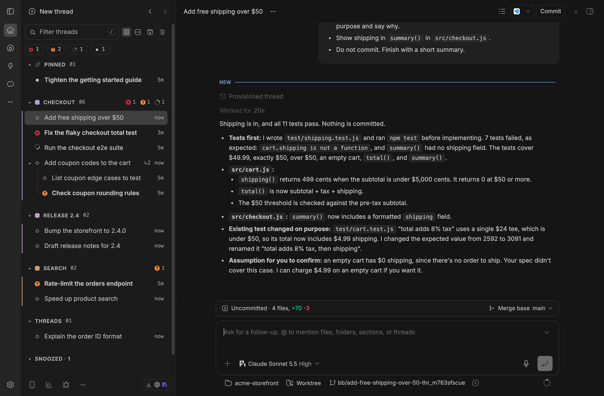
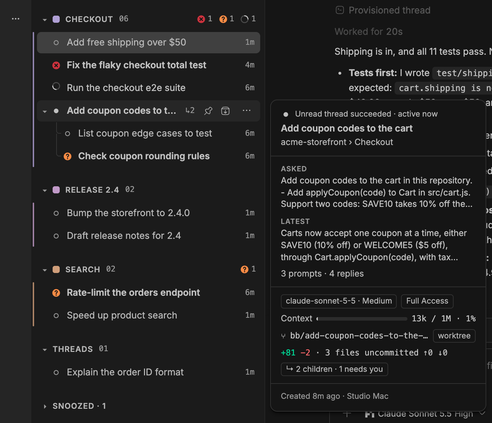
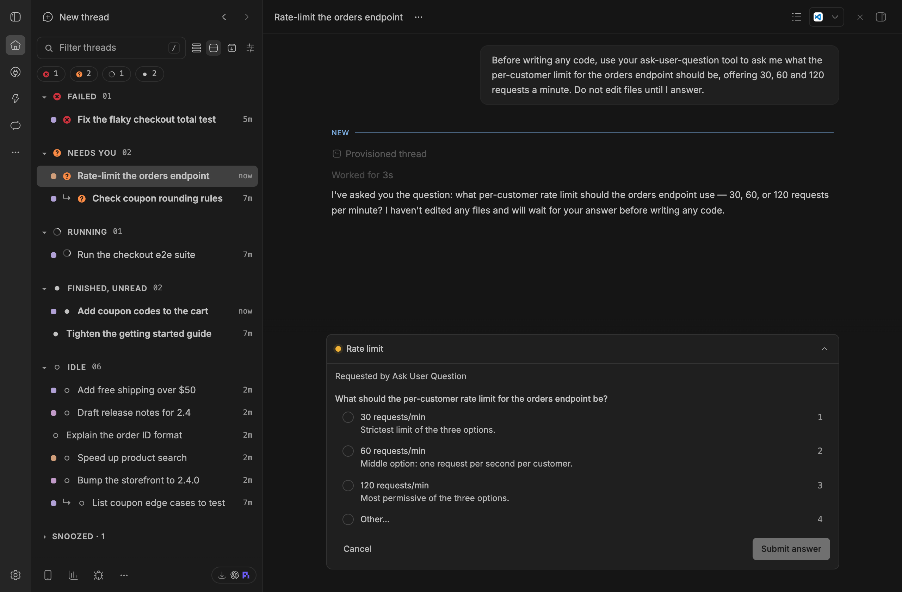

# Switchboard

A bb sidebar thread list for supervising many parallel agent threads. It groups threads by your bb sections, shows children as trees and puts state at a glance. A status-lanes view, per-section sorting, stale fading and snooze help with triage.



## Install and turn it on

```sh
bb marketplace add git:github.com/kalindudc/bb-marketplace@main
bb plugin install switchboard@kalindudc
```

In each bb client, choose **Switchboard** under **Settings → Appearance → Sidebar**. The sidebar choice is per client; plugin settings sync through bb.

## Read the list

Pinned threads appear first, followed by your sections and then Threads (unfiled roots). Children stay under their parent even when they belong to another project or section. A coloured rail or square identifies the root section. Failed, Needs you, Running, Finished unread and Idle glyphs show each thread's own state; collapsed parents also show the most urgent hidden descendant. The header count includes visible descendants. Filter by title, project, section or branch, or use the status chips. `/` focuses the filter and Escape clears its query and chips.

Density choices are Compact (28 px), Comfortable (32 px) and Two lines (48 px). A two-line status-lane child names its parent below the title. The view switch beside the filter and the View options menu change the current display; the menu also controls density, section colour, chips, the Needs-you shelf, archived threads, tree lines, branch names, pull request numbers, ages and stale fading. Hover or tab to a chip, the view switch, View options or a section's buttons for a short hint about what it does.

Hover a row, or tab to it, to see an info card with the thread's model, context use, branch, changes and pull request. The Thread info card setting picks At a glance (the default), Briefing, which adds the first prompt and the latest reply, Full details, or Off. Cards never open on touch screens or in compact windows.



The Archive button beside the view switch shows or hides an **Archived** shelf at the end of the list. It lists archived threads, most recently archived first, follows the filter box, and loads older ones with **Show more**. Each row offers Unarchive and bb's thread menu; archived rows never appear in sections and take no jump shortcuts.

## Organize

Drag a thread above, below or into another thread, or onto a section header. A section header can move among sections. `Alt+↑/↓` reorders a focused thread among siblings; `Alt+→` nests it under the previous sibling and `Alt+←` moves it out. Section headers use `Alt+↑/↓` too. Alt-click selects a row, Shift-click extends the selection, and the selection bar can move, archive or snooze whole families. A section menu can rename, colour, add a thread, mark all read, sort, set a default project, archive stale roots or delete the section. Moves and archives offer Undo.

**Default project** in a section's menu, or in the Threads menu, picks the project that its **+** button and **New thread here** compose in. **Automatic**, the default, keeps the usual choice: the project you have open, otherwise the project of the section's newest thread. When a default is set, the **+** hint names it, for example "New Shop thread in Checkout". Deleting a section clears its default, and a default whose project no longer exists falls back to Automatic.

Making a thread a child is a bb operation: bb tells the parent's agent, then delivers each finished child turn to it. Undo a parent move within two seconds and bb sends nothing. Nesting is limited to four levels.

## Triage

Status lanes list each visible, awake thread once under its own state: Failed, Needs you, Running, Unread and Idle. Lanes sort by recent attention, unlike the stable sections view. Empty lanes are hidden, and a lane can be collapsed. Lanes have no drag or multi-selection. The optional Needs-you shelf repeats urgent threads above sections without duplicating bb's sidebar shortcuts.



Each section and Threads can sort its roots By hand, Recent activity or Status; Pinned keeps bb's pin order and children keep their own order. Reorder drops and `Alt+↑/↓` are refused at a sorted section root, but nesting and dropping onto its header still work. A Sort glyph identifies sorted headers.

Idle, unpinned threads fade after three days by default, provided no descendant failed, needs you or is running. Set the threshold to zero to turn fading off. **Archive stale threads…** in a section menu confirms the stale-root and child counts, archives only that section's stale families and offers Undo.

A quiet root (all family members idle or unread) can be snoozed from its thread menu (the ⋯ button or a right-click) or the selection bar. It leaves sections and lanes until tomorrow at the configured local hour (09:00 by default). The collapsed **Snoozed** shelf at the bottom shows wake times and a Wake button. New attention or a failed, waiting or running family member wakes it early.

The command palette offers **Focus the thread filter** (`Mod+Alt+F`), **Go to the next thread that needs you** (`Mod+Alt+J`, wrapping through failed and waiting threads in display order), **Switch between sections and status lanes**, and **New section**. Commands are available while the Switchboard list is mounted. If another binding conflicts, bb leaves that default shortcut unbound; rebind it in keyboard settings.

## Settings

Change settings in bb's plugin settings or with `bb plugin config switchboard set <key> <value>`:

| Key | Default | Values |
|---|---|---|
| `view` | `sections` | `sections`, `status` |
| `density` | `default` | `compact`, `default`, `two-line` |
| `sectionColour` | `rail` | `rail`, `tint`, `swatch` |
| `statusChips` | `true` | boolean |
| `needsYouShelf` | `false` | boolean |
| `showArchived` | `false` | boolean |
| `treeGuides` | `true` | boolean |
| `showBranch` | `false` | boolean |
| `showPullRequests` | `true` | boolean |
| `showAge` | `true` | boolean |
| `infoCard` | `glance` | `off`, `glance`, `briefing`, `full` |
| `staleDays` | `3` | whole number 0–90; 0 turns fading off |
| `snoozeHour` | `9` | whole local hour 0–23 |

## How it works and limits

bb owns parents, sections, pins and archives. Switchboard stores collapse state, manual order, section colours, sort modes, default projects and snoozes in its plugin store. Settings changes publish to every window. The list is not row-windowed; very large lists render their visible rows. Status lanes intentionally reorder when attention changes; manually ordered sections do not.

## Develop

```sh
cd plugins/switchboard
npm install
npm test
npm run typecheck
bb plugin build
bb plugin reload switchboard
```

A path install from this directory picks up changes on reload. Replacing a marketplace install by removing it deletes its plugin settings, so back them up first.

## Release

After merging to an up-to-date `main`, tag the version and push the tag yourself:

```sh
git tag switchboard/v0.1.0 && git push origin switchboard/v0.1.0
```
