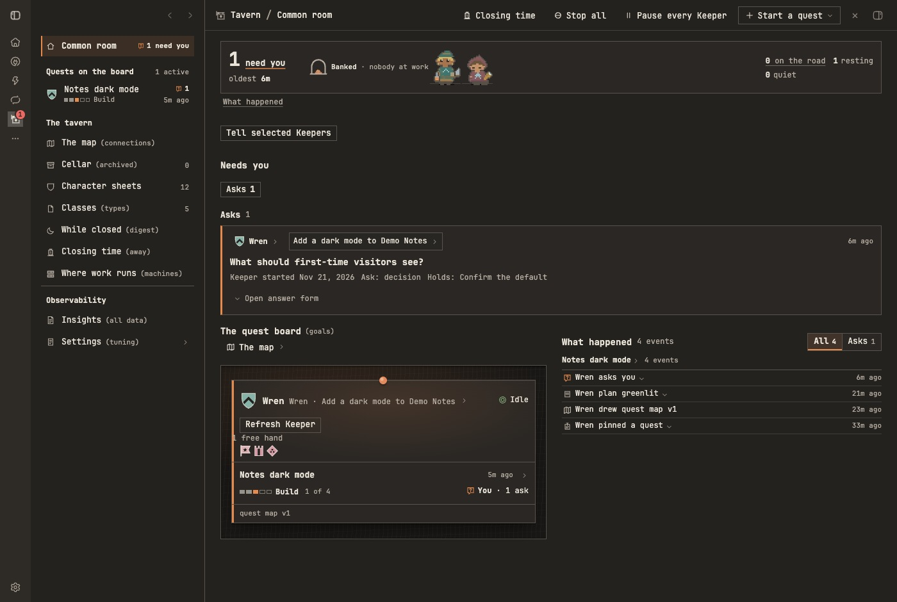

# Tavern

Hand a goal to one lead agent and keep every decision that matters. Tavern gives that lead—called a [Keeper](docs/design.md#the-keeper)—a plan, a team of specialist threads, and a recorded Ledger so you steer multi-agent work from one thread.

Every thread in bb also gets a [Journal](docs/design.md#the-journal): a checklist with steps, evidence, blockers, and grouped Undo, separate from your team's board quests.


## Install

```sh
bb marketplace add git:github.com/kalindudc/bb-marketplace@main
bb plugin install tavern@kalindudc
```

Requirements: bb 0.49 or newer (SDK 0.6.132 or newer), a configured model provider, and Git with bb's `git-worktree` environment provider. If you used `pi-quests`, disable it before enabling Tavern because both register the legacy `quest` tool name; Tavern imports old checklists automatically on first read.

For pre-execution guardrails on local Pi sessions, install Tavern's Pi guard shim from a terminal:

```sh
bb tavern guard install
bb tavern guard status
```

## Run your first quest

1. **Open Tavern** in bb's left navigation and choose **Start a quest**. Give your Keeper the goal, what done looks like, and any boundaries.
2. **Approve the plan.** The Keeper hires Rangers to scout, then proposes a quest map of deliverables (waypoints), check methods, and an optional spend cap. Explicit approval is the default before building starts.
3. **Steer from the same thread.** Keep talking to the Keeper, naming the quest if it holds more than one. Questions, asides, and standing rules stay separate from plan changes.
4. **Answer Needs you.** Handle open asks on the Common room, quest page, or composer widget, and open member reports in the side panel for evidence.
5. **Conclude and read the tale.** A quest never closes itself. Your answer to the Keeper's closing ask writes the tale and archives the party without committing, pushing, or merging for you.

> Scouting and coordination use model turns too. Set a spend budget on the quest or plan if you want Tavern to hold new hires at a dollar cap.



[See the full screenshot set](../../screenshots/tavern/).

## Guides

See the [documentation index](docs/README.md) for the user guides and contributor references in one place.

- [How Tavern works](docs/design.md) — architecture diagram, concepts, and end-to-end quest flow.
- [Quests, party, and characters](docs/quests-and-party.md) — steering, controls, budgets, delegation, Keeper chains, classes, and service records.
- [Safety and controls](docs/safety-and-controls.md) — scopes, Pi guard, send guard, cluster writes, `scopes.yml`, Closing time, and Stop all.
- [Machines and forges](docs/machines-and-forges.md) — machine rules, per-class models, clean Git snapshots, and draft pull requests from home.
- [Settings, memory, backups, and CLI](docs/settings-and-data.md) — Settings, guided setup, contextual speech, Durable memory, backups, and `bb tavern` commands.
- [Contributing and development](docs/contributing/development.md) — architecture layout, invariants, testing, SDK contracts, and open bb host requests.

## Current limits

- **Pre-execution prevention is Pi-only.** Claude Code and Codex run detection-only with explicit approval; Tavern can stop a violating turn after dispatch, never beforehand.
- **Placed members are detection-only under Tavern.** Machine placement currently executes only rules requesting a new machine with a dedicated checkout; other target shapes save and block hires with a reason.
- **Spend budgets count measured spend only.** Budgets count guarded local Pi receipts and Burn-reported sessions; uncovered remote sessions show as unknown, and already-admitted work can push spend past the cap.
- **Client attribution is shared in bb.** Because bb currently labels desktop, CLI, and unmarked client calls alike as `client`, receipts for page-only controls such as Resume note that Tavern cannot cryptographically prove a person clicked the button.
