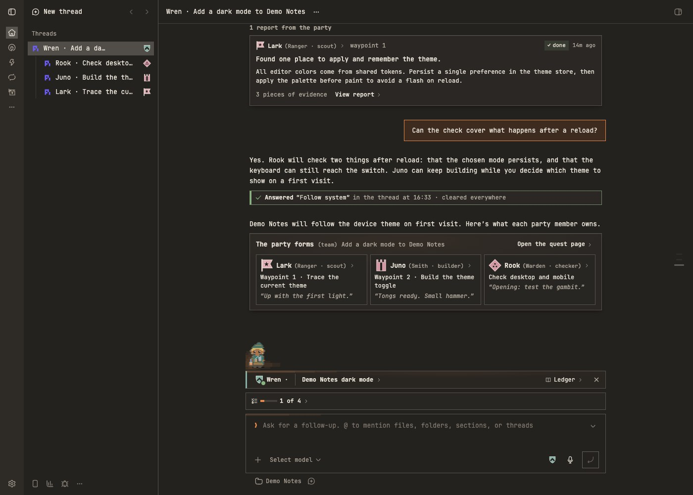

# Tavern

Hand a goal to a lead agent and keep the decisions. Tavern gives that lead—called a [Keeper](docs/glossary.md#keeper)—a plan, a team of specialist threads, and a recorded ledger so you can steer multi-agent work from one thread instead of relaying messages between agents.

Every thread in bb also gets a [journal](docs/glossary.md#journal): a checklist with steps, evidence, blockers, and grouped Undo, separate from your team's board quests.



## Install

```sh
bb marketplace add git:github.com/kalindudc/bb-marketplace@main
bb plugin install tavern@kalindudc
```

**Requirements:**
- bb 0.49 or newer (SDK 0.6.132 or newer).
- At least one configured provider offering the models you assign to Tavern classes.
- Git and bb's `git-worktree` environment provider for isolated builder checkouts.

If you used the legacy `pi-quests` plugin, disable it before enabling Tavern because both register the legacy `quest` tool name. Tavern imports old checklists automatically when it first reads them; restart open agent sessions to pick up the `journal` tool schema.

To enable pre-execution guardrails for local Pi sessions, install Tavern's Pi guard shim from a terminal:

```sh
bb tavern guard install
bb tavern guard status
```

## Run your first quest

1. **Open Tavern** from bb's left navigation and choose **Start a quest**. Send your goal in the Keeper thread it opens, including what a checked result looks like and anything the team must not do.
2. **Review and greenlight the plan.** The Keeper hires [Rangers](docs/glossary.md#ranger) to scout, then proposes a [quest map](docs/glossary.md#quest-map) with [waypoints](docs/glossary.md#waypoint), check methods, and optional spend budget. Explicit approval is the default before building begins.
3. **Steer from the same thread.** Keep talking to the Keeper. Name the quest if the Keeper holds more than one; quick questions, asides, and standing rules are tracked separately from plan changes.
4. **Watch Needs you and reports.** Answer asks on the Common room, quest page, or composer widget. Open a member's report in the side panel when you want its evidence.
5. **Conclude and read the tale.** A quest never concludes itself. When waypoints settle, the Keeper asks to conclude (or close early); your answer tells the [tale](docs/glossary.md#tale) with verified results, credits, and open pull requests, and archives the party. Returning a quest does not commit, push, or merge for you.

> Scouting and coordination consume model turns too. A plan waiting for approval has already used turns. Set a [spend budget](docs/quests-and-party.md#spend-and-review-budgets) on the quest or with the plan if you want Tavern to hold new hires at a dollar cap.


[See the full screenshot set](../../screenshots/tavern/).

## Control and safety at a glance

- **Scopes and guards:** Built-in presets constrain scouts, builders, and checkers. On macOS, local Pi bash calls run inside an OS sandbox; [consequential shell acts](docs/scopes.md#consequential-shell-acts-sends-and-cluster-writes), sends as you, and cluster writes are guarded separately.
- **Stop all and Pause:** Pull **Stop all** on the Common room (or `bb tavern stop-all`) to halt every live Keeper and member turn and hold new work across restarts until you Resume. Use **Pause every Keeper** to hold new Keeper work while running turns finish.
- **Closing time:** Step away with an away window that pauses quests or restricts guarded work to a temporary stop list and summarizes what happened when you return.
- **Separate machines and forges:** Add rules in **Settings → Where work runs** to place working members on dedicated machines through bb's providers and open draft pull requests from home.
- **Guided setup:** Open **Settings** and ask the setup agent to inspect your checkouts, providers, and models and propose a reviewed settings patch.

## Where to go next

See the [Documentation index](docs/README.md) for the full map, or jump straight to:

- [Glossary](docs/glossary.md) — every Tavern term defined once.
- [Quests, party and characters](docs/quests-and-party.md) — steering, lifecycle, budgets, delegation, Keeper refresh and chains, classes, and service records.
- [Scopes and guardrails](docs/scopes.md) — presets, modes, send guard, cluster writes, macOS Git sandbox, and `~/.agents/tavern/scopes.yml`.
- [Machines and snapshots](docs/machines-snapshots.md) and [Draft pull requests from home](docs/forges.md) — remote placement and forge profiles.
- [Closing time](docs/closing-time.md), [Stop all](docs/stop-all.md), [Backups](docs/backups.md), and [Settings and CLI](docs/settings-and-cli.md).

## Current limits

- **Pre-execution prevention is Pi-only.** Claude Code and Codex run detection-only with explicit approval; Tavern can stop a violating turn after the fact, not prevent a call before it runs.
- **Placed members are detection-only under Tavern.** Machine placement currently executes only rules that target a new machine with a dedicated checkout; other rule shapes save and block hires with a reason.
- **Spend budgets cover measured spend only.** Budgets count guarded local Pi cost receipts and Burn-reported sessions; uncovered remote sessions are reported as unknown, and already-admitted work can push total spend past the cap.
- **Classes are read-only in the UI.** Edit class definitions as Markdown files under `~/.agents/tavern/classes/` or `<project>/.agents/tavern/classes/`.
- **Client attribution is shared in bb.** Because bb currently labels the desktop app, CLI, and unmarked client calls alike as `client`, receipts for page-only controls such as Resume note that Tavern cannot cryptographically prove a person clicked the button.
