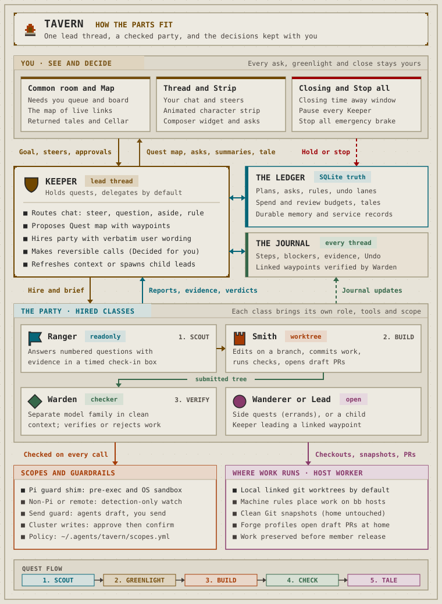

# How Tavern works

Tavern lets you hand a goal to one lead agent, called a Keeper, and keep every decision that matters. Instead of juggling several chat threads yourself, you talk to the Keeper. It scouts the problem, proposes a plan for your approval, hires specialist threads to build and check the work, and gathers questions for you in one place.

Every thread in bb also gets a Journal, which is a live checklist with steps, evidence, blockers, and Undo. The Journal works in plain threads too and stays separate from the team quests a Keeper runs.

<picture>
  <source media="(prefers-color-scheme: dark)" srcset="assets/tavern-architecture-dark.svg">
  <source media="(prefers-color-scheme: light)" srcset="assets/tavern-architecture-light.svg">
  
</picture>

## The Keeper

A Keeper is a lead thread that holds one or more goals for you. Keepers delegate by default and act directly only for tiny one-turn work or when you ask.

Before a Keeper acts on your message, Tavern routes it as a steer for a named quest, a quick question, an unrelated aside, a new quest, or a standing rule. Standing rules stay local to that Keeper unless you make them global. When a Keeper thread grows heavy, you can refresh it onto a fresh thread without losing its quests or open requests. For large tracks of work, a Keeper can also hire a child Keeper lead under shared team and spend limits.

## Members and classes

A class defines a thread's job, tools, and guardrails. Tavern ships five classes.

| Class | Plain role | Default scope | Job |
| --- | --- | --- | --- |
| Keeper | Lead | Open | Routes your chat, proposes plans, hires the party, and tracks decisions. |
| Ranger | Scout | Read-only | Answers numbered questions with evidence inside a timed check-in box. |
| Smith | Builder | Worktree | Edits on a branch in an isolated checkout, commits changes, runs checks, and opens draft pull requests. |
| Warden | Checker | Checker | Inspects a maker's deliverable in a clean context, prefers another model family, and verifies or rejects it. |
| Wanderer | General | Open when hired | Handles a bounded side quest or errand outside the full map-and-check flow. |

You can customize classes from the Classes page or through Markdown override files. Characters are separate from classes: a character supplies a name, pixel-art avatar, crest, and speech lines, never permissions or expertise.

## Quests and quest maps

A quest is a goal tracked on Tavern's board through scouting, approval, building, closing, and completion. Before planned building starts, the Keeper proposes a quest map naming what done means, the ordered deliverables called waypoints, who owns each one, and how each one is checked. Only a Warden verdict counts as verified work; Keeper reviews, outside gates, and report-only waypoints are labelled distinctly.

When a Keeper briefs a member, Tavern attaches your exact opening request and routed steers so builders and checkers read your literal words. A quest never closes itself: the Keeper asks to Conclude or Close early, and your answer writes the tale (verified results, open pull requests, and lasting character credits) and archives the party. Sending a finished quest to the Cellar archives it while preserving its history and credits.

## Asks and greenlights

An ask is a recorded request waiting in Needs you, answerable from the Common room, the quest page, or the widget above your composer. Explicit plan approval, called a greenlight, is the default before building begins. Consequential acts such as merges, deployments, deletes, credentials, production writes, and messages sent as you never default on a timer.

Reversible calls inside approved work appear in Decided for you, each with Undo. If you undo two of a Keeper's last ten calls of the same kind, Tavern pauses that Keeper's autonomy for that kind until you reset the lane in the Ledger.

## The journal

Every bb thread gets a Journal in its context row and Journal side tab. Threads use it to track deliverables, steps, blockers, and observed evidence with grouped Undo. When a Keeper assigns a waypoint, Tavern links the matching Journal entry to that board quest. Linked entries require evidence before finishing, and only the assigned Warden can verify or reject them.

## Scopes and guardrails

Scopes constrain tools, file writes, shell commands, consequential shell acts, messages sent as you, and cluster writes. You can set ordinary enforcement to Enforce, Watch, or Off, while three boundaries always stay on: agents cannot send as you, scoped shells cannot run user-only Tavern controls, and party members cannot spawn or archive threads.

Local Pi sessions with Tavern's guard shim prevent supported violations before execution, and on macOS run bash inside an operating-system sandbox. Claude Code, Codex, and placed remote members run detection-only: a watcher stops a turn after it starts, not beforehand. Blocked external sends become drafts so you remain the sender, and cluster writes such as Kubernetes or Terraform mutations always require your approval followed by a separate immediate confirmation.

## Closing time and Stop all

Closing time is an away window for stepping away from your desk. Per quest, you choose Drafts-ready (allow locally guarded work under a temporary stop list) or Pause (interrupt members and hold new work). Returning happens only when you click Return, send a message, or answer an ask, and gives you a digest of what happened while away.

Stop all is the emergency brake on the Common room and in the terminal. It sends a stop to every live Keeper and member, including remote machines, and holds new work across restarts until you press Resume. Pause every Keeper is gentler: running turns finish while new Keeper ticks wait.

## Where work runs

Smiths edit locally in linked Git worktrees by default. Machine rules in Settings under Where work runs can instead place newly hired members onto dedicated machines through bb's providers, with optional per-class model overrides.

Tavern moves source code through clean Git snapshots without touching your local working tree, index, or branches. Before a Warden checks a placed Smith, Tavern carries the Smith's submitted tree onto the Warden's own machine. Before a placed member is released, Tavern saves its checkout state and evidence back home. Forge profiles let placed Smiths open draft pull requests through your home machine without putting credentials on remote hosts.

## The Ledger, memory, and service records

The Ledger is Tavern's SQLite database and the single source of truth for every Keeper. When chat compacts, Tavern re-anchors Keepers from the Ledger, and the Ledger tab shows the same quests, asks, rules, decisions, and guardrails.

Tavern also keeps Durable memory for project notes that outlive a single quest (built-in by default, or connected to an external note store) and lasting Service records that track each character's verified work across returned quests.

## The Common room, The map, and the strip

- **The Common room** is Tavern's home page: a live hearth, a summary of what changed since your last visit, the Needs you queue, Decided for you, the review queue, and all active and returned quests.
- **The map** shows live connections across four columns (Keepers, Quests, Party and asks, and Waiting on) so you can trace any quest at a glance.
- **The character strip and widget** sit above your chat composer. The strip shows quest work as a road with stops where characters work and wait. The widget gives you live quest controls.

## How a goal flows through Tavern

1. **Start a quest.** You describe a goal, what done looks like, and any boundaries in a Keeper thread.
2. **Scout.** The Keeper hires Rangers under a read-only scope to answer bounded questions with evidence.
3. **Greenlight.** The Keeper proposes a quest map of waypoints, check methods, and any spend budget; you approve it in Needs you or above the composer.
4. **Build.** The Keeper briefs a Smith with your verbatim words in a local worktree or placed machine. The Smith commits changes, runs tests, updates its linked Journal entry, and opens a draft pull request if needed.
5. **Steer.** Any new requirement you send in chat routes as a steer and flags outdated member briefs until re-briefed.
6. **Verify.** A Warden in a clean context, preferring another model family, re-runs checks on the submitted tree and verifies or rejects the linked Journal entry.
7. **Conclude.** Once waypoints settle, the Keeper asks to Conclude. Your answer writes the tale, records character credits, and archives the party without committing, pushing, or merging for you.
