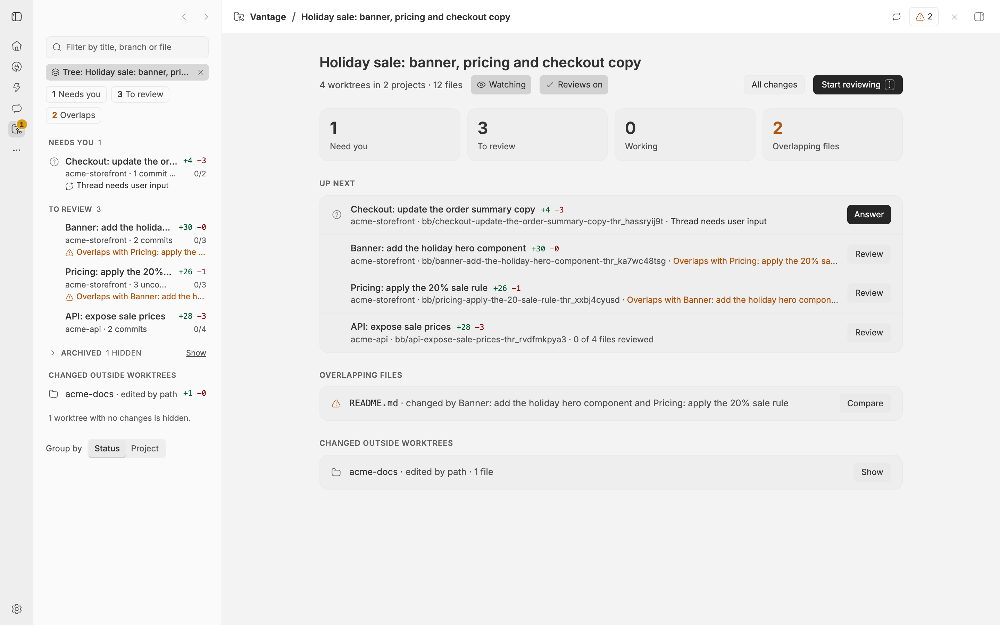
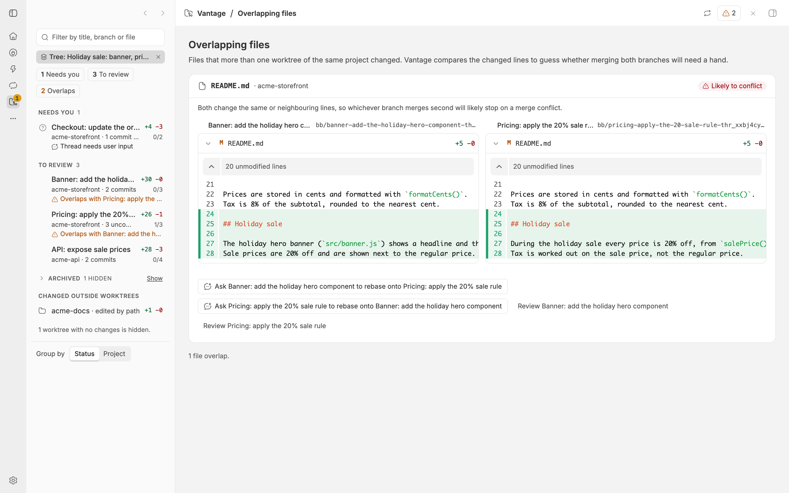
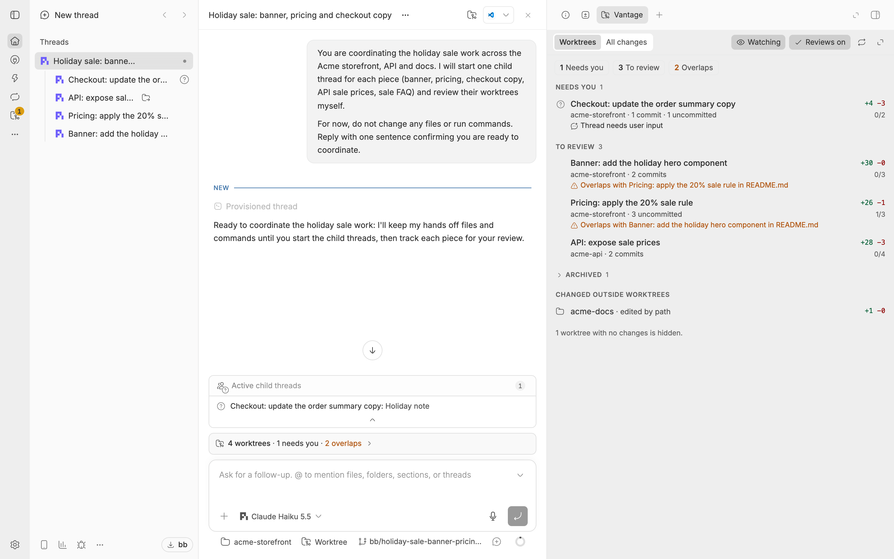

# Vantage

A bb plugin for a parent thread that runs many agents at once. It shows every
worktree your agents work in, lets you read and review what each one changed,
and sends your review comments back to the agent that made the change. It
also shows everything a thread tree changed in other repositories, and warns
you when two worktrees change the same file.

Vantage has two places:

- **The Vantage page** in bb's left navigation (the folder icon). It covers
  every thread active in the last 24 hours, or one thread's tree, and is where
  you review diffs. See [The Vantage page](#the-vantage-page).
- **Inside a thread**: a Vantage tab in the side panel, a one-line summary
  above the composer, a Worktrees section in the Info tab, and two entries in
  the thread menu. See [Inside a thread](#inside-a-thread).

Vantage is quiet by default. It does not tell you that a worktree needs you
until you watch its thread, and it does not track reviewed files until you
turn reviews on. Diffs and file lists work for every thread either way. See
[Watching and reviews](#watching-and-reviews).

## The Vantage page


Click Vantage in bb's left navigation to open the page. While it is open, its
worktree list takes the place of bb's thread list, so the page itself keeps its
whole width for diffs. bb's title bar names where you are, such as
"Holiday sale / Pricing: apply the 20% sale rule", and each part links back.
On its right sit the Refresh button (point at it to see when the data was
read) and, when files overlap, a button with the number of overlapping
worktrees.

### The worktree list

- **Search** matches thread titles, project names, branches, folders and file
  paths.
- **The scope** reads "All threads · last 24 h" or "Tree: <thread>". A tree's
  × shows every thread again.
- **Chips** filter the list to one kind of worktree: Needs you, To review,
  Working or Overlaps. A chip shows only when something matches it.
- **Rows** are grouped by what you need to do next: Needs you, To review,
  Changed, Working, Reviewed, then Archived, which starts folded. "Group by
  Project" at the bottom groups them by project instead. A row shows the
  thread, its line counts, its project, its commits or uncommitted files, its
  pull request, and, when files are reviewed, how many. A third line says why
  the row matters, such as "Overlaps with Banner in README.md".
- **Changed outside worktrees** lists repositories an agent edited by path and
  files outside any repository. A row opens them in All changes.
- Worktrees with no changes are left out; a line at the bottom counts them.
  Archived threads are left out of the page until you press Show next to
  Archived, and Hide archived at the bottom leaves them out again.

### The overview



With no worktree selected, the page answers "what should I look at next?":
counts of what is waiting, then an Up next list with a button on each row
(Review, Open, or Answer for a watched thread that asks you something), then
what is still working, overlapping files, reviewed worktrees and changes
outside worktrees. On a thread's tree it also has the Watch and Track reviews
buttons for that tree.

### Reviewing a worktree

Select a row to open its worktree.

- **The header** has the thread's title and state, its project, branch (with a
  copy button), how far it is behind its base branch, its pull request and
  machine, and its actions: Message agent (Answer when a watched thread waits
  for you), Open thread, Terminal, Copy path and bb's own thread menu.
  `[` and `]`, or the arrows, step to the previous and next worktree.
- **Strips** under the header say what you should know: the agent is waiting
  for you or its last turn failed (watched threads only, with Answer, Retry and
  Message agent), it is still working, it is archived, or a file is also
  changed in another worktree, with Compare and "Ask to rebase onto …".
- **One switch** chooses which changes you read: All changes, Not committed,
  Committed, or one commit from the Commits menu.
- **The file tree** on the left lists every file with its status letter, line
  counts, an overlap mark and its number of comments. Click a file to jump to
  it. The list button hides it.
- **Every diff is in one stream**, each file with a header that stays in view.
  Diffs are unified or side by side (the two buttons at the right), and
  "unchanged lines" between the changes expand to show the rest of the file.
  The chevron folds one file away; Collapse all folds every file at once, and
  Expand all opens them all again.
- `J` and `K` step through the files, `C` comments on the current file, `X`
  collapses or expands every file, and `Escape` goes back to the overview.

### Comments

The comment button on a file opens a box for a comment. Select lines in the
diff first to quote them. Comments are drafts kept on this device and listed
under their file, where you can edit or remove them. Once there is one, a bar
at the bottom collects them: Preview shows the exact message, and Send to
agent sends every comment as one message to the worktree's thread, which then
opens in the Agent tab. While the agent works, the button reads "Queue for
agent", and the message waits for its current turn. Its menu has Send now
(added to the running turn), Queue after its current turn, and Copy as
Markdown. `⌘↵` sends.

### The Agent tab

The page's right panel has an Agent tab next to bb's Terminal and Browser
tabs. It shows the selected worktree's conversation in bb's own chat, where you
can answer a question or steer the agent. A worktree several threads share has
a chip for each.

### Overlapping files



The overlaps page lists every file that more than one worktree of a project
changed. Each card shows both changes side by side and Vantage's guess at what
merging both branches will do: "Likely to conflict" when the two change the
same or neighbouring lines, or "Should merge cleanly". This is a guess made
from the changed line ranges, not a real merge. "Ask <agent> to rebase onto
<other>" writes a comment for that worktree and opens it, ready to send.

### All changes

All changes lists every change the threads made, grouped by repository: thread
workspaces, checkouts agents work in or edited by path, archived branches, and
the recorded edits of files outside any repository. Switch between Not
committed and Since the base branch, and fold every file with Collapse all
(or `X`), then open them again with Expand all. A
repository an agent only edited by path lists the files the agents edited
first, and keeps the repository's other changes under a folded line.

### Addresses

Every view has its own address, so back, forward and links work:

| Address after `/plugins/vantage/vantage/` | Shows |
| --- | --- |
| (nothing) | every thread, the overview |
| `worktree/<key>` | every thread, one worktree |
| `changes` | every thread, All changes |
| `changes/repo/<key>` | All changes for one repository |
| `changes/other-files` | All changes for files outside any repository |
| `overlaps` | every thread, the overlapping files |
| `tree/<thread id>` | only that thread's tree, with any of the above after it |

An address from 0.5 or earlier that says `repositories` opens All changes. A
part that is not valid is dropped and the address is corrected. A worktree or
repository key is written with letters, digits, `.`, `_`, `-` and `~XX` for any
other byte (a `:` is `~3A`, a `/` is `~2F`), because bb encodes each address
segment a second time and its router would otherwise alter a percent-encoded
key.

The time window and the number of threads are Vantage's settings: "Time window
for the full-screen page (hours)" from 1 to 720, default 24, and "Most threads
on the full-screen page" from 10 to 500, default 200. When more threads match
than the limit, the page says so.

## Inside a thread



- **The Vantage tab** opens from the thread header's folder button, the palette
  ("Vantage: Show changes across repositories") or the side panel's tab
  launcher. Worktrees lists the thread's own checkout ("This thread") and its
  child threads' worktrees, grouped like the page. Select one to review it in
  the tab, with the same switch, diffs, reviewed ticks and comments, and Chat to
  talk to its agent. All changes shows everything the tree changed, by
  repository. The header has Watch and Track reviews for this thread, Refresh
  and Open full screen, which opens the page on this thread's tree.
- **Above the composer**, one line sums up the child threads' worktrees, such
  as "4 worktrees · 1 needs you · 2 overlaps". It shows only once a child
  thread has changed something, and it stays one line until you click it; then
  it lists the worktrees, with Watch, Track reviews and Open Vantage. Clicking a
  worktree opens it in the Vantage tab.
- **The Info tab** has a Worktrees section with the first three child
  worktrees and why each matters.
- **The thread menu** (in the header, on the sidebar row and on its right-click
  menu) has "Review changes in Vantage", which opens the page on that thread's
  tree, and a Vantage entry with Watch worktrees and Track reviews.

## Watching and reviews

Both are off by default, and both are chosen per thread. A choice on a thread
covers its child threads too, and a child can make its own choice. A thread
that has made none follows its nearest ancestor that has, and then the
setting.

**Watching** decides whether Vantage tells you a worktree needs you. For a
watched thread that waits for your answer or whose last turn failed, Vantage
files its worktree under Needs you, shows bb's status mark for it, counts it
in the composer summary, the Info section and the badge on the Vantage icon in
bb's navigation, and shows a toast when it starts waiting (unless you are
looking at that thread). An unwatched thread shows none of this: its worktree
sits under Changed or Working, with no status mark beyond "working". bb's own
notifications for the thread are not affected.

**Reviews** decide whether diffs carry reviewed ticks. With reviews on, each
file has a Reviewed button (`V`), a reviewed file folds away, the bar shows
"3 of 5 reviewed" with a Hide reviewed switch, and the list shows each
worktree's progress and files it under To review or Reviewed. A file that
changes after you tick it shows "Changed" until you tick it again. With reviews
off, the same diffs show without any of that.

Turn them on or off with Watch and Track reviews on the page's overview of a
tree, in a thread's Vantage tab, in the summary above the composer or in the
thread menu. In a worktree's bar, Track reviews changes the choice where it
was made, or the tree's top thread when no thread in it has chosen.
Two settings in Vantage's plugin settings change the default for every thread:
"Watch every thread's worktrees" and "Track reviews in every thread". A thread
you turned off stays off when you turn a default on.

## Loading and archived threads

The page and the tab paint every worktree row at once, with grey placeholders
where the line counts and files will be, and fill them in when git has
answered. A first, quick `shell` request draws the rows in about a tenth of a
second; the full `overview` follows. Later refreshes (an agent's edit, a
workspace change, every 60 seconds while the page is visible, and the Refresh
button) ask for the overview only.

The page starts without archived threads, because most of a busy page is
finished work; Show next to Archived adds them below the active ones without
moving the active rows. The thread tab includes its archived children. Each
choice is remembered on this device (`bb-plugin-vantage:page-archived` and
`bb-plugin-vantage:panel-archived`).

## For agents

```sh
bb vantage worktrees                  # one row per worktree of the current thread's tree
bb vantage worktrees --thread <id>    # another thread's tree
bb vantage worktrees --json
bb vantage worktree <thread>          # that thread's worktree: files and commits
bb vantage worktree <thread> --json
bb vantage changes                    # All changes, as text
bb vantage changes --thread <id>      # another thread
bb vantage changes --scope branch     # everything since the base branch
bb vantage changes --json             # the full overview
bb vantage worktrees --all            # every thread active in the window, by project
bb vantage changes --all --hours 6    # the last 6 hours instead of the setting
bb vantage worktrees --all --archived # include archived threads, which --all hides
```

`--all` reads the same threads as the Vantage page. It cannot be used with
`--thread` (error code `target_conflict`). `--hours <n>` (1 to 720) overrides
the window for that call and needs `--all` (error code `hours_requires_all`).
`--all` leaves archived threads out, like the page; add `--archived` to include
them. `--archived` needs `--all` (error code `archived_requires_all`), because a
thread's own tree always includes its archived children. When threads were left
out, the text output ends with `N archived threads hidden (use --archived)`.
Without `--all` and without a thread, the commands fail with `thread_required`.
With `--all`, the text output puts a project heading above each group of
repositories or worktrees, for example `Shop · 2 worktrees`.

`worktrees` prints the columns STATUS, THREAD (cut at 30 characters),
AHEAD/BEHIND, UNCOMMITTED and BRANCH, then the files changed in more than one
worktree. The status is `archived`, `unavailable`, `running`, `failed` or the
thread's own status. A worktree on its base branch reads `on base` under
AHEAD/BEHIND, and a branch cell such as `main · 3 commits by its threads`
counts the commits its threads made there. `worktree <thread>` reads the whole
tree the thread belongs to and prints each worktree the thread works in, its own
workspace first and then any thread checkout: at most 50 uncommitted and 50
committed files, then `… N more`, and at most 20 commits. A worktree on its base
branch prints `on main, its base branch` in its heading, then `Commits its
threads made on main (N)`, or a line saying none were found.

`worktrees --json` prints `{ threadId, target, windowHours, threads, archivedHidden, worktrees, sharedFiles }`.
`archivedHidden` is how many archived threads matched and were left out (0 with
`--archived` and for a thread's tree). `changes --json` also carries `partial`,
which is true only in the page's instant outline and so is false on the command line.
`target` is `{ "kind": "tree", "threadId": … }` or `{ "kind": "all" }`; for `--all`,
`threadId` is empty and `windowHours` says how far back it looked (null for a
thread's tree). Each thread has a `rootThreadId`, the top of its tree among the
threads read.
Each worktree has `key`, `threadIds`, `state` (`ready`, `unavailable`, or `loading` in the instant outline),
`message`, `branch`, `base`, `kind` (`workspace`, `branch` or `checkout`), `aheadCount`,
`behindCount`, `uncommitted`, `committed`, `commits`, `onBase` (its branch is
its base branch, or that branch on a remote) and `threadCommits` (the commits its
threads made that are not ahead of the base, newest first); `sharedFiles` lists
`path` and `worktreeKeys`. `worktree <thread> --json` prints one worktree object:
the thread's own workspace when it has one. A thread checkout's `ref` is
`{ "kind": "checkout", …, "worked": true }` in both the worktree and the repository.

The text output of `changes` lists each repository with its kind, branch,
totals and the titles of the threads that touched it, then `N commits by its
threads on main` with up to five of them, then at most 50 files and a `… N more`
line, then other files and warnings. `changes --json` prints the overview; the
fields agents read are `repos[].label`, `repos[].projectId`, `ref.kind`, `branch`,
`files`, `otherFiles`, `threadCommits`, `threadIds` and `state`, plus the `worktrees` and
`sharedFiles` above. The bundled skill (`skills/vantage`) describes them. All
the commands keep their output under bb's limit by cutting files from the end.

## Install

```sh
bb marketplace add git:github.com/kalindudc/bb-marketplace@main
bb plugin install vantage@kalindudc
```

## How it works

Vantage never stages, commits or changes a file. What it writes is your own
state: watch and review choices and reviewed marks, in Vantage's plugin
storage, and comment drafts, in this browser's storage. Sending comments starts
or steers a turn of the worktree's thread, as typing them into its chat would.

- The thread tree comes from `threads.get` and `threads.experimental_listDescendants`.
- Each worktree's branch, commits ahead and behind, and uncommitted and
  committed files come from one `environments.status` call, which All changes
  reuses for the same workspace's uncommitted files. The
  Branch scope and a commit's files use `environments.diffFiles`, and diffs use
  `diffPatch`. For an untracked file the status reports the same line counts as
  `diffFiles`; it does not flag a file as too large and does not name a renamed
  file's old path. An archived child's branch gets its numbers from one git
  range call on the host, shared by both views.
- The instant outline is built from the thread, environment, project and
  machine lists alone. It makes no git, status, diff or event call.
- A row's status and title come from the data bb's own sidebar already loads,
  so they cost no extra requests. Its pull request comes from bb's GitHub PR
  Status plugin (`pullRequests`, keyed by environment), which re-checks a row
  only while it is on screen.
- The expandable context comes from a `fileSides` call: both whole sides of
  one file, read with `environments.diffFile` for a workspace bb manages and
  with `git cat-file` on the host for everything else. A side over 1 MiB, a
  binary file and a symlink come back empty, and the diff then shows its
  changes without expanding.
- Watch and review choices are stored per thread, and reviewed marks per
  worktree, in `bb.storage.kv`. A mark is the file's status and line counts
  when you ticked it. The `prefs` and `reviewed` reads are tagged, so a change
  made in one window, or a changed default, refreshes every other window.
- Other checkouts and archived branches are read by a host entry (`host.ts`),
  plugin code that bb runs on the machine that owns the repository. It runs
  `git` with `GIT_OPTIONAL_LOCKS=0`, so it never takes the index lock that
  agents running git need, and it checks every path and ref before use.
- Edits made outside a workspace come from each thread's recorded `fileChange`
  events. The server keeps an in-memory index per thread and reads only new
  events on each refresh.
- A thread checkout is found from the thread's own commands. Every `cd`,
  `pushd` or `git -C` with an absolute or `~/` folder in a recorded command is
  noted, the 32 most recent per thread, as the index reads the events it
  already reads. Only a thread that edited a file outside its own workspace has
  those folders looked up (the host expands `~/` itself), and a checkout
  becomes a thread checkout when the same thread both edited a file in it and
  ran commands in it. One `checkoutStatus` host call reads its branch,
  uncommitted and committed files, commits ahead and behind and the commit
  list; the worktree row and All changes share it through the
  60-second cache. A checkout only edited by path keeps the cheaper
  uncommitted-only call, and the instant outline shows a thread checkout's row
  when earlier loads already know the edits and the roots.
- The commits a thread made on its base branch come from its commands and the
  checkout's reflog. The event index also notes when each `git commit`
  command started and finished, from the `item/started` and `item/completed`
  events it reads; one still running lasts
  until now, and one in a stopped thread until its last event. For a ready
  workspace or thread checkout with no commits ahead whose threads ran such a
  command, one `threadCommits` host call reads the HEAD reflog (`git log -g`,
  the last 5,000 entries), keeps the `commit`, `commit (amend)`, `commit
  (initial)` and `commit (merge)` entries made within two seconds of one of
  those spans, and drops any that `merge-base --is-ancestor` says are no longer
  on HEAD, such as an amended commit. Pulls, merges and rebases are never
  counted. The result shares the 60-second cache, keyed by the spans.
- bb's status call can take more than 30 seconds, and time out, on a
  repository that is far behind its base branch. Vantage waits 10 seconds for
  bb's status or Branch-scope diff. When bb has not answered by then, Vantage
  reads that workspace with the same `checkoutStatus` host call as a thread
  checkout, which took under a second on a repository 110,000 commits behind,
  and keeps reading it, its diffs and its commit files with git on its machine
  until the server restarts. Git gives the same numbers, so the workspace is
  not handed back to bb.
- A workspace whose folder is below its repository root, such as an
  environment in a subfolder of a large repository, is grouped under that
  root and read the same way, because bb's diff calls return empty patches
  for it. Its file links open the file by its full path.
- A workspace read with git has `root` and `hostId` in its `ref`. bb's
  workspace events still refresh it. When an environment below the root and
  one at the root share a repository, the one at the root speaks for the row.
- To place a path in a repository, the host asks git itself
  (`rev-parse --show-toplevel --show-prefix`) instead of comparing path
  prefixes, so `/tmp` and `/private/tmp` agree on macOS.
- The thread tab refreshes on bb's thread, environment and connection events,
  with at most one request at a time and 1.5 seconds between requests. The
  page, its sidebar, its title bar and its Agent tab share one store, and so do
  a thread's tab, composer summary and Info section; a store lingers 30
  seconds after its last reader closes, so moving between views does not load
  everything again.
- The Vantage page asks for every thread with `threads.list`, 100 at a
  time (up to 1,000 active and 500 archived threads), and keeps those active in
  the window, running, or archived in it. It builds the same overview as a
  tree, over that set of threads, with each repository's git result and each
  worktree's status in a 60-second cache that thread events and environment
  events clear. Concurrent requests share one build for each scope and archived
  choice. Its store follows every thread's file changes, at most one request per
  5 seconds.
- In the thread tab, Terminal creates a terminal scoped to the parent
  thread, because bb shows a thread only its own terminals, and starts
  `cd <folder> && exec $SHELL -l` in it. On the page, which belongs to no
  thread, it creates a terminal scoped to the worktree's environment, which
  opens in the worktree's folder.

## Limits

- At most 500 files per repository or worktree list, 100 commits per worktree,
  200 shared files, 200 other files and 200 threads in a tree; patches are cut
  at 1 MiB and recorded diffs at 60,000 characters. The Vantage page reads
  at most the thread limit setting (200 by default, 500 at most).
- The Vantage page can show a repository up to 60 seconds late if bb does
  not report a change that no agent made, such as a file you edit by hand; its
  60-second refresh and the Refresh button bring it up to date.
- When a child is archived, bb keeps its worktree on disk for about five
  minutes. Vantage lists it as a worktree (marked archived) during that time,
  then as the kept branch. Uncommitted work is removed with the worktree, so
  only committed work remains.
- A branch that no longer exists is not a worktree, so it is not listed; its
  recorded edits show in All changes.
- Titles and statuses come from bb's sidebar. A thread bb does not list in it
  (a hidden one, such as a study's worker, or an archived page that was not
  loaded) shows the title the thread tree gave it, and is marked running only
  when its status says so; other states (needs you, failed) are not known.
- Edits are found from recorded file edits and, for thread checkouts, from
  git. A checkout becomes a thread checkout only when one thread both edited a
  file in it and changed into it with `cd`, `pushd` or `git -C` and an
  absolute or `~/` folder; a relative `cd`, a folder in a variable and a
  checkout only reached by a shell script are not seen. Shell-only work in a
  repository the thread never edited is still missed.
- A thread checkout is compared with `origin/HEAD`; without one it shows its
  uncommitted files only.
- The commits a thread made on its base branch are matched by time. A commit
  someone else makes in the same checkout while one of the thread's commit
  commands runs is counted as the thread's. A commit made by any command other
  than `git commit`, such as a script or a release tool, is not found. A commit
  made on another branch, or no longer on HEAD, is not listed.
- An archived child's branch is read from the project checkout, which is where
  bb's git-worktree provider leaves it. When the project's folder is not a
  repository, or the project has none, it is read in the folder the thread
  ran in, which some environment providers leave in place when they remove
  the environment. When the branch no longer exists, Vantage shows the
  recorded edits instead. An archived thread shows only its committed work,
  even when its folder, and any uncommitted change in it, is still on disk.
- Git must be installed on the machine that owns each repository.
- A comment is about a file, optionally quoting lines you selected. bb's diff
  viewer does not tell a plugin which line was clicked, so there are no
  comments on a single line.
- A reviewed mark is the file's status and line counts. An edit made after the
  tick that leaves both counts the same is not noticed, so the file stays
  reviewed.
- Expanding unchanged lines needs both whole sides of the file to match the
  diff. A checkout read with git gives the file as it is on disk, so with
  `core.autocrlf` or Git LFS the sides may not match and the diff then shows
  only its changes.
- "Likely to conflict" and "Should merge cleanly" are guesses from the line
  ranges each change touches, not a real merge.
- Comment drafts are kept in the browser's storage, so they stay on the device
  you wrote them on.
- The toast for a watched thread that starts waiting for you shows in every
  open bb window.

## Changes

- **0.6.0**: a page built for reviewing. The worktree list replaces bb's
  thread list while the page is open and groups worktrees by what you need to
  do; one switch chooses all, uncommitted, committed or one commit's changes;
  every diff is in one stream with a file tree, side-by-side view,
  expandable context, and Collapse all and Expand all (`X`); comments on files go to the agent as one message; the
  agent's chat is in the page's Agent tab; an overlaps page guesses whether two
  worktrees will conflict; the Repositories view is now All changes. Watching
  (needs-you signals, the navigation badge and toasts) and reviews (reviewed
  ticks and progress) are both opt in per thread, with a setting for each
  default. In a thread: the tab gains All changes and Watch and Track reviews,
  a collapsible one-line summary sits above the composer once a child thread
  has changes, the Info tab has a Worktrees section, and the thread menu has
  "Review changes in Vantage" and Vantage's watch and review choices. Pull
  requests come from bb's GitHub PR Status plugin. Needs bb 0.47.
- **0.5.0**: a worktree on its base branch, such as a thread working on `main`
  in the project checkout, reads "on base" instead of ↑0 ↓0 and lists the
  commits its threads made there with `git commit`, found in the checkout's
  reflog. The worktree's Commits tab, `bb
  vantage worktree`, `bb vantage worktrees` and the Repositories view show
  them, and the JSON has `onBase` and `threadCommits`.
- **0.4.3**: the bundled `vantage` skill loads. The manifest listed the
  skill's own folder, which bb reads as a folder of skills and so found none;
  it now lists `./skills`.
- **0.4.1**: an archived thread's branch is read in the folder it ran in when
  its project's folder is not a repository, or the project has none, instead
  of showing as unavailable or as recorded edits only. A workspace that bb's
  status does not answer within 10 seconds, and a workspace whose folder is
  below its repository root, are read with git at the repository root, like a
  thread checkout: bb's status can time out on a repository far behind its
  base, and bb returns empty diffs for a folder below the root.
- **0.4.0**: a checkout a thread made outside bb and works in, such as a clone
  it made with a shell command, gets a worktree row with its branch, commits ahead and behind, commits
  and every uncommitted and committed change, including changes made by shell
  commands; the Repositories view lists all of its changes as a "Thread
  checkout"; its terminal on the page opens in its folder; committed diffs and
  commit files work for any checkout; `bb vantage worktree <thread>` prints
  every worktree the thread is in.
- **0.3.2**: clicking a row under "Changed outside worktrees", or switching to
  Repositories with a worktree open, shows only that repository (or only the
  other files) instead of every one, with an "Only …" chip that clears the
  filter; the page keeps the filter in its address.
- **0.3.1**: "Show archived" becomes an "Include archived (N)" checkbox;
  switching it keeps the active rows and their numbers on screen and adds or
  removes only archived rows, which are listed after the active ones; the
  summary line counts archived workspaces; active threads come first under
  the thread limit.
- **0.3.0**: the side tab and the page paint worktree rows and repository
  headers at once from a quick `shell` request, with placeholders for the git
  numbers; the full-screen page hides archived threads until "Show archived"
  is pressed (the side tab shows them and has the same button); a workspace's
  git status and a branch's range are read once for both views and start
  earlier; git roots are cached for 10 minutes; a thread's own tree uses the
  60-second cache; `bb vantage changes|worktrees --all --archived`.
- **0.2.0**: a full-screen Vantage page in bb's left navigation for every
  recent thread, with project, text and changes-only filters, addresses for
  every view, an "Open full screen" button in the side panel, the time window
  and thread limit settings, a 60-second repository cache, and
  `bb vantage changes --all` and `bb vantage worktrees --all` with `--hours`.
- **0.1.0**: the side-panel tab with the Worktrees and Repositories views, the
  thread-header button and `bb vantage changes`, `worktrees` and `worktree`.

## Develop

```sh
cd plugins/vantage
npm install
npm test
npm run typecheck
npm run build    # bb plugin build
```

With explicit permission to change the local bb plugin installation, a
working copy can be installed and reloaded from this directory:

```sh
bb plugin remove vantage
bb plugin install "path:$PWD" --yes
bb plugin reload vantage
```

## Release

After review, bump the package version, merge to an up-to-date `main`, and
tag that version. This release uses:

```sh
git tag vantage/v0.6.0 && git push origin vantage/v0.6.0
```
