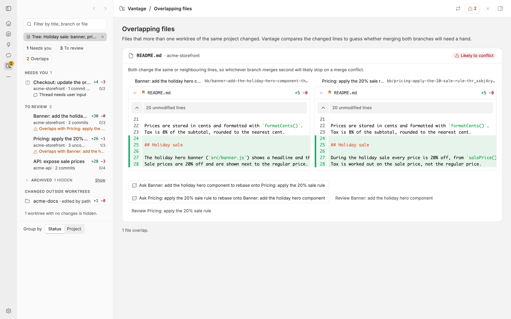
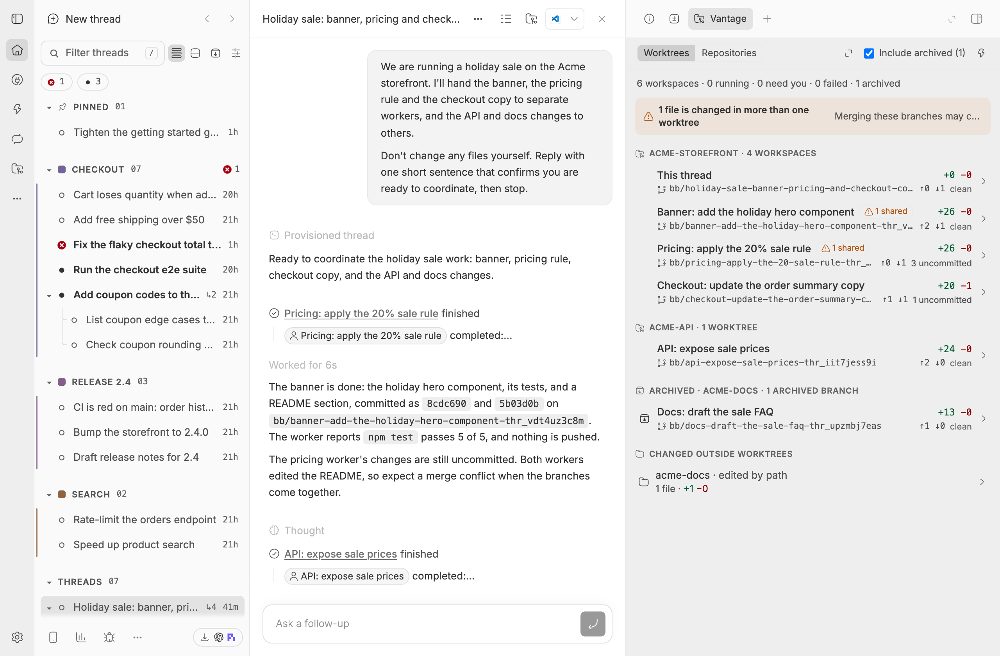

# Vantage

A bb plugin for a parent thread that runs many agents at once. It shows every
worktree your agents work in, lets you read and review what each one changed,
and sends your review comments back to the agent that made the change. It
also shows everything a thread tree changed in other repositories, and warns
you when two worktrees change the same file.

Vantage has two places:

- **The Vantage page** in bb's left navigation (the folder icon). It covers
  every thread active in the last 24 hours, or one thread's tree, and is where
  you review diffs. See [The Vantage page](#the-vantage-page).
- **Inside a thread**: a Vantage tab in the side panel, a Worktrees section in
  bb's thread context card (or a small segment above the composer when bb
  shows thread context there), a Worktrees section in the Info tab, and an
  entry in the thread menu. See [Inside a thread](#inside-a-thread).

There is nothing to turn on. Vantage shows each thread's real state, the same
one bb's sidebar shows, and every file has a Reviewed tick. You can turn on
a toast when a thread needs you. See
[Status, reviews and alerts](#status-reviews-and-alerts).

Vantage counts only what a thread did. It compares each worktree with the
closest base branch, leaves out branch history its threads did not write, and
folds untracked folders such as a clone into one uncounted entry. See
[What counts as a thread's work](#what-counts-as-a-threads-work).

## The Vantage page


Click Vantage in bb's left navigation to open the page. While it is open, its
worktree list takes the place of bb's thread list, so the page itself keeps its
whole width for diffs. bb's title bar names where you are, such as
"Holiday sale / Pricing: apply the 20% sale rule", and each part links back.
On its right sit the Refresh button (point at it to see when the data was
read) and, when files overlap, a button with the number of overlapping
worktrees.

### The worktree list

- **Search** matches thread titles, project names, branches, folders and file
  paths.
- **The scope** reads "All threads · last 24 h" or "Tree: <thread>". A tree's
  × shows every thread again.
- **Chips** filter the list to one kind of worktree: Waiting on you, Ready to
  review, Still working or Shared files. A chip shows only when something
  matches it.
- **Rows** are grouped by what you need to do next: Waiting on you, Ready to
  review, Still working, Done, Unavailable (a worktree that cannot be read),
  then Archived. A group's heading folds it, and Archived starts folded; a
  folded group still shows the worktree you have open. "Group by Project" at
  the bottom groups them by project instead. A row has two lines: the thread
  and its line counts, then the project and one plain sentence about why it
  matters, such as "The agent asked you a question", "3 files to read" or
  "Shares README.md with Banner".
- **Changed outside worktrees** lists repositories an agent edited by path and
  files outside any repository. A row opens them in All changes.
- Worktrees with no changes are left out; a line at the bottom counts them.
  Archived threads are left out of the page until you press Show next to
  Archived, and Hide archived at the bottom leaves them out again.

### What opens first

The page never draws a second index of the worktrees: the list is the index.
With no worktree in the address, it opens the one that most needs a person,
in this order: waiting on you, ready to review, still working, done,
unavailable. Pressing a row opens that one instead, and `[` and `]` step
through the list. When no worktree has changes at all, the page says so and
offers All changes. The header always has All changes, and a count of the
overlapping worktrees while files overlap.

### Reviewing a worktree

Select a row to open its worktree.

- **The header** has the thread's title and state, its project, branch (with a
  copy button), how far it is behind its base branch, its pull request and
  machine, and its actions: Message agent (Answer when the thread waits for
  you), Open thread, Terminal, Copy path and bb's own thread menu.
  `[` and `]`, or the arrows, step to the previous and next worktree.
- **Strips** under the header say what you should know: the agent is waiting
  for you or its last turn failed (with Answer, Retry and Message agent), it
  is still working, it is archived, or a file is also
  changed in another worktree, with Compare and "Ask to rebase onto …".
- **One switch** chooses which changes you read: All changes, Not committed,
  Committed, or one commit from the Commits menu. Each worktree keeps its
  choice, and shows All changes instead when the kept choice has nothing left
  in it, such as Not committed after the agent committed everything.
- **The file tree** on the left nests the files in their folders, folders
  first, and joins a chain of folders that hold only one folder into one row
  (`src/ui/forms`). Each file has its status letter, line counts, an overlap
  mark and its number of comments. A folder's chevron folds it; a folded
  folder shows how many files it holds and still carries the overlap mark,
  comment count and reviewed tick of the files inside. The button at the top
  folds or opens every folder. Click a file to jump to it. The list button
  hides the tree.
- **Focus on diffs** (`F`) hides the file tree and details. In the thread tab,
  it also hides the Trail and keeps one line for the title and file count.
  The review bar and file actions stay available. Exit focus with `Escape`
  or the same button to restore the details without losing your place.
  Vantage remembers this separately for the page and each thread tab.
- **Every diff is in one stream**, each file with a header that stays in view.
  Diffs are unified or side by side (the two buttons at the right), and
  "unchanged lines" between the changes expand to show the rest of the file.
  The wrap button wraps long lines instead of scrolling them sideways. A
  change to an image (png, jpg, gif, webp and the rest) renders as pictures
  instead of a diff: Before and After side by side when both sides exist,
  each clickable to view it full size. The
  chevron folds one file away; Collapse all folds every file at once, and
  Expand all opens them all again. Collapse all is kept: the next worktree
  you open starts folded too, until you press Expand all. Either button also
  drops the files you folded or opened by hand.
- `J` and `K` step through the files, `C` comments on the current file, `X`
  collapses or expands every file, and `W` wraps long lines or stops wrapping
  them.
- **What Vantage remembers** on this device, across reloads: the diff layout,
  wrapping, Collapse all, each file you folded or opened by hand, each
  worktree's change switch, the folders you folded in each worktree's tree,
  the list groups you folded, whether the tree shows, and Hide reviewed.

### Comments

The comment button on a file opens a box for a comment. Select lines in the
diff first to quote them. Comments are drafts kept on this device and listed
under their file, where you can edit or remove them. Once there is one, a bar
at the bottom collects them: Preview shows the exact message, and Send to
agent sends every comment as one message to the worktree's thread, which then
opens in the Agent tab. While the agent works, the button reads "Queue for
agent", and the message waits for its current turn. Its menu has Send now
(added to the running turn), Queue after its current turn, and Copy as
Markdown. `⌘↵` sends.

### The Agent tab

The page's right panel has an Agent tab next to bb's Terminal and Browser
tabs. It shows the selected worktree's conversation in bb's own chat, where you
can answer a question or steer the agent. A worktree several threads share has
a chip for each.

### Overlapping files



The overlaps page lists every file that more than one worktree of a project
changed. Each card shows both changes side by side and Vantage's guess at what
merging both branches will do: "Likely to conflict" when the two change the
same or neighbouring lines, or "Should merge cleanly". This is a guess made
from the changed line ranges, not a real merge. "Ask <agent> to rebase onto
<other>" writes a comment for that worktree and opens it, ready to send.

### All changes

All changes lists every change the threads made, grouped by repository: thread
workspaces, checkouts agents work in or edited by path, archived branches, and
the recorded edits of files outside any repository. Switch between Not
committed and Since the base branch, and fold every file with Collapse all
(or `X`), then open them again with Expand all. Collapse all and wrapping
(`W`) are the same choices as in a worktree's review. A
repository an agent only edited by path lists the files the agents edited
first, and keeps the repository's other changes under a folded line, which
stays open once you open it.

### Addresses

Every view has its own address, so back, forward and links work:

| Address after `/plugins/vantage/vantage/` | Shows |
| --- | --- |
| (nothing) | every thread, the worktree that needs you first |
| `worktree/<key>` | every thread, one worktree |
| `changes` | every thread, All changes |
| `changes/repo/<key>` | All changes for one repository |
| `changes/other-files` | All changes for files outside any repository |
| `overlaps` | every thread, the overlapping files |
| `tree/<thread id>` | only that thread's tree, with any of the above after it |

An address from 0.5 or earlier that says `repositories` opens All changes. A
part that is not valid is dropped and the address is corrected. A worktree or
repository key is written with letters, digits, `.`, `_`, `-` and `~XX` for any
other byte (a `:` is `~3A`, a `/` is `~2F`), because bb encodes each address
segment a second time and its router would otherwise alter a percent-encoded
key.

The time window and the number of threads are Vantage's settings: "Time window
for the full-screen page (hours)" from 1 to 720, default 24, and "Most threads
on the full-screen page" from 10 to 500, default 200. When more threads match
than the limit, the page says so.

## Inside a thread



- **The Vantage tab** opens from the thread header's Vantage button (a
  labelled button bb draws after the workspace's Open button, which closes the
  tab again and folds into the thread menu on a narrow pane), the thread
  context card, the segment above the composer, the Info tab, the palette ("Vantage: Show changes across
  repositories") or the side panel's tab launcher. Its navigator is the Trail
  and the file tree as one tree: the thread and its child threads, the
  selected thread's evidence sources, each labelled with who owns it
  ("Recorded edits · only Worker", "Checkout Git · shared · 3 threads"), and
  under the selected source its folders and files. From 720 px of panel width
  the navigator sits in a column beside the diffs; below that it opens as a
  sheet from the "Trail" button, which names the thread and source you are
  reading. The tree is one Tab stop: arrow keys move, Right and Left open and
  fold, and Escape closes the sheet. Archived threads you are reading, have
  read in this tab, or that have live children keep their place; the rest of
  a parent's archived threads fold into one "N more archived" row. Flare's
  hidden companion threads are counted in a footer instead of listed. Above
  the diffs, one title line has the thread's state (Working explains itself on
  click), Changes and Chat, Open thread, Terminal and bb's thread menu, and one
  line of chips has the branch (which opens the checkout's details), overlaps,
  the shared checkout and incomplete records, each opening its details in
  place. The tab opens on the thread's own worktree, or, when that has no
  changes, on the child worktree that most needs a person. Each review has the
  same scope choice, diffs, reviewed ticks and comments as the page, and Send
  names its recipient. `[` and `]` step through the worktrees. The navigator
  has Refresh and Open full screen, which opens the page on this thread's tree.
- **The thread context card** (with bb's `threadContextCard` experiment on)
  gets a Worktrees section above bb's Child
  threads: at most three child worktrees that changed something, waiting on
  you first, each with its status and line counts, one "N more" row, and one
  row for the files two worktrees both changed, which opens the overlaps page.
  bb places the card beside the transcript when the pane has room and behind
  a header button when it does not.
- **Above the composer**, one segment sums up what the thread and its child
  threads changed: the thread's own line counts (`+475 −39`, compared with the
  closest base), then the number of child worktrees, how many wait on you and
  how many files two worktrees share. The numbers always show, about 60 to
  120px; the words ("33 files", "child worktrees", "waiting on you", "shared
  files") take only the row's spare room, and a narrow composer hides them. It
  shows once the thread or a child thread has changed something, with bb's
  thread context card on or off: a plugin cannot tell whether bb has the card
  on screen or behind its header button. Clicked, it lists at most three
  lines: the thread's own worktree, the child worktrees that need a person
  most, the shared files, and one row for the rest when there are more.
- **The Info tab** has a Worktrees section with counts: waiting on you, ready
  to review and shared files. It does not repeat the panel's list.
- **The sidebar** can show a thread's line counts, and how many of its files
  another worktree also changed, on a line under its row. bb draws that line
  only with its `threadRowMetadata` experiment on and Organize → Rows →
  Metadata chosen. A worktree's numbers go to its own thread only, so a
  read-only reviewer working beside its parent shows none.
- **The thread menu** (in the header, on the sidebar row and on its right-click
  menu) has "Review changes in Vantage", which opens the page on that thread's
  tree.

bb's own Git plugin also shows a thread's changed files above the composer and
in the card. With Vantage, turn that off so a thread shows one summary:

```sh
bb plugin config bb--git set showGitChanges false
```

## What counts as a thread's work

Line counts used to reach hundreds of thousands when a worktree was compared
with a stale or wrong base branch: every commit made upstream since then
counted as the thread's. Vantage now decides what to compare with, and tells
you when it chose differently from bb.

- **The closest base.** Vantage measures the base bb records, that branch on
  origin, origin's default branch, `origin/main` and `origin/master`, and,
  for a branch that is a base itself such as `main`, its upstream. It compares
  with the one the fewest commits are ahead of, and on a tie with the
  remote-tracking one. When it picked another base than bb's, the review says
  so, for example "Compared with origin/main, not master, which would count
  2,794 commits this branch did not add", with a button to use bb's.
- **Only its threads' history.** When a branch is more than 50 commits ahead
  of that base, and its threads made fewer than 10% of those commits, Vantage
  shows and counts only their commits and the uncommitted files, and says so
  with a button to show the whole branch. The commits its threads made are
  the ones `git commit` made while one of them ran it.
- **Folded folders.** An untracked folder with more than 200 files, one that
  holds a Git repository of its own, or one that reaches the scan limit shows
  as one entry that no count includes. A bounded sample can be visible.
- **One owner per worktree.** A worktree's row, status and numbers belong to
  the thread nearest the tree's root that works in it. Other threads in it,
  such as read-only reviewers, are named in its header.

"Show all" and "Use master" are remembered per worktree, in Vantage's plugin
storage, until you choose "Count only its work". Four settings change the
rules: "Compare with the closest base branch" (on), "Leave out branch history
above this many commits" (50; 0 never leaves anything out), "Share of those
commits a thread must have made to see the whole branch" (10%) and "Fold
untracked folders with more files than this" (200). Every view, the card, the
composer segment, the sidebar line and the CLI use the same numbers.

## Status, reviews and alerts

Vantage has no per-thread switches. Earlier versions had Watch and Track
reviews; both are gone, and the choices they stored are ignored.

**Status** is always the thread's real state, the one bb's sidebar shows. A
thread that waits for your answer or whose last turn failed files its worktree
under Waiting on you, with bb's status mark, a strip with Answer or Retry, and
a count in the composer summary and the Info section.

**Reviews** are always there. Every file has a Reviewed button (`V`), in its
header and in the file tree. A reviewed file folds away. Once you tick a file
in a worktree, the bar shows "3 of 5 reviewed" with a Hide reviewed switch, and
the list shows the worktree's progress; a worktree you have not started shows
no count. Worktrees with changes sit under Ready to review until every file is
ticked, then under Done. A file that changes after you tick it shows
"Changed" until you tick it again.

**Alerts** are one setting in Vantage's plugin settings: "Show a toast when a
thread needs you" (off by default) pops up a toast when a thread starts waiting
or fails, unless you are looking at it. bb's own notifications are separate and
not affected. Vantage puts no badge on its navigation icon.

## Loading and archived threads

The page and the tab paint every worktree row at once, with grey placeholders
where the line counts and files will be, and fill them in when git has
answered. A first, quick `shell` request draws the rows in about a tenth of a
second; the full `overview` follows. Later refreshes (an agent's edit, a
workspace change, every 60 seconds while the page is visible, and the Refresh
button) ask for the overview only.

The page starts without archived threads, because most of a busy page is
finished work; Show next to Archived adds them below the active ones without
moving the active rows. The thread tab includes its archived children. Each
choice is remembered on this device (`bb-plugin-vantage:page-archived` and
`bb-plugin-vantage:panel-archived`).

## For agents

```sh
bb vantage worktrees                  # one row per worktree of the current thread's tree
bb vantage worktrees --thread <id>    # another thread's tree
bb vantage worktrees --json
bb vantage worktree <thread>          # that thread's worktree: files and commits
bb vantage worktree <thread> --json
bb vantage changes                    # All changes, as text
bb vantage changes --thread <id>      # another thread
bb vantage changes --scope branch     # everything since the base branch
bb vantage changes --json             # the full overview
bb vantage worktrees --all            # every thread active in the window, by project
bb vantage changes --all --hours 6    # the last 6 hours instead of the setting
bb vantage worktrees --all --archived # include archived threads, which --all hides
```

`--all` reads the same threads as the Vantage page. It cannot be used with
`--thread` (error code `target_conflict`). `--hours <n>` (1 to 720) overrides
the window for that call and needs `--all` (error code `hours_requires_all`).
`--all` leaves archived threads out, like the page; add `--archived` to include
them. `--archived` needs `--all` (error code `archived_requires_all`), because a
thread's own tree always includes its archived children. When threads were left
out, the text output ends with `N archived threads hidden (use --archived)`.
Without `--all` and without a thread, the commands fail with `thread_required`.
With `--all`, the text output puts a project heading above each group of
repositories or worktrees, for example `Shop · 2 worktrees`.

`worktrees` prints the columns STATUS, THREAD (cut at 30 characters),
AHEAD/BEHIND, UNCOMMITTED and BRANCH, then the files changed in more than one
worktree. The status is `archived`, `unavailable`, `running`, `failed` or the
thread's own status. A worktree on its base branch reads `on base` under
AHEAD/BEHIND, and a branch cell such as `main · 3 commits by its threads`
counts the commits its threads made there. `worktree <thread>` reads the whole
tree the thread belongs to and prints each worktree the thread works in, its own
workspace first and then any thread checkout: at most 50 uncommitted and 50
committed files, then `… N more`, and at most 20 commits. A worktree on its base
branch prints `on main, its base branch` in its heading, then `Commits its
threads made on main (N)`, or a line saying none were found.

`worktrees --json` prints `{ threadId, target, windowHours, threads, archivedHidden, worktrees, sharedFiles }`.
`archivedHidden` is how many archived threads matched and were left out (0 with
`--archived` and for a thread's tree). `changes --json` also carries `partial`,
which is true only in the page's instant outline and so is false on the command line.
`target` is `{ "kind": "tree", "threadId": … }` or `{ "kind": "all" }`; for `--all`,
`threadId` is empty and `windowHours` says how far back it looked (null for a
thread's tree). Each thread has a `rootThreadId`, the top of its tree among the
threads read.
Each worktree has `key`, `threadIds`, `state` (`ready`, `unavailable`, or `loading` in the instant outline),
`message`, `branch`, `base`, `kind` (`workspace`, `branch` or `checkout`), `aheadCount`,
`behindCount`, `uncommitted`, `committed`, `commits`, `onBase` (its branch is
its base branch, or that branch on a remote) and `threadCommits` (the commits its
threads made that are not ahead of the base, newest first); `sharedFiles` lists
`path` and `worktreeKeys`. `worktree <thread> --json` prints one worktree object:
the thread's own workspace when it has one. A thread checkout's `ref` is
`{ "kind": "checkout", …, "worked": true }` in both the worktree and the repository.

The text output of `changes` lists each repository with its kind, branch,
totals and the titles of the threads that touched it, then `N commits by its
threads on main` with up to five of them, then at most 50 files and a `… N more`
line, then other files and warnings. `changes --json` prints the overview; the
fields agents read are `repos[].label`, `repos[].projectId`, `ref.kind`, `branch`,
`files`, `otherFiles`, `threadCommits`, `threadIds` and `state`, plus the `worktrees` and
`sharedFiles` above. The bundled skill (`skills/vantage`) describes them. All
the commands keep their output under bb's limit by cutting files from the end.

## Install

Vantage needs bb 0.49 or later. From Kalindu's public marketplace:

```sh
bb marketplace add git:github.com/kalindudc/bb-marketplace@main
bb plugin install vantage@kalindudc
```

The thread context card and sidebar metadata are optional. See [Inside a
thread](#inside-a-thread).

## Exclude checkouts from Git reads

Both settings are empty by default. In Vantage's plugin settings, enter one
item per line or separate items with commas:

- `excludedPaths` (**Folders excluded from Git**): Absolute folder paths or
  paths like `~/checkouts`. Each host expands `~` to its own home directory.
  An exclusion applies to the folder, its descendants and resolved aliases.
- `excludedProviders` (**Environment providers excluded from Git**): Exact
  bb environment provider IDs. Vantage skips Git reads in their checkouts.

Vantage marks excluded checkouts as unavailable for live Git. Recorded
thread edits are still available when the thread saved them. Changing the
settings refreshes the exclusions without a plugin reload.

## How it works

Vantage never stages, commits or changes a file. What it writes is your own
state: reviewed marks, in Vantage's plugin storage, and comment drafts and
view choices, in this browser's storage. Sending comments starts
or steers a turn of the worktree's thread, as typing them into its chat would.

- The thread tree comes from `threads.get` and `threads.experimental_listDescendants`.
- Every worktree, a bb workspace or not, is read with git on the machine that
  owns it, by a host entry (`host.ts`). One `checkoutStatus` call reads its
  branch, HEAD, base, commits ahead and behind, the commit list and its
  uncommitted and committed files; All changes reuses it for the same
  repository's uncommitted files. These reads do not use bb's Git plugin.
- With "Compare with the closest base branch" on, `checkoutStatus` counts the
  commits ahead of each candidate base with `git rev-list --count`, picks the
  smallest, and reports the base bb asked for and its count when it skipped
  it. Diffs, file sides and the Branch scope of All changes are then read
  against the base the worktree row used, with nothing picked again.
- For a branch over the history threshold, a `threadCommits` call finds its
  threads' commits in the reflog and the commit before the oldest of them;
  Vantage then reads the worktree again against that commit (or HEAD, when
  they made none). Both reads share the 60-second cache.
- Git lists file metadata with rename detection off, regardless of Git
  configuration. A rename is an addition and a deletion. Line counts use
  at most 128 changed paths, 1 MiB per side and 8 MiB of combined inputs
  per list. If Vantage cannot verify the inputs or a limit is exceeded,
  it lists the files without line counts. Totals include only known counts.
- A one-file patch checks blob sizes and checks that working files are
  readable regular files before Git calculates the diff. It skips external
  diff commands, text conversion and submodule recursion. A local file can
  still change between the check and Git's own read. Reads of file sides
  use bounded I/O and do not follow file symlinks.
- Git first lists untracked directories as single entries. Vantage checks
  at most 512 directory entries and opens per list, then shows a sample
  if it cannot count the whole folder. Vantage also limits directory lookups
  to 16 ancestors per path and reflog ancestry checks to 100 candidates per
  checkout; those limits can leave the root or commit attribution unavailable.
- The instant outline is built from the thread, environment, project and
  machine lists alone. It makes no git, status, diff or event call.
- A row's status and title come from the data bb's own sidebar already loads,
  so they cost no extra requests. Its pull request comes from bb's GitHub PR
  Status plugin (`pullRequests`, keyed by environment), which re-checks a row
  only while it is on screen.
- The expandable context comes from a `fileSides` call: both whole sides of
  one file, read with `git cat-file` on the host. A side over 1 MiB, a
  binary file and a symlink come back empty, and the diff then shows its
  changes without expanding. An image file's sides are read as bytes
  instead (`imageSides`). Each side must be smaller than 3 MiB so both sides
  fit in one reply.
- Reviewed marks are stored per worktree in `bb.storage.kv`. A mark is the
  file's status and line counts when you ticked it. The `reviewed` read is
  tagged, so a tick made in one window refreshes every other window. Earlier
  versions also kept watch and review choices in a `prefs` row, which nothing
  reads now.
- Other checkouts and archived branches are read by a host entry (`host.ts`),
  plugin code that bb runs on the machine that owns the repository. It runs
  `git` with `GIT_OPTIONAL_LOCKS=0`, so it never takes the index lock that
  agents running git need, and it checks every path and ref before use.
- Edits made outside a workspace come from each thread's recorded `fileChange`
  events. The server keeps an in-memory index per thread and reads only new
  events on each refresh.
- A thread checkout is found from the thread's own commands. Every `cd`,
  `pushd` or `git -C` with an absolute or `~/` folder in a recorded command is
  noted, the 32 most recent per thread, as the index reads the events it
  already reads. Only a thread that edited a file outside its own workspace has
  those folders looked up (the host expands `~/` itself), and a checkout
  becomes a thread checkout when the same thread both edited a file in it and
  ran commands in it. One `checkoutStatus` host call reads its branch,
  uncommitted and committed files, commits ahead and behind and the commit
  list; the worktree row and All changes share it through the
  60-second cache. A checkout only edited by path keeps the cheaper
  uncommitted-only call, and the instant outline shows a thread checkout's row
  when earlier loads already know the edits and the roots.
- The commits a thread made on its base branch come from its commands and the
  checkout's reflog. The event index also notes when each `git commit`
  command started and finished, from the `item/started` and `item/completed`
  events it reads; one still running lasts
  until now, and one in a stopped thread until its last event. For a ready
  workspace or thread checkout with no commits ahead whose threads ran such a
  command, one `threadCommits` host call reads the HEAD reflog (`git log -g`,
  the last 5,000 entries), keeps the `commit`, `commit (amend)`, `commit
  (initial)` and `commit (merge)` entries made within two seconds of one of
  those spans, and drops any that `merge-base --is-ancestor` says are no longer
  on HEAD, such as an amended commit. Pulls, merges and rebases are never
  counted. The result shares the 60-second cache, keyed by the spans.
- A workspace whose folder is below its repository root, such as an
  environment in a subfolder of a large repository, is grouped under that
  root and read there. Its file links open the file by its full path. When an
  environment below the root and one at the root share a repository, the one
  at the root speaks for the row.
- To place a path in a repository, the host asks git itself
  (`rev-parse --show-toplevel --show-prefix`) instead of comparing path
  prefixes, so `/tmp` and `/private/tmp` agree on macOS.
- The thread tab refreshes on bb's thread, environment and connection events,
  with at most one request at a time and 1.5 seconds between requests. The
  page, its sidebar, its title bar and its Agent tab share one store, and so do
  a thread's tab, composer summary and Info section; a store lingers 30
  seconds after its last reader closes, so moving between views does not load
  everything again.
- The Vantage page asks for every thread with `threads.list`, 100 at a
  time (up to 1,000 active and 500 archived threads), and keeps those active in
  the window, running, or archived in it. It builds the same overview as a
  tree, over that set of threads, with each repository's git result and each
  worktree's status in a 60-second cache that thread events and environment
  events clear. Concurrent requests share one build for each scope and archived
  choice. Its store follows every thread's file changes, at most one request per
  5 seconds.
- In the thread tab, Terminal creates a terminal scoped to the parent
  thread, because bb shows a thread only its own terminals, and starts
  `cd <folder> && exec $SHELL -l` in it. On the page, which belongs to no
  thread, it creates a terminal scoped to the worktree's environment, which
  opens in the worktree's folder.

## Limits

- At most 500 files per repository or worktree list, 100 commits per worktree,
  200 shared files, 200 other files and 200 threads in a tree; patches are cut
  at 1 MiB, image sides below 3 MiB and recorded diffs at 60,000 characters.
  The Vantage page reads at most the thread limit setting (200 by default, 500
  at most).
- The Vantage page can show a repository up to 60 seconds late if bb does
  not report a change that no agent made, such as a file you edit by hand; its
  60-second refresh and the Refresh button bring it up to date.
- When a child is archived, bb keeps its worktree on disk for about five
  minutes. Vantage lists it as a worktree (marked archived) during that time,
  then as the kept branch. Uncommitted work is removed with the worktree, so
  only committed work remains.
- A branch that no longer exists is not a worktree, so it is not listed; its
  recorded edits show in All changes.
- Titles and statuses come from bb's sidebar. A thread bb does not list in it
  (a hidden one, such as a study's worker, or an archived page that was not
  loaded) shows the title the thread tree gave it, and is marked running only
  when its status says so; other states (needs you, failed) are not known.
- Edits are found from recorded file edits and, for thread checkouts, from
  git. A checkout becomes a thread checkout only when one thread both edited a
  file in it and changed into it with `cd`, `pushd` or `git -C` and an
  absolute or `~/` folder; a relative `cd`, a folder in a variable and a
  checkout only reached by a shell script are not seen. Shell-only work in a
  repository the thread never edited is still missed.
- A thread checkout is compared with the closest base among `origin/HEAD`,
  `origin/main` and `origin/master`; without any it shows its uncommitted
  files only.
- Folding happens after git lists the untracked files. A huge untracked
  folder that `.gitignore` does not cover, such as a `node_modules` with
  hundreds of thousands of files, can still make a worktree's status too large
  to read; a nested repository is always listed as one entry.
- The history rule finds a thread's commits from its `git commit` commands.
  Commits made another way, such as with `gt create` or bb's commit button, are
  not seen, so a long branch whose thread committed only that way shows just
  its uncommitted files until you choose "Show all". When a merge lies between
  the threads' first commit and HEAD, or a thread's events could not be read,
  the whole branch is shown.
- The closest base is a guess from commit counts. A branch started from
  another feature branch that is not one of the candidates is compared with
  the nearest one that is, and may count that branch's commits too; the
  history rule and "Show all" are there for that case.
- The commits a thread made on its base branch are matched by time. A commit
  someone else makes in the same checkout while one of the thread's commit
  commands runs is counted as the thread's. A commit made by any command other
  than `git commit`, such as a script or a release tool, is not found. A commit
  made on another branch, or no longer on HEAD, is not listed.
- An archived child's branch is read from the project checkout, which is where
  bb's git-worktree provider leaves it. When the project's folder is not a
  repository, or the project has none, it is read in the folder the thread
  ran in, which some environment providers leave in place when they remove
  the environment. When the branch no longer exists, Vantage shows the
  recorded edits instead. An archived thread shows only its committed work,
  even when its folder, and any uncommitted change in it, is still on disk.
- Git must be installed on the machine that owns each repository.
- A comment is about a file, optionally quoting lines you selected. bb's diff
  viewer does not tell a plugin which line was clicked, so there are no
  comments on a single line.
- A reviewed mark is the file's status and line counts. An edit made after the
  tick that leaves both counts the same is not noticed, so the file stays
  reviewed.
- Expanding unchanged lines needs both whole sides of the file to match the
  diff. A checkout read with git gives the file as it is on disk, so with
  `core.autocrlf` or Git LFS the sides may not match and the diff then shows
  only its changes.
- "Likely to conflict" and "Should merge cleanly" are guesses from the line
  ranges each change touches, not a real merge.
- Comment drafts are kept in the browser's storage, so they stay on the device
  you wrote them on.
- The toast for a thread that starts waiting for you shows in every
  open bb window.

## Changes

See the [changelog](CHANGELOG.md) for release history.

## Develop

```sh
cd plugins/vantage
npm install
npm test
npm run typecheck
npm run build    # bb plugin build
```

With explicit permission to change the local bb plugin installation, a
working copy can be installed and reloaded from this directory:

```sh
bb plugin remove vantage
bb plugin install "path:$PWD" --yes
bb plugin reload vantage
```

See the [marketplace release guide](../../README.md#release-a-plugin) for
version bumps and automatic release tags.
