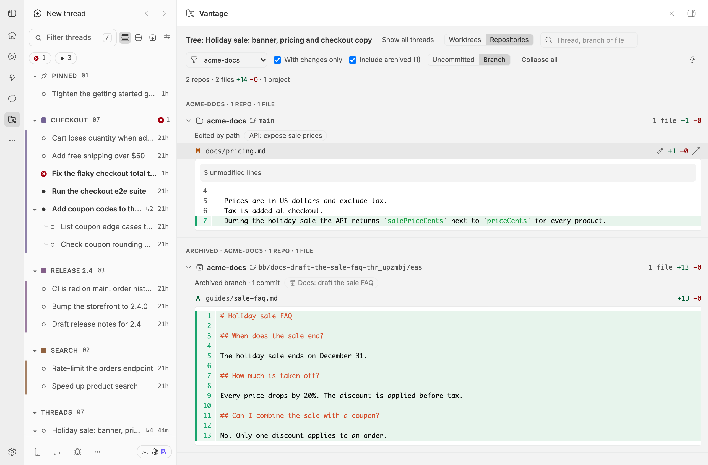
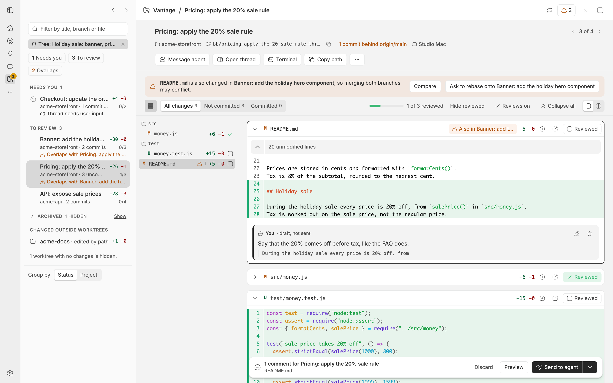

# Vantage

A bb plugin for a parent thread that runs many agents at once. Its side-panel
tab shows how every child's worktree is doing, lets you look inside any one of
them without leaving the parent, and groups everything the thread tree changed
by repository. Open it from the thread header, from the palette ("Vantage:
Show changes across repositories") or from the thread's side-panel tabs. The
command has no default shortcut; you can bind one under Settings, Keyboard.

A full-screen Vantage page in bb's left navigation does the same for every
recent thread at once: see [The full-screen page](#the-full-screen-page).
Both views paint at once and fill in their numbers as git answers: see
[Loading and archived threads](#loading-and-archived-threads).

bb's Changes tab shows the diff of one thread's own workspace. Agents often
work beyond it: a parent spawns child threads in their own worktrees, agents
edit files in other repositories by absolute path, and bb removes a child's
worktree when the child is archived. Vantage gathers all of that for the thread
and every descendant, archived and hidden children included. A switch at the
left of the toolbar chooses between two views, and the choice is remembered on
this device.

## The Worktrees view


This is the default. It lists one row for each workspace in the thread tree:
the parent's own checkout (it reads "This thread"), every child's worktree, and
the kept branch of every archived child. A row shows bb's own status glyph
(running, needs you, failed, finished), the branch, how many commits it is
ahead of and behind its base branch, how many files are uncommitted, the line
counts and the pull request, if there is one. Rows are grouped by project. A
banner warns when files are changed in more than one worktree of the same
project, because those branches may conflict when merged; it opens to list the
files and the threads. Repositories that agents edited by path, and files
outside any repository, are listed under "Changed outside worktrees". Clicking
one opens the Repositories view filtered to just that repository, or to just
the other files.

Click a row to open that worktree inside the parent's panel:

- **Changes** lists the uncommitted files and the files committed on the
  branch, each with its diff, and marks a file that other worktrees also
  changed.
- **Commits** lists the commits ahead of the base branch. Open one to see its
  files and their diffs.
- **Chat** shows the child's conversation in bb's own chat component, so you
  can approve a request or steer the agent from there. The parent's own row has
  no Chat tab.
- **Open thread** opens the child in a split pane. **Terminal here** starts a
  shell in the worktree's folder in the parent's terminal panel; it needs a
  worktree on disk, on the same machine as the parent thread. **Copy path**
  copies the folder. The ⋯ button is bb's own thread menu (stop, archive and
  the other usual actions).
- `[` and `]` step to the previous and next worktree, and Escape returns to the
  list. The keys do nothing while you type in a text field.

## The Repositories view




A toolbar with a summary ("3 repos · 12 files · +120 −30 · 5 threads"), a scope
switch, Expand all and Refresh, then one section for each repository. A section
header has the repository's project name, its branch, a caption, the totals and
a chip for every thread that touched it. A chip opens that thread in a split;
an archived thread's chip has an archive mark. Open a file to see its diff in
bb's own viewer.

| Kind | Caption | Where it is read from |
| --- | --- | --- |
| Thread workspace | Thread workspace | bb's environment status API (the same call as the worktree row); the Branch scope uses bb's diff API |
| Another checkout an agent edited by path | Edited by path | git, on the machine that owns the checkout |
| An archived child's branch | Archived branch · N commits | git in the project checkout, comparing the branch with its base branch |
| No repository could be read | Recorded edits only | the file edits bb keeps in each thread's history |

In a checkout, the files the agents edited come first. The repository's other
changes sit under a folded "N other changes in this repo" row, so changes made
by commands such as code generators are not lost and your own unrelated edits
stay out of the way. A file that an agent edited but that has no change now
(for example because it was committed) is listed as clean, and opening it
shows the agent's recorded edits. Files outside any repository, such as thread
storage or /tmp, are listed under "Other files" the same way.

When the Repositories view was opened from one row, or with a worktree open,
it shows only that repository, and an "Only <project> · <branch>" chip sits
beside the view switch. The chip's × button shows every repository again, and
so does switching to Worktrees and back.

The switch chooses between **Uncommitted** (working-tree changes) and **Branch**
(everything since the base branch). The tab refreshes within about two seconds
of an agent's edit and on the Refresh button. A machine that is offline, or a
repository that fails, marks only its own section as unavailable; the rest
still shows.

## The full-screen page




Click Vantage in bb's left navigation (the folder icon) to open the page at
`/plugins/vantage/vantage`. It covers every thread active in the time window
(24 hours by default), plus any thread that is running and any thread archived
in that window, so you see all your parallel agents across projects in one
place. Threads whose parent is not in the window start their own tree.

- **Worktrees** is the default view. On a window at least 880 pixels wide, the
  list is on the left, grouped by project, and the selected worktree's detail
  (Changes, Commits, Chat) is on the right; with nothing selected the right
  side says "Select a worktree to inspect it." On a narrower window the list and
  the detail take turns, as in the side panel. A row for a child shows
  "under <root thread>". Click a row to select it; `[` and `]` step through the
  rows that are shown, and Escape clears the selection. **Terminal here**
  starts a shell in the worktree's folder as a terminal of the worktree's own
  environment, in the page's terminal panel, on whichever machine it is on.
  **Open thread** opens the thread and leaves the page.
- **Repositories** shows every repository those threads changed, grouped by
  project ("Shop · 2 repos · 4 files"), then "Other files". The scope switch
  and Expand all sit in the toolbar. A row under "Changed outside worktrees",
  or the Repositories switch pressed while a worktree is selected, opens it
  filtered to that one repository (or to the other files), with a chip to
  clear the filter; the toolbar filters still apply on top.
- The toolbar's **text filter** matches thread titles, project and repository
  names, branches, folders and file paths. The **project** select narrows to one
  project. **With changes only** (on by default) hides worktrees and
  repositories with nothing to show, but keeps one that could not be read.
  The summary line counts what is shown: "6 workspaces · 2 running · 1 needs
  you · 0 failed · 14 files +120 −30 · 3 projects".
- Every view and selection has its own address, so the browser's back and
  forward buttons work and a link opens the same view:

  | Address after `/plugins/vantage/vantage/` | Shows |
  | --- | --- |
  | (nothing) | every thread, Worktrees |
  | `repositories` | every thread, Repositories |
  | `worktree/<key>` | every thread, one worktree selected |
  | `tree/<thread id>` | only that thread's tree, Worktrees |
  | `repositories/repo/<key>` | every thread, Repositories, only that repository |
  | `repositories/other-files` | every thread, Repositories, only the other files |
  | `tree/<thread id>/repositories` | that tree, Repositories |
  | `tree/<thread id>/repositories/repo/<key>` | that tree, Repositories, only that repository |
  | `tree/<thread id>/worktree/<key>` | that tree, one worktree selected |

  A part that is not valid is dropped and the address is corrected. A
  worktree or repository key is written with letters, digits, `.`, `_`, `-` and `~XX` for any
  other byte (a `:` is `~3A`, a `/` is `~2F`), because bb encodes each address
  segment a second time and its router would otherwise alter a percent-encoded
  key.
- In a thread's Vantage tab, **Open full screen** (the corner-arrows button in
  the toolbar) opens the page for just that thread's tree. **Show all threads**
  in the page's toolbar widens it again.

The window and the number of threads are Vantage's plugin settings (open the
plugin's page in bb's Tools): "Time window for the full-screen page (hours)" from 1
to 720, default 24, and "Most threads on the full-screen page" from 10 to 500,
default 200. When more threads match than the limit, the page says "Showing the
200 most recent threads; raise the limit in Settings". Changing a setting
refreshes every open page.

The page reads more than one tree, so a cold load costs more than the side
panel. The server keeps each repository's result for 60 seconds, and an agent's
edit, a workspace change that bb reports, or the 60 seconds clear only the
entries they touch, so a refresh reloads just the repositories that changed.
Open windows share one build, and the side panel reads through the same cache.
The page refreshes about 5 seconds after a change, every 60 seconds while the
window is visible, when you return to it, and on the Refresh button (which
clears the cache).

## Loading and archived threads

**The instant outline.** A load sends two requests at once. The first, `shell`,
returns in about a tenth of a second with every worktree row (title, status,
branch, project, machine) and every repository header, and no git work. Grey
placeholder bars stand where the line counts, the ahead and behind counts and
the file lists will be, and "Changed outside worktrees" says "Looking for edits
in other repositories…". The second, `overview`, replaces the outline when git
has answered. Until then you can already open a worktree: its header, actions
and Chat work, and Changes and Commits show placeholders. Later refreshes (an
agent's edit, the 60-second refresh, the Refresh button) ask for the overview
only. A failed outline is ignored; a failed overview shows the usual error.

**Archived threads.** Most of a busy page is finished work, so the full-screen
page starts without archived threads and their kept branches. Tick
**Include archived (N)**, after "With changes only", to add them; N is how many
were left out, or how many are in view once ticked. Archived rows get their
own groups, headed "Archived · <project>", after every active group, and the
summary line says how many are showing, such as "6 workspaces · … · 1 archived".
Switching keeps every active row and its numbers on screen: archived rows
appear below them, or disappear, while the rest reloads. With "With changes
only" ticked, archived rows whose changes are still being read wait behind one
"Loading archived threads…" placeholder, so rows with nothing changed never
flash up and vanish. Active threads always come first under the
thread limit. The side tab is about one tree's children, so it includes
archived children by default and has the same checkbox. Each choice is
remembered on this device (`bb-plugin-vantage:page-archived` and
`bb-plugin-vantage:panel-archived`).

**What makes it faster.** A workspace's git status is read once and feeds both
the worktree row and the Repositories view; bb's diff call is used only for the
Branch scope. Those reads start as soon as the threads are known, 8 at a time,
while the edit history and the git roots are looked up. An archived thread's
edit history is not read again once it has been indexed. Git roots are
remembered for 10 minutes, and a branch that no longer exists for 10 minutes
too, instead of being asked about on every refresh. A thread's own tree now
uses the same 60-second cache as the page.

## For agents

```sh
bb vantage worktrees                  # one row per worktree of the current thread's tree
bb vantage worktrees --thread <id>    # another thread's tree
bb vantage worktrees --json
bb vantage worktree <thread>          # that thread's worktree: files and commits
bb vantage worktree <thread> --json
bb vantage changes                    # the Repositories view, as text
bb vantage changes --thread <id>      # another thread
bb vantage changes --scope branch     # everything since the base branch
bb vantage changes --json             # the full overview
bb vantage worktrees --all            # every thread active in the window, by project
bb vantage changes --all --hours 6    # the last 6 hours instead of the setting
bb vantage worktrees --all --archived # include archived threads, which --all hides
```

`--all` reads the same threads as the full-screen page. It cannot be used with
`--thread` (error code `target_conflict`). `--hours <n>` (1 to 720) overrides
the window for that call and needs `--all` (error code `hours_requires_all`).
`--all` leaves archived threads out, like the page; add `--archived` to include
them. `--archived` needs `--all` (error code `archived_requires_all`), because a
thread's own tree always includes its archived children. When threads were left
out, the text output ends with `N archived threads hidden (use --archived)`.
Without `--all` and without a thread, the commands fail with `thread_required`.
With `--all`, the text output puts a project heading above each group of
repositories or worktrees, for example `Shop · 2 worktrees`.

`worktrees` prints the columns STATUS, THREAD (cut at 30 characters),
AHEAD/BEHIND, UNCOMMITTED and BRANCH, then the files changed in more than one
worktree. The status is `archived`, `unavailable`, `running`, `failed` or the
thread's own status. `worktree <thread>` reads the whole tree the thread belongs
to and prints the worktree the thread works in: at most 50 uncommitted and 50
committed files, then `… N more`, and at most 20 commits.

`worktrees --json` prints `{ threadId, target, windowHours, threads, archivedHidden, worktrees, sharedFiles }`.
`archivedHidden` is how many archived threads matched and were left out (0 with
`--archived` and for a thread's tree). `changes --json` also carries `partial`,
which is true only in the page's instant outline and so is false on the command line.
`target` is `{ "kind": "tree", "threadId": … }` or `{ "kind": "all" }`; for `--all`,
`threadId` is empty and `windowHours` says how far back it looked (null for a
thread's tree). Each thread has a `rootThreadId`, the top of its tree among the
threads read.
Each worktree has `key`, `threadIds`, `state` (`ready`, `unavailable`, or `loading` in the instant outline),
`message`, `branch`, `base`, `kind` (`workspace` or `branch`), `aheadCount`,
`behindCount`, `uncommitted`, `committed` and `commits`; `sharedFiles` lists
`path` and `worktreeKeys`. `worktree <thread> --json` prints one worktree object.

The text output of `changes` lists each repository with its kind, branch,
totals and the titles of the threads that touched it, then at most 50 files and
a `… N more` line, then other files and warnings. `changes --json` prints the
overview; the fields agents read are `repos[].label`, `repos[].projectId`, `ref.kind`, `branch`,
`files`, `otherFiles`, `threadIds` and `state`, plus the `worktrees` and
`sharedFiles` above. The bundled skill (`skills/vantage`) describes them. All
the commands keep their output under bb's limit by cutting files from the end.

## Install

```sh
bb marketplace add git:github.com/kalindudc/bb-marketplace@main
bb plugin install vantage@kalindudc
```

## How it works

Vantage only reads. It never stages, commits or changes a file, and it keeps
nothing on disk.

- The thread tree comes from `threads.get` and `threads.experimental_listDescendants`.
- Each worktree's branch, commits ahead and behind, and uncommitted and
  committed files come from one `environments.status` call, which the
  Repositories view reuses for the same workspace's uncommitted files. The
  Branch scope and a commit's files use `environments.diffFiles`, and diffs use
  `diffPatch`. For an untracked file the status reports the same line counts as
  `diffFiles`; it does not flag a file as too large and does not name a renamed
  file's old path. An archived child's branch gets its numbers from one git
  range call on the host, shared by both views.
- The instant outline is built from the thread, environment, project and
  machine lists alone. It makes no git, status, diff or event call.
- A row's status, title and pull request come from the data bb's own sidebar
  already loads, so they cost no extra requests.
- Other checkouts and archived branches are read by a host entry (`host.ts`),
  plugin code that bb runs on the machine that owns the repository. It runs
  `git` with `GIT_OPTIONAL_LOCKS=0`, so it never takes the index lock that
  agents running git need, and it checks every path and ref before use.
- Edits made outside a workspace come from each thread's recorded `fileChange`
  events. The server keeps an in-memory index per thread and reads only new
  events on each refresh.
- To place a path in a repository, the host asks git itself
  (`rev-parse --show-toplevel --show-prefix`) instead of comparing path
  prefixes, so `/tmp` and `/private/tmp` agree on macOS.
- The panel refreshes on bb's thread, environment and connection events, with
  at most one request at a time and 1.5 seconds between requests.
- The full-screen page asks for every thread with `threads.list`, 100 at a
  time (up to 1,000 active and 500 archived threads), and keeps those active in
  the window, running, or archived in it. It builds the same overview as a
  tree, over that set of threads, with each repository's git result and each
  worktree's status in a 60-second cache that thread events and environment
  events clear. Concurrent requests share one build for each scope and archived
  choice. Its store follows every thread's file changes, at most one request per
  5 seconds.
- In the side panel, "Terminal here" creates a terminal scoped to the parent
  thread, because bb shows a thread only its own terminals, and starts
  `cd <folder> && exec $SHELL -l` in it. On the full-screen page, which belongs
  to no thread, it creates a terminal scoped to the worktree's environment, which
  opens in the worktree's folder.

## Limits

- At most 500 files per repository or worktree list, 100 commits per worktree,
  200 shared files, 200 other files and 200 threads in a tree; patches are cut
  at 1 MiB and recorded diffs at 60,000 characters. The full-screen page reads
  at most the thread limit setting (200 by default, 500 at most).
- The full-screen page can show a repository up to 60 seconds late if bb does
  not report a change that no agent made, such as a file you edit by hand; its
  60-second refresh and the Refresh button bring it up to date.
- When a child is archived, bb keeps its worktree on disk for about five
  minutes. Vantage lists it as a worktree (marked archived) during that time,
  then as the kept branch. Uncommitted work is removed with the worktree, so
  only committed work remains.
- A branch that no longer exists is not a worktree, so it is not listed; its
  recorded edits show in the Repositories view.
- Titles and statuses come from bb's sidebar. A thread bb does not list in it
  (a hidden one, such as a study's worker, or an archived page that was not
  loaded) shows the title the thread tree gave it, and is marked running only
  when its status says so; other states (needs you, failed) are not known.
- Edits are found only from recorded file edits. Changes an agent makes only
  with shell commands in another repository are missed unless an agent also
  edited a file there.
- An archived child's branch is read from the project checkout, which is where
  bb's git-worktree provider leaves it. When the branch no longer exists,
  Vantage shows the recorded edits instead.
- Git must be installed on the machine that owns each repository.

## Changes

- **0.3.2**: clicking a row under "Changed outside worktrees", or switching to
  Repositories with a worktree open, shows only that repository (or only the
  other files) instead of every one, with an "Only …" chip that clears the
  filter; the page keeps the filter in its address.
- **0.3.1**: "Show archived" becomes an "Include archived (N)" checkbox;
  switching it keeps the active rows and their numbers on screen and adds or
  removes only archived rows, which are listed after the active ones; the
  summary line counts archived workspaces; active threads come first under
  the thread limit.
- **0.3.0**: the side tab and the page paint worktree rows and repository
  headers at once from a quick `shell` request, with placeholders for the git
  numbers; the full-screen page hides archived threads until "Show archived"
  is pressed (the side tab shows them and has the same button); a workspace's
  git status and a branch's range are read once for both views and start
  earlier; git roots are cached for 10 minutes; a thread's own tree uses the
  60-second cache; `bb vantage changes|worktrees --all --archived`.
- **0.2.0**: a full-screen Vantage page in bb's left navigation for every
  recent thread, with project, text and changes-only filters, addresses for
  every view, an "Open full screen" button in the side panel, the time window
  and thread limit settings, a 60-second repository cache, and
  `bb vantage changes --all` and `bb vantage worktrees --all` with `--hours`.
- **0.1.0**: the side-panel tab with the Worktrees and Repositories views, the
  thread-header button and `bb vantage changes`, `worktrees` and `worktree`.

## Develop

```sh
cd plugins/vantage
npm install
npm test
npm run typecheck
npm run build    # bb plugin build
```

With explicit permission to change the local bb plugin installation, a
working copy can be installed and reloaded from this directory:

```sh
bb plugin remove vantage
bb plugin install "path:$PWD" --yes
bb plugin reload vantage
```

## Release

After review, bump the package version, merge to an up-to-date `main`, and
tag that version. This release uses:

```sh
git tag vantage/v0.3.0 && git push origin vantage/v0.3.0
```
